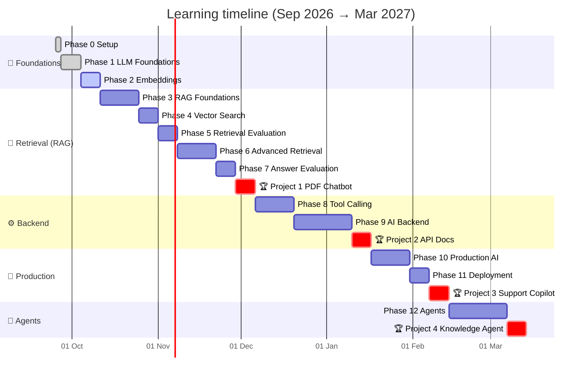

<div align="center">

# 🚀 AI Backend Engineer — Learning Journey

**From zero to shipping production AI features: LLM APIs, RAG, evaluation, tool calling, backend services, deployment and agents.**


<!-- progress:start -->

-brightgreen?style=for-the-badge)

**Overall** &nbsp; `██████░░░░░░░░░░░░░░░░░░░░░░░░` &nbsp; **21%** · 23 / 112 items

**📐 Phase 2 — Embeddings & Semantic Search** &nbsp; `█████████░░░░░░░░░░░░░░░░░░░░░` &nbsp; **30%** · 3 / 10 items

<!-- progress:end -->

*Build it from scratch first → then use the framework → then measure it.*

</div>

---

## 📑 Table of Contents

- [🎯 The Goal](#-the-goal)
- [🗺️ Roadmap at a Glance](#️-roadmap-at-a-glance)
- [📊 Progress Tracker](#-progress-tracker)
- [📚 Phase-by-Phase Details](#-phase-by-phase-details)
- [📁 Repository Structure](#-repository-structure)
- [📖 How Every Concept Folder Is Organized](#-how-every-concept-folder-is-organized)
- [⌨️ Learning Commands](#️-learning-commands)
- [🚫 Intentionally Excluded](#-intentionally-excluded)

---

## 🎯 The Goal

Become an **AI Backend Engineer** — someone who *integrates* AI models into real products — **not** an ML engineer who *trains* models.

| | 🧑‍💻 AI Backend Engineer (**this repo**) | 🔬 ML / Deep Learning Engineer |
|---|---|---|
| **Main job** | Connect ready-made models to products | Create and train new models |
| **Daily tools** | APIs, Python, FastAPI, databases, vector search | PyTorch, GPUs, datasets, training loops |
| **Math needed** | Light (vectors, similarity, basic stats) | Heavy (calculus, linear algebra, probability) |
| **Typical output** | Chatbots, search, copilots, agents, AI APIs | Model weights, research papers, benchmarks |

> [!NOTE]
> **Learning principles used throughout this repo**
> 1. Every new term is defined in plain words the first time it appears.
> 2. Each concept follows: **Intuition → Technical → Tiny example → Code → Interview answer**.
> 3. Build from scratch in plain Python/NumPy first, use frameworks later.
> 4. From Phase 5 onward, every retrieval improvement is **measured** with before/after numbers.

---

## 🗺️ Roadmap at a Glance

```mermaid
flowchart LR
    subgraph F["🧱 Foundations"]
        P0["Phase 0<br/>Setup"] --> P1["Phase 1<br/>LLM Foundations"] --> P2["Phase 2<br/>Embeddings &<br/>Semantic Search"]
    end

    subgraph R["🔎 Retrieval (RAG)"]
        P3["Phase 3<br/>RAG Foundations"] --> P4["Phase 4<br/>Vector Search"] --> P5["Phase 5<br/>Retrieval Evaluation"] --> P6["Phase 6<br/>Advanced Retrieval"] --> P7["Phase 7<br/>Answer Evaluation"] --> PR1(["🏆 Project 1<br/>PDF Chatbot"])
    end

    subgraph B["⚙️ Backend"]
        P8["Phase 8<br/>Tool Calling &<br/>Structured Outputs"] --> P9["Phase 9<br/>AI Backend<br/>Engineering"] --> PR2(["🏆 Project 2<br/>API Docs Assistant"])
    end

    subgraph D["🚢 Production"]
        P10["Phase 10<br/>Production AI"] --> P11["Phase 11<br/>Deployment"] --> PR3(["🏆 Project 3<br/>Support Copilot"])
    end

    subgraph A["🤖 Agents"]
        P12["Phase 12<br/>Agents"] --> PR4(["🏆 Project 4<br/>Knowledge Agent"])
    end

    P2 --> P3
    PR1 --> P8
    PR2 --> P10
    PR3 --> P12

    classDef phase fill:#1f6feb,stroke:#0b3d91,color:#fff
    classDef project fill:#2ea043,stroke:#1a7f37,color:#fff
    class P0,P1,P2,P3,P4,P5,P6,P7,P8,P9,P10,P11,P12 phase
    class PR1,PR2,PR3,PR4 project
```



---

## 📊 Progress Tracker

**Legend:** ✅ Done · 🟡 In progress · ⬜ Not started

**🗓️ Start:** Fri 25 Sep 2026 → **🏁 Target finish:** Sat 13 Mar 2027 · **~24 weeks** at 1–2 hours/day

| # | Phase | ⏱️ Duration | 📅 Start | 🏁 End | Status | 📁 Folder |
|:-:|---|:-:|:-:|:-:|:-:|---|
| 0 | Setup | 2 days | Fri 25 Sep 2026 | Sat 26 Sep 2026 | ✅ | [`phase-00-setup`](phase-00-setup/) |
| 1 | LLM Foundations | 1 week | Sun 27 Sep 2026 | Sat 03 Oct 2026 | ✅ | [`phase-01-llm-foundations`](phase-01-llm-foundations/) |
| 2 | Embeddings & Semantic Search | 1 week | Sun 04 Oct 2026 | Sat 10 Oct 2026 | 🟡 | [`phase-02-embeddings`](phase-02-embeddings/) |
| 3 | RAG Foundations | 2 weeks | Sun 11 Oct 2026 | Sat 24 Oct 2026 | ⬜ | `phase-03-rag-foundations` |
| 4 | Vector Search | 1 week | Sun 25 Oct 2026 | Sat 31 Oct 2026 | ⬜ | `phase-04-vector-search` |
| 5 | Retrieval Evaluation | 1 week | Sun 01 Nov 2026 | Sat 07 Nov 2026 | ⬜ | `phase-05-retrieval-evaluation` |
| 6 | Advanced Retrieval | 2 weeks | Sun 08 Nov 2026 | Sat 21 Nov 2026 | ⬜ | `phase-06-advanced-retrieval` |
| 7 | Answer Evaluation | 1 week | Sun 22 Nov 2026 | Sat 28 Nov 2026 | ⬜ | `phase-07-answer-evaluation` |
| 🏆 | **Project 1 — PDF Chatbot** | 1 week | Sun 29 Nov 2026 | Sat 05 Dec 2026 | ⬜ | `project-1-pdf-chatbot` |
| 8 | Tool Calling & Structured Outputs | 2 weeks | Sun 06 Dec 2026 | Sat 19 Dec 2026 | ⬜ | `phase-08-tool-calling` |
| 9 | AI Backend Engineering | 3 weeks | Sun 20 Dec 2026 | Sat 09 Jan 2027 | ⬜ | `phase-09-ai-backend` |
| 🏆 | **Project 2 — API Documentation Assistant** | 1 week | Sun 10 Jan 2027 | Sat 16 Jan 2027 | ⬜ | `project-2-api-docs-assistant` |
| 10 | Production AI Systems | 2 weeks | Sun 17 Jan 2027 | Sat 30 Jan 2027 | ⬜ | `phase-10-production` |
| 11 | Deployment | 1 week | Sun 31 Jan 2027 | Sat 06 Feb 2027 | ⬜ | `phase-11-deployment` |
| 🏆 | **Project 3 — Customer Support Copilot** | 1 week | Sun 07 Feb 2027 | Sat 13 Feb 2027 | ⬜ | `project-3-support-copilot` |
| 12 | Agents | 3 weeks | Sun 14 Feb 2027 | Sat 06 Mar 2027 | ⬜ | `phase-12-agents` |
| 🏆 | **Project 4 — Internal Knowledge Agent** | 1 week | Sun 07 Mar 2027 | Sat 13 Mar 2027 | ⬜ | `project-4-knowledge-agent` |

<sub>Dates use the **upper end** of each time range (e.g. "1–2 weeks" → 2 weeks) as a built-in buffer, and **1 week per project** (the roadmap gives projects no duration). Assumes 1–2 hours per day, every day. Folders are created as we reach each phase.</sub>



---

## 📚 Phase-by-Phase Details

> Click a phase to expand it. Ticked boxes = concepts completed.

<details>
<summary><h3>🧱 Phase 0 — Setup <code>1–2 days</code></h3></summary>

Get a clean, safe Python workspace that can talk to an LLM.

- [x] 01 · Virtual environment
- [x] 02 · pip & `requirements.txt`
- [x] 03 · API key
- [x] 04 · `.env` + `python-dotenv`
- [x] 05 · API spending limits
- [x] 06 · Git basics
- [x] 07 · 🏁 Milestone: "Hello" to an LLM

**✅ Done when:** a script sends `"Hello"` to an LLM and prints the reply.
</details>

<details>
<summary><h3>🧠 Phase 1 — LLM Foundations <code>1 week</code></h3></summary>

- [x] What an LLM is (next-token prediction, no memory, no internet by default)
- [x] Tokens and `tiktoken`
- [x] Context window
- [x] API call anatomy (client, model, messages, response)
- [x] Message roles (system / user / assistant)
- [x] Statelessness & resending chat history
- [x] Temperature
- [x] Max output tokens
- [x] Prompt structure & few-shot prompting
- [x] Hallucinations
- [x] Reasoning models
- [x] Cost calculation (input vs output token pricing)

- [x] **🔨 Build:** terminal chatbot with memory, showing tokens and cost per message.
</details>

<details open>
<summary><h3>📐 Phase 2 — Embeddings & Semantic Search <code>1 week</code></h3></summary>

- [x] Embeddings
- [x] Vectors and dimensions
- [x] NumPy arrays
- [ ] Dot product and norm
- [ ] Cosine similarity
- [ ] L2 distance
- [ ] Normalization
- [ ] Semantic vs keyword search
- [ ] Batch embeddings

- [ ] **🔨 Build:** semantic search over ~20 FAQ sentences using NumPy.
</details>

<details>
<summary><h3>📄 Phase 3 — RAG Foundations <code>1–2 weeks</code></h3></summary>

- [ ] Why RAG
- [ ] Ingestion (text / PDF, cleaning)
- [ ] Chunking (size, overlap, word vs token, recursive, structural)
- [ ] Chunk vs document embeddings
- [ ] Top-k retrieval
- [ ] Context injection
- [ ] Grounded prompts ("say I don't know")
- [ ] Citations
- [ ] Chat memory vs RAG knowledge
- [ ] Debugging retrieval first

- [ ] **🔨 Build:** "chat with a PDF" in the terminal.
</details>

<details>
<summary><h3>⚡ Phase 4 — Vector Search <code>1 week</code></h3></summary>

- [ ] Why brute force gets slow
- [ ] FAISS (index, add, search, distances, indices)
- [ ] Exact vs approximate nearest neighbor (ANN)
- [ ] HNSW (concept)
- [ ] Vector databases (Chroma)

- [ ] **🔨 Build:** move the PDF chatbot to FAISS, then Chroma.
</details>

<details>
<summary><h3>📏 Phase 5 — Retrieval Evaluation <code>1 week</code></h3></summary>

- [ ] Why evaluate
- [ ] Evaluation datasets
- [ ] Hit@K
- [ ] Recall@K
- [ ] Precision@K
- [ ] MRR
- [ ] Retrieval latency and p95

- [ ] **🔨 Build:** evaluation script with a score report.

> [!TIP]
> This phase comes **before** Advanced Retrieval on purpose: every Phase 6 upgrade can then be measured with real numbers instead of guesses.
</details>

<details>
<summary><h3>🎯 Phase 6 — Advanced Retrieval <code>2 weeks</code></h3></summary>

- [ ] Metadata filtering
- [ ] BM25 keyword search
- [ ] Hybrid search, the score-scale problem, Reciprocal Rank Fusion (RRF)
- [ ] Reranking (LLM reranker vs cross-encoder, retrieve-many-then-rerank)
- [ ] Query expansion
- [ ] Conversational RAG (rewriting follow-up questions)
- [ ] Parent-child chunking
- [ ] Long context vs RAG

- [ ] **🔨 Build:** upgrade the PDF chatbot with a before/after score table per technique.
</details>

<details>
<summary><h3>⚖️ Phase 7 — Answer Evaluation <code>1 week</code></h3></summary>

- [ ] Faithfulness
- [ ] Answer relevancy
- [ ] LLM-as-judge and its weaknesses
- [ ] Ragas
- [ ] A/B evaluation
</details>

<details>
<summary><h3>🏆 Project 1 — PDF Chatbot</h3></summary>

Full RAG: hybrid search, reranking, citations, evaluation report.
</details>

<details>
<summary><h3>🛠️ Phase 8 — Tool Calling & Structured Outputs <code>1–2 weeks</code></h3></summary>

- [ ] Structured outputs
- [ ] JSON Schema
- [ ] Pydantic
- [ ] Validation and retries
- [ ] Tool / function calling
- [ ] The tool loop
- [ ] Routing
- [ ] MCP (build a small MCP server)

- [ ] **🔨 Build:** assistant that looks up and creates records through tools.
</details>

<details>
<summary><h3>🏗️ Phase 9 — AI Backend Engineering <code>3 weeks</code></h3></summary>

- [ ] FastAPI
- [ ] Async Python
- [ ] Streaming and SSE
- [ ] pgvector
- [ ] Redis
- [ ] Caching
- [ ] Background jobs and queues
- [ ] Authentication
- [ ] Rate limiting
- [ ] Multi-user chat sessions
</details>

<details>
<summary><h3>🏆 Project 2 — API Documentation Assistant</h3></summary>

FastAPI service with streaming, pgvector, background ingestion, auth.
</details>

<details>
<summary><h3>🔭 Phase 10 — Production AI Systems <code>2 weeks</code></h3></summary>

- [ ] Observability (logs, traces, OpenTelemetry)
- [ ] LangSmith or Langfuse
- [ ] Token / cost tracking
- [ ] Latency optimization
- [ ] Prompt caching
- [ ] Model routing
- [ ] Provider fallback (e.g. OpenAI → Claude)
- [ ] Security (prompt injection, guardrails, PII handling)
- [ ] RAG vs fine-tuning vs prompting
</details>

<details>
<summary><h3>🚢 Phase 11 — Deployment <code>1 week</code></h3></summary>

- [ ] Docker
- [ ] Docker Compose (app + Postgres + Redis)
- [ ] Environment variables and secrets
- [ ] Cloud deployment
- [ ] CI/CD with the evaluation suite as a test
</details>

<details>
<summary><h3>🏆 Project 3 — Customer Support Copilot</h3></summary>

Deployed, observable, cost-tracked, with tool calling and fallback.
</details>

<details>
<summary><h3>🤖 Phase 12 — Agents <code>2–3 weeks</code></h3></summary>

- [ ] What an agent is
- [ ] Workflows vs agents
- [ ] ReAct
- [ ] Planning
- [ ] Agent memory
- [ ] Agentic RAG
- [ ] Context engineering
- [ ] Agent frameworks (check what's current)
- [ ] Agent evaluation
- [ ] Agent safety and human approval
</details>

<details>
<summary><h3>🏆 Project 4 — Internal Knowledge Agent</h3></summary>

Searches documents, calls internal APIs, asks for approval before actions.
</details>

---

## 📁 Repository Structure

```text
AI-claude/
├── README.md                          ← you are here (the full roadmap)
├── .venv/                             ← one shared virtual environment (never committed)
├── scripts/update_progress.py         ← redraws the progress bars at the top of this file
│
├── phase-00-setup/
│   ├── README.md                      ← phase overview + concept index
│   ├── 01-virtual-environment/
│   │   ├── README.md                  ← full notes for the concept
│   │   └── check_env.py               ← code for the concept
│   ├── 02-pip-and-requirements/
│   └── ...
│
├── phase-01-llm-foundations/
│   └── ...
│
└── project-1-pdf-chatbot/
    └── ...
```

**Naming rules**

| Item | Pattern | Example |
|---|---|---|
| Phase folder | `phase-NN-short-name` | `phase-02-embeddings` |
| Concept folder | `NN-short-name` | `05-cosine-similarity` |
| Project folder | `project-N-short-name` | `project-1-pdf-chatbot` |

The two-digit numbers keep folders sorted in learning order.

---

## 📖 How Every Concept Folder Is Organized

Every concept `README.md` follows the same layout, so revision is fast:

| Section | What you'll find |
|---|---|
| 🧠 **Intuition** | The idea in plain words, with an everyday analogy |
| ⚙️ **Technical explanation** | How it actually works |
| 🔢 **Tiny example** | Small numbers or data you can check by hand |
| 💻 **Code** | Small pieces, explained line by line |
| 🎤 **Interview answer** | 2–3 sentences you can say out loud |
| 📌 **Cheat sheet** | Commands and facts to remember |
| ⚠️ **Common mistakes** | What usually goes wrong and how to spot it |
| 📖 **Glossary** | Every new term from the lesson, defined |

---

## ⌨️ Learning Commands

| Command | What happens |
|---|---|
| `start` | Begin the current phase / lesson |
| `next concept` | Teach the next concept in the roadmap |
| `done` | Mark the current concept complete, update the trackers, move on |

---

## 🚫 Intentionally Excluded

These belong to ML engineering, not AI backend engineering:

- ❌ Training neural networks
- ❌ Backpropagation
- ❌ Deep ML math
- ❌ Building models from scratch
- ❌ Hands-on fine-tuning *(we only learn **when** to use it, in Phase 10)*

---

<div align="center">

**Keep going. One concept a day beats ten concepts in a weekend.** 💪

</div>
