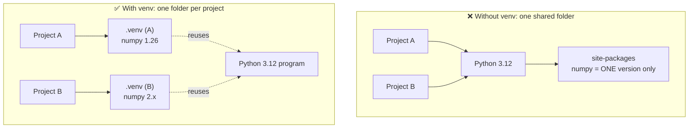

<div align="center">

# 📦 Concept 01 — Virtual Environments


**Give every project its own private Python and its own private set of packages.**

[⬅️ Phase 0 index](../README.md) · [🗺️ Roadmap](../../README.md) · Next ➡️ [02 · pip & requirements.txt](../02-pip-and-requirements/)

</div>

---

## 🎯 What you'll be able to do after this

- [x] Explain **why** every Python project needs its own environment
- [x] Create, activate and deactivate a virtual environment
- [x] Prove from Python code whether you are inside one
- [x] Answer the "what is a virtual environment?" interview question

---

## 🧠 1. Intuition

Imagine one shared kitchen used by five cooks. One cook replaces the salt with sea salt; another cook's recipe now tastes wrong. Nobody knows who changed what.

A **virtual environment** gives each project **its own small kitchen**. Whatever you install in one project's kitchen never touches another's.

> [!NOTE]
> **Package** = a bundle of Python code someone else wrote that you can install and `import` (e.g. `numpy`, `openai`, `requests`).
> **Dependency** = a package your project needs in order to run.

---

## ⚙️ 2. Technical Explanation

### Without a virtual environment

Your computer has one Python installation. It keeps installed packages in one folder called **`site-packages`**. Every project that uses that Python shares that one folder, so **only one version of each package can exist at a time**.

### With a virtual environment

A virtual environment is just **a folder** (by convention named `.venv`) that contains:

| Item inside `.venv/` | What it is |
|---|---|
| `bin/python` | A **symlink** (a shortcut file that points to another file) to the real Python program |
| `bin/pip` | The package installer, wired to install *into this folder only* |
| `bin/activate` | A small shell script that "switches on" the environment |
| `lib/python3.12/site-packages/` | **This project's own** package folder — starts almost empty |
| `pyvenv.cfg` | A small config file saying which real Python this venv was built from |

It is **not** a full copy of Python. It reuses the real Python program but gives it a separate `site-packages`.

### What "activate" actually does

When you type a command like `python`, your **shell** (the program in the terminal that reads your commands, here `zsh`) searches a list of folders called **`PATH`** and runs the first match.

`source .venv/bin/activate` does three things:

1. Puts `.venv/bin` at the **front** of `PATH` → now `python` and `pip` mean *this project's* versions
2. Sets an **environment variable** (a named value the shell passes to programs) called `VIRTUAL_ENV`
3. Adds `(.venv)` to your terminal prompt so you can see it's on

`deactivate` undoes all three.



### How Python knows it's in a venv

Python exposes two values in the built-in `sys` module:

| Value | Meaning | Inside a venv | Outside a venv |
|---|---|---|---|
| `sys.prefix` | Where Python looks for packages **right now** | the `.venv` folder | the real Python install |
| `sys.base_prefix` | Where the **real** Python is installed | the real Python install | the real Python install |

👉 **If they're different, you're in a virtual environment.** That is exactly what our script checks.

---

## 🔢 3. Tiny Example

`numpy` changed a lot between version **1.x** and **2.x** (some old code stopped working in 2.x).

| | Project A (old code) | Project B (new code) |
|---|---|---|
| Needs | `numpy 1.26` | `numpy 2.x` |
| **Shared Python** | installs 1.26 ✅ | installs 2.x → **replaces 1.26** → Project A breaks 💥 |
| **Separate venvs** | `A/.venv` has 1.26 ✅ | `B/.venv` has 2.x ✅ |

Same computer, same Python program, no conflict.

---

## 💻 4. Code & Commands

### Step 0 — Use a modern Python

> [!WARNING]
> macOS ships **Python 3.9** at `/usr/bin/python3`. Python 3.9 is **end-of-life** (EOL = it no longer gets security or bug fixes), and new AI libraries are dropping support for it. We use **Python 3.12**, which is supported (security fixes until Oct 2028) and works with every library in this roadmap.

We get Python 3.12 from **uv**, a Python tool installer. Its Python builds are **self-contained**: they bundle their own helper libraries instead of borrowing macOS's. *(Why this matters: see [🐛 Real debugging story](#-real-debugging-story) below.)*

```bash
uv python install 3.12
```

```bash
uv python find 3.12
```

The second command prints the full path of that Python program, e.g.
`~/.local/share/uv/python/cpython-3.12.11-macos-aarch64-none/bin/python3.12` (`~` means your home folder).

### Step 1 — Create the environment

```bash
cd /Users/sujithkumar/Documents/ai/AI-claude
```

```bash
~/.local/share/uv/python/cpython-3.12.11-macos-aarch64-none/bin/python3.12 -m venv .venv
```

| Piece | Meaning |
|---|---|
| `~/.local/.../python3.12` | Use this exact Python 3.12 program (path from `uv python find`) |
| `-m venv` | Run Python's built-in module (a Python file you can run) named `venv` |
| `.venv` | Name of the folder to create. The leading `.` hides it in Finder/`ls` |

We use **one shared `.venv` at the root** of this repo. All lessons need the same packages, so one environment is simpler than 40 small ones.

### Step 2 — Activate it

```bash
source .venv/bin/activate
```

Your prompt now starts with `(.venv)`. Check which Python you're using:

```bash
which python
```

It should print a path ending in `AI-claude/.venv/bin/python`.

### Step 3 — Prove it with Python: [`check_env.py`](check_env.py)

```python
import sys

print("Python version :", sys.version.split()[0])
print("Interpreter    :", sys.executable)
print("sys.prefix     :", sys.prefix)
print("sys.base_prefix:", sys.base_prefix)

in_venv = sys.prefix != sys.base_prefix
print("Inside a venv? :", in_venv)
```

**Line by line**

| Line | What it does |
|---|---|
| `import sys` | Loads Python's built-in `sys` module, which describes the running Python itself |
| `sys.version.split()[0]` | `sys.version` is a long text like `"3.12.11 (main, ...) [Clang ...]"`. `.split()` cuts it at spaces into a list; `[0]` takes the first piece → `"3.12.11"` |
| `sys.executable` | Full path of the Python program running this script |
| `sys.prefix` | Where packages are being loaded from right now |
| `sys.base_prefix` | Where the real Python lives |
| `in_venv = sys.prefix != sys.base_prefix` | `!=` means "not equal". Different → `True` → we're inside a venv |

**Run it**

```bash
python phase-00-setup/01-virtual-environment/check_env.py
```

Expected output (your exact paths/version may differ slightly):

```text
Python version : 3.12.11
Interpreter    : /Users/sujithkumar/Documents/ai/AI-claude/.venv/bin/python
sys.prefix     : /Users/sujithkumar/Documents/ai/AI-claude/.venv
sys.base_prefix: /Users/sujithkumar/.local/share/uv/python/cpython-3.12.11-macos-aarch64-none
Inside a venv? : True
```

### Step 4 — See the difference

```bash
deactivate
```

```bash
python3 phase-00-setup/01-virtual-environment/check_env.py
```

Now it uses the old system Python 3.9: `sys.prefix` equals `sys.base_prefix`, and `Inside a venv?` is `False`.

> [!TIP]
> **IDE users (PyCharm / VS Code):** point the project interpreter at `AI-claude/.venv/bin/python`. The IDE then runs your code inside the venv automatically.

---

## 🎤 5. Interview Answer

> *"A virtual environment is an isolated folder with its own `site-packages`, so each project has its own dependency versions without conflicting with other projects or the system Python. Activating it puts the venv's `bin` folder first on `PATH`, so `python` and `pip` point to that environment. We don't commit the venv itself; we commit a `requirements.txt` so anyone can recreate it."*

---

## 📌 Cheat Sheet

| Task | Command |
|---|---|
| Create | `<path-from-uv-python-find> -m venv .venv` |
| Activate (macOS/Linux) | `source .venv/bin/activate` |
| Activate (Windows) | `.venv\Scripts\activate` |
| Deactivate | `deactivate` |
| Which Python am I using? | `which python` |
| Run without activating | `.venv/bin/python script.py` |
| Start over | delete the `.venv` folder, create it again |

---

## ⚠️ Common Mistakes

| Mistake | Symptom | Fix |
|---|---|---|
| Forgot to activate | `ModuleNotFoundError` for a package you *know* you installed | `source .venv/bin/activate`, then run again |
| New terminal tab | Prompt has no `(.venv)` | Activation lasts per terminal session; activate again |
| Moved or renamed the project folder | venv commands fail with strange path errors | Venvs store full paths inside them; delete `.venv` and recreate |
| Committed `.venv` to Git | Huge repo, thousands of files | Add `.venv/` to `.gitignore` *(Concept 06)* |
| Built venv with system Python 3.9 | Newer packages refuse to install | Delete `.venv`, recreate it with Python 3.12 |
| `python3.12: command not found` | That Python isn't installed or isn't on `PATH` | `uv python install 3.12`, then use the full path from `uv python find 3.12` |
| Created venv in the wrong folder | `.venv` appears in the parent folder, not the project | `-m venv .venv` creates the folder **in your current directory** → `cd` into the project first |
| Ran script from the wrong folder | `can't open file ... [Errno 2] No such file or directory` | Relative paths start from your **current working directory**; `pwd` to check, `cd` to fix |

---

## 🐛 Real Debugging Story

What actually happened while setting this up — worth remembering, because this is how real environment bugs look.

**1️⃣ Symptom**

```text
python3.13 -m venv .venv
Error: Command '[... '-m', 'ensurepip', '--upgrade', '--default-pip']' returned non-zero exit status 1.
```

`ensurepip` is the step where `venv` installs `pip` into the new environment. So the venv folder was created, but **without pip**.

**2️⃣ Dig one level deeper** — run the failing command yourself to see its full error:

```text
ValueError: invalid literal for int() with base 10: ''
  ... truststore/_macos.py ... _mac_version.split(".")
```

pip asked Python *"which macOS version is this?"* and got an **empty string** `''` back.

**3️⃣ Dig again** — why is the version empty? Python reads it from a system file using the `xml` parser. Importing that parser failed:

```text
ImportError: ... pyexpat ... Symbol not found: _XML_SetAllocTrackerActivationThreshold
  Expected in: /usr/lib/libexpat.1.dylib
```

**4️⃣ Root cause**

| Piece | Explanation |
|---|---|
| `libexpat` | A small C library for reading XML. macOS ships its own copy at `/usr/lib/` |
| **Symbol** | A named function inside a compiled library |
| The bug | Homebrew's Python 3.13 was built expecting a **newer** `libexpat` than the one in this macOS version, so a function it needs is missing |

**5️⃣ Fix** — use a Python that **bundles its own `libexpat`** (uv's builds do), instead of borrowing macOS's.

> [!TIP]
> **Lesson:** the first error message is often *not* the real problem. Re-run the failing inner command, read the **last** error in the traceback, and keep asking "why?" until you reach something you can fix.

---

## 📖 Glossary

| Term | Plain meaning |
|---|---|
| **Virtual environment (venv)** | A project folder with its own private package storage |
| **Interpreter** | The program that reads and runs Python code (`python`) |
| **Package** | Reusable code someone published that you can install and import |
| **Dependency** | A package your project needs to run |
| **site-packages** | The folder where installed packages are stored |
| **Module** | A single Python file (or built-in unit) you can import or run with `-m` |
| **Shell** | The program in your terminal that reads commands (`zsh` on macOS) |
| **PATH** | The ordered list of folders the shell searches to find commands |
| **Environment variable** | A named value the shell passes to programs (e.g. `VIRTUAL_ENV`) |
| **Symlink** | A shortcut file that points to another file |
| **Homebrew** | A package manager for installing software on macOS |
| **EOL (end-of-life)** | A version that no longer receives fixes or security updates |
| **uv** | A fast tool that installs Python versions and packages |
| **pip** | Python's package installer *(next concept)* |
| **ensurepip** | The built-in step that puts `pip` into a new venv |
| **Traceback** | The error report Python prints, listing each function call that led to the error |
| **Root cause** | The underlying reason for a bug, not just its first visible symptom |

---

<div align="center">

**Status:** ✅ DONE · completed Fri 25 Sep 2026 · verified with `check_env.py` → `Inside a venv? : True`

[⬅️ Phase 0 index](../README.md) · [🗺️ Roadmap](../../README.md)

</div>
