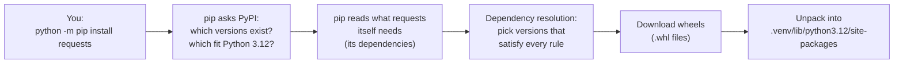

<div align="center">

# 📥 Concept 02 — pip & `requirements.txt`


**Install packages into your venv, and write down exactly which ones you need so anyone can rebuild the same environment.**

[⬅️ 01 · Virtual environment](../01-virtual-environment/) · [📂 Phase 0 index](../README.md) · [🗺️ Roadmap](../../README.md) · Next ➡️ [03 · API key](../03-api-key/)

</div>

---

## 🎯 What you'll be able to do after this

- [x] Explain what pip and PyPI are
- [x] Install, inspect and uninstall packages
- [x] Tell **direct** dependencies from **transitive** ones
- [x] Read version rules like `>=2,<4`
- [x] Write a `requirements.txt` and rebuild an environment from it

---

## 🧠 1. Intuition

- **PyPI** is a huge online **shop** of free Python packages.
- **pip** is the **delivery driver**: you name a package, and it fetches the package from the shop and puts it in your venv's `site-packages`.
- **`requirements.txt`** is your **shopping list**. Instead of remembering what you installed, you write it down. Anyone (a teammate, a server, you in 6 months) hands the list to pip and gets the **same** packages.

> [!NOTE]
> The venv (Concept 01) is the empty kitchen. pip fills it. `requirements.txt` is how you **recreate** the same kitchen anywhere. That's why we never share the `.venv` folder itself.

---

## ⚙️ 2. Technical Explanation

### What `pip install requests` actually does



| Term | Meaning |
|---|---|
| **PyPI** (Python Package Index) | The public online store of Python packages, at [pypi.org](https://pypi.org) |
| **Wheel** (`.whl`) | A ready-to-install package file (a zip in a standard layout), so nothing needs building on your machine |
| **Dependency resolution** | pip finding one set of versions that satisfies every package's version rules at the same time |

pip installs into **`sys.prefix`** of the Python running it. With the venv activated, that's `.venv`. With nothing activated, it's the system Python, which is usually **not** what you want.

### Direct vs transitive dependencies

| Type | Meaning | Example |
|---|---|---|
| **Direct** | A package **you** asked for and `import` in your code | `requests` |
| **Transitive** | A package your package needs; pip installs it **automatically** | `urllib3`, `idna`, … |

### Version numbers: `MAJOR.MINOR.PATCH`

Most packages follow **semantic versioning**: `2.34.2` means major `2`, minor `34`, patch `2`.

| Part bumps | Meaning | Safe to upgrade? |
|---|---|---|
| **PATCH** `2.34.1 → 2.34.2` | Bug fixes only | ✅ Almost always |
| **MINOR** `2.33 → 2.34` | New features, old code still works | ✅ Usually |
| **MAJOR** `1.x → 2.x` | Breaking changes (old code may stop working) | ⚠️ Test first |

### Version rules (called *specifiers*)

| You write | Meaning |
|---|---|
| `requests` | Any version (pip picks the newest that fits) |
| `requests==2.34.2` | **Exactly** 2.34.2 → this is called **pinning** |
| `requests>=2.30` | 2.30 or newer |
| `requests<3` | Anything below 3.0 |
| `requests>=2,<4` | At least 2, below 4 (comma = **AND**) |
| `requests~=2.34.0` | "Compatible release": `>=2.34.0` and `<2.35` |

### Why `python -m pip` instead of just `pip`

`pip` is simply the first program named `pip` that your shell finds on `PATH`. That might belong to a **different** Python. This Mac's `PATH` even includes `~/Library/Python/3.9/bin`, a leftover pip for the system Python 3.9.

`python -m pip` means *"run the pip that belongs to **this** `python`"*. There's no ambiguity, so it always installs where you expect.

---

## 🔢 3. Tiny Example

You ask for **one** package. pip installs **five**:

```text
requests 2.34.2                    ← direct (you asked for it)
├── charset_normalizer  >=2, <4    ← transitive: detects text encodings
├── idna                >=2.5, <4  ← transitive: handles international domain names
├── urllib3             >=1.26, <3 ← transitive: the low-level HTTP engine
└── certifi             >=2023.5.7 ← transitive: trusted HTTPS certificates
```

Reading one rule: `urllib3 >=1.26, <3` → any version from **1.26** up to (not including) **3.0**. pip picks the newest version inside that range.

> [!TIP]
> **Connection to Concept 01:** `requests 2.34.2` requires **Python ≥ 3.10**. On the old system Python 3.9, pip would quietly fall back to an **older** requests. That's one concrete reason we moved to 3.12.

---

## 💻 4. Code & Commands

> Every command below assumes you are in `AI-claude/` **with the venv active**. Your prompt should start with `(.venv)`.

```bash
cd /Users/sujithkumar/Documents/ai/AI-claude
```
```bash
source .venv/bin/activate
```

### Step 1 — Upgrade pip itself

```bash
python -m pip install --upgrade pip
```

`--upgrade` means *"replace it with the newest version if one exists"*. A new venv often starts with an older pip bundled inside Python.

### Step 2 — Install a package

```bash
python -m pip install requests
```

We use `requests` (a popular package for making HTTP calls, i.e. talking to web servers and APIs) because it pulls in transitive dependencies you can see. We'll also use it in Phase 1 to call an LLM API by hand.

### Step 3 — Look at what got installed

```bash
python -m pip list
```

Shows **every** package in the venv. You asked for 1; you'll see `requests` + 4 dependencies + `pip`.

```bash
python -m pip show requests
```

Shows details about one package. Look at `Requires:` (what it needs) and `Location:` (it should be inside `.venv`).

```bash
python -m pip freeze
```

Same list, printed in **requirements format**: `name==version`, ready to copy into a file.

### Step 4 — Write `requirements.txt`

Create a file named **`requirements.txt`** at the **root** of `AI-claude/`, not inside this concept folder. There is one venv for the whole repo, so there is one list for the whole repo.

```text
requests==2.34.2
```

We list only **direct** dependencies, **pinned** with `==`. pip will work out the transitive ones.

> [!NOTE]
> **Two styles you'll see in real projects**
>
> | Style | How | Pro | Con |
> |---|---|---|---|
> | **Hand-written** (we use this) | You list direct deps only | Clear what the project actually uses | Transitive versions may differ slightly per install |
> | **Full freeze** | `pip freeze > requirements.txt` | Every version locked exactly | Hard to tell which packages *you* chose |
>
> Modern tools (uv, Poetry) do both: a short list you edit plus an auto-generated **lock file** with every exact version. We'll stay with plain pip for now.

### Step 5 — Prove the package lives in the venv: [`inspect_package.py`](inspect_package.py)

```python
from importlib.metadata import version, requires

import requests

print("requests version :", version("requests"))
print("loaded from      :", requests.__file__)

print("depends on       :")
for requirement in requires("requests"):
    if "extra ==" not in requirement:
        print("   -", requirement)
```

**Line by line**

| Line | What it does |
|---|---|
| `from importlib.metadata import version, requires` | `importlib.metadata` is a **built-in** module that reads information about installed packages |
| `import requests` | Loads the package we installed. If it isn't in the active environment → `ModuleNotFoundError` |
| `version("requests")` | Returns the installed version as text, e.g. `"2.34.2"` |
| `requests.__file__` | The file path the package was loaded from, which proves which `site-packages` it came from |
| `requires("requests")` | Returns requests' dependency rules as a list of strings, e.g. `'urllib3<3,>=1.26'` |
| `if "extra ==" not in requirement` | Skips **extras**: optional add-ons installed only when asked, e.g. `pip install "requests[socks]"` |

```bash
python phase-00-setup/02-pip-and-requirements/inspect_package.py
```

Expected output:

```text
requests version : 2.34.2
loaded from      : /Users/sujithkumar/Documents/ai/AI-claude/.venv/lib/python3.12/site-packages/requests/__init__.py
depends on       :
   - charset_normalizer<4,>=2
   - idna<4,>=2.5
   - urllib3<3,>=1.26
   - certifi>=2023.5.7
```

### Step 6 — Rebuild from the list (the whole point)

```bash
python -m pip uninstall -y requests
```

`-y` answers "yes" to the "are you sure?" question. Now run `python -m pip list`. `requests` is gone, **but its 4 dependencies are still there**: pip does not remove orphaned dependencies.

```bash
python -m pip install -r requirements.txt
```

`-r` means *"read package names from this file"*. requests is back at exactly `2.34.2`. Run the Step 5 script again to confirm.

---

## 🎤 5. Interview Answer

> *"pip is Python's package installer. It downloads packages from PyPI, resolves their transitive dependencies, and installs them into the active environment's site-packages, which is why I run it as `python -m pip` inside a venv. I record the project's direct dependencies with pinned versions in `requirements.txt`, so anyone can rebuild the same environment with `pip install -r requirements.txt`, and for fully reproducible builds I'd add a lock file of exact transitive versions."*

---

## 📌 Cheat Sheet

| Task | Command |
|---|---|
| Install | `python -m pip install requests` |
| Install exact version | `python -m pip install "requests==2.34.2"` |
| Upgrade a package | `python -m pip install --upgrade requests` |
| Uninstall | `python -m pip uninstall -y requests` |
| List everything | `python -m pip list` |
| Details of one package | `python -m pip show requests` |
| Print in requirements format | `python -m pip freeze` |
| Install from a list | `python -m pip install -r requirements.txt` |
| Check for broken dependency rules | `python -m pip check` |
| Preview an install without doing it | `python -m pip install -r requirements.txt --dry-run` |
| Show a file's contents | `cat requirements.txt` |

---

## ⚠️ Common Mistakes

| Mistake | Symptom | Fix |
|---|---|---|
| Venv not activated | Package "installed" but `ModuleNotFoundError` when running | Activate, check `(.venv)` in prompt, install again |
| Using bare `pip` | Installs into a different Python (e.g. the old 3.9) | Always `python -m pip` |
| `error: externally-managed-environment` | pip refuses to install | You're outside a venv; the system/Homebrew Python protects itself. Activate the venv |
| Forgot to update `requirements.txt` | Works for you, fails for others ("works on my machine") | Every time you install something you `import`, add it to the file |
| Not pinning versions | A new release breaks your code months later | Pin with `==` |
| `requirements.txt` created but empty (not saved) | `pip install -r requirements.txt` finishes silently, then `ModuleNotFoundError` | Save the file; check its contents with `cat requirements.txt` before installing from it |
| Using an IDE's "sync requirements" on a parent folder | File full of unrelated packages, downgrades, `~=` ranges | List only what **this** project imports; check with `pip install -r requirements.txt --dry-run` |
| Expecting uninstall to clean up | Orphaned dependencies left behind | Normal for pip; recreate the venv from `requirements.txt` for a clean slate |

---

## 📖 Glossary

| Term | Plain meaning |
|---|---|
| **pip** | Python's package installer |
| **PyPI** | The public online store of Python packages |
| **Wheel (`.whl`)** | A ready-to-install package file |
| **Direct dependency** | A package you chose and import |
| **Transitive dependency** | A package pulled in because another package needs it |
| **Dependency resolution** | Finding versions that satisfy every package's rules at once |
| **Semantic versioning** | `MAJOR.MINOR.PATCH` numbering; a major bump signals breaking changes |
| **Version specifier** | A version rule like `==2.34.2` or `>=2,<4` |
| **Pinning** | Fixing a package to one exact version with `==` |
| **Extra** | An optional add-on of a package, installed with `pkg[extra]` |
| **Lock file** | An auto-generated file listing the exact version of every package, including transitive ones |
| **Reproducible environment** | One that can be rebuilt identically on any machine |
| **HTTP** | The protocol (set of rules) programs use to talk to web servers and APIs |

---

<div align="center">

**Status:** ✅ DONE · completed Mon 28 Sep 2026 · `requirements.txt` → `requests==2.34.2`

[⬅️ 01 · Virtual environment](../01-virtual-environment/) · [📂 Phase 0 index](../README.md) · [🗺️ Roadmap](../../README.md)

</div>
