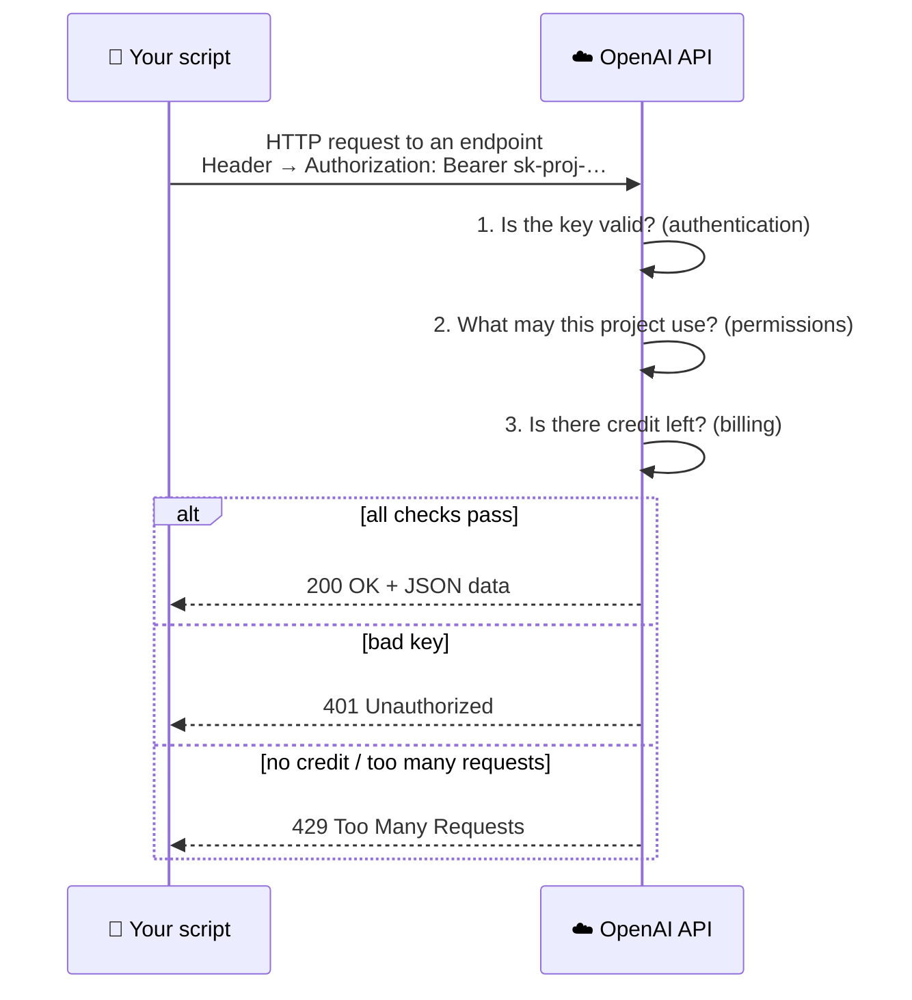

<div align="center">

# 🔑 Concept 03 — API Key


**The secret that proves "this request comes from my account, bill me for it."**

[⬅️ 02 · pip & requirements.txt](../02-pip-and-requirements/) · [📂 Phase 0 index](../README.md) · [🗺️ Roadmap](../../README.md) · Next ➡️ [04 · .env + python-dotenv](../04-env-and-dotenv/)

</div>

---

## 🎯 What you'll be able to do after this

- [x] Explain what an API and an API key are
- [x] Explain what happens when a request carries a key
- [x] Create a **project-scoped** OpenAI key safely
- [x] Verify a key with a free request, without saving it anywhere
- [x] Know what to do if a key leaks

---

## 🧠 1. Intuition

An **API** (Application Programming Interface) is a **service counter for programs**. Your program walks up, places an order (a **request**), and gets something back (a **response**). No website, no buttons: just programs talking to programs.

An **API key** is your **membership card** at that counter. It tells the provider:

1. **Who** is asking (your account and project)
2. **Whether** they're allowed (valid key? enough credit?)
3. **Whom to bill** for the work

> [!WARNING]
> An API key works like **a password and a credit card in one**. Anyone who has it can spend your money. They don't need your email or your login.

---

## ⚙️ 2. Technical Explanation

### What happens on every request



| Term | Meaning |
|---|---|
| **Endpoint** | One specific URL of an API that does one job, e.g. `https://api.openai.com/v1/models` lists models |
| **HTTP header** | Extra information attached to a request, like a label on an envelope |
| **`Authorization: Bearer <key>`** | The standard header for sending a key. "Bearer" means *"whoever **bears** (holds) this token is allowed in"*, which is exactly why leaking it is dangerous |
| **Authentication** | Proving who you are |
| **Status code** | A 3-digit number in every response: `200` = OK, `401` = bad/missing key, `429` = out of credit or too many requests |
| **JSON** | A text format for structured data (`{"key": "value"}`, `[1, 2, 3]`) that Python turns into dicts and lists |

### OpenAI key types

| Type | Looks like | Use it for |
|---|---|---|
| **Project key** ⭐ | `sk-proj-…` | Normal development. Tied to one **project**, so usage, limits and permissions are tracked separately per project |
| **Service account key** | `sk-svcacct-…` | Servers and automated systems that don't belong to a person |
| User key (legacy) | `sk-…` | Older style tied to your personal user. Avoid for new work |

A **project** in OpenAI's dashboard is a container that groups keys, usage and spending limits. Best practice is **one project per app** and **separate keys for development and production**.

### Billing (checked Sep 2026)

- OpenAI uses **prepaid credits**: you buy credit first, and each request is deducted from it.
- **Minimum top-up is $5.** Purchased credits **expire after 1 year**.
- **No free credits** for new accounts (discontinued mid-2025).
- You pay per **token** (≈ a piece of a word; explained properly in Phase 1). Simple learning requests cost fractions of a cent.

> [!TIP]
> Prepaid billing is itself a safety net. If a key leaks, the damage is capped at your remaining balance, as long as **auto-recharge is off**. Concept 05 adds more limits.

### Why OpenAI for this roadmap

| Need | OpenAI covers it? |
|---|---|
| Chat models (Phase 1, 3) | ✅ |
| Embedding models (Phase 2 onward) | ✅ same key |
| `tiktoken` tokenizer (Phase 1) | ✅ OpenAI's own library |
| Provider fallback to Claude (Phase 10) | Added later with a second key |

One key covers everything until Phase 10, so there's less setup and one bill.

---

## 🔢 3. Tiny Example

Your key: `sk-proj-AbCdEf...XyZ9` (fake).

| Scenario | What happens |
|---|---|
| Your script sends it | ✅ `200`, work done, ~$0.0001 deducted |
| You typo one character | ❌ `401 Unauthorized`, nothing deducted |
| Valid key, $0 balance | ❌ `429` with `insufficient_quota` |
| Key pushed to a public GitHub repo | 🤖 Bots scan GitHub for keys **within minutes** and start spending. OpenAI may also auto-disable leaked keys it detects |
| You **revoke** the key in the dashboard | Every request with it now gets `401`, instantly |

**Safe way to display a key** (e.g. in logs):

```text
sk-proj-AbCdEfGh123...XyZ9   ❌ full key, never print this
sk-proj-...XyZ9              ✅ masked: enough to recognize, useless to steal
```

---

## 💻 4. Code & Commands

### Step 1 — Create a project and a project key (in the browser)

> [!CAUTION]
> **Never paste your key into chat (including to me), into code files, into screenshots, or into Git.** The only places it should go are the terminal prompt in Step 2, and (in Concept 04) a `.env` file.

1. Go to [platform.openai.com](https://platform.openai.com) and log in.
2. **Billing:** check your credit balance. If it's $0, add the minimum ($5 is plenty for Phases 0–3). Leave **auto-recharge OFF** for now.
3. **Create a project** (project switcher at the top → *Create project*). Name it `ai-learning`.
4. Open [platform.openai.com/api-keys](https://platform.openai.com/api-keys) → **Create new secret key**:
   - **Owned by:** Project
   - **Project:** `ai-learning`
   - **Name:** `ai-learning-local-dev` (names say *where* a key is used, so you know which one to revoke)
5. **Copy it immediately.** OpenAI shows the full key **only once**. Lost it? No problem: revoke it and create a new one.

*(Dashboard labels shift over time; if something is named slightly differently, look for the closest match.)*

### Step 2 — Verify the key without saving it: [`check_api_key.py`](check_api_key.py)

This calls the **list models** endpoint, which is **free**: it only reads, and no model runs.

```python
from getpass import getpass

import requests

api_key = getpass("Paste your OpenAI API key (input is hidden): ").strip()

masked = api_key[:8] + "..." + api_key[-4:]
print("Key received:", masked)

response = requests.get(
    "https://api.openai.com/v1/models",
    headers={"Authorization": f"Bearer {api_key}"},
    timeout=30,
)

print("Status code :", response.status_code)

if response.status_code == 200:
    model_ids = [model["id"] for model in response.json()["data"]]
    print("Key works ✅  models visible:", len(model_ids))
    print("A few of them:", sorted(model_ids)[:5])
else:
    print("Key rejected ❌ ", response.text[:200])
```

**Line by line**

| Line | What it does |
|---|---|
| `from getpass import getpass` | Built-in function that asks for input **without showing it on screen** (made for passwords) |
| `import requests` | The package from Concept 02, now doing real work |
| `getpass("...").strip()` | Reads the pasted key. `.strip()` removes accidental spaces/newlines, a very common cause of `401` |
| `api_key[:8] + "..." + api_key[-4:]` | **Slicing**: first 8 characters + last 4. Proves the right key arrived without revealing it |
| `requests.get(url, ...)` | Sends an HTTP **GET** request (GET = "give me data", nothing is changed) |
| `headers={"Authorization": f"Bearer {api_key}"}` | Attaches the key in the standard header |
| `timeout=30` | Give up after 30 seconds instead of waiting forever if the network hangs |
| `response.status_code` | The 3-digit result: `200` good, `401` bad key, `429` quota |
| `response.json()["data"]` | Parses the JSON body into Python. OpenAI returns `{"data": [ {"id": "..."}, ... ]}` |
| `[model["id"] for model in ...]` | List comprehension collecting just the model names |
| `sorted(model_ids)[:5]` | Alphabetical order, first 5, just a sample |
| `response.text[:200]` | On failure, the first 200 characters of the raw error message |

Run it **in the terminal** (`getpass` may not hide input in some IDE run consoles):

```bash
python phase-00-setup/03-api-key/check_api_key.py
```

Expected (numbers and names will differ):

```text
Paste your OpenAI API key (input is hidden):
Key received: sk-proj-...a1B2
Status code : 200
Key works ✅  models visible: <some number>
A few of them: ['<model-id>', '<model-id>', '<model-id>', '<model-id>', '<model-id>']
```

> [!NOTE]
> The key lived only in memory while the script ran. Nothing was written to disk. Having to paste it every time is annoying, and Concept 04 (`.env`) solves exactly that, safely.

---

## 🎤 5. Interview Answer

> *"An API key is a bearer secret that authenticates requests to a provider and attributes usage and billing to an account or project, so anyone holding it can spend on your behalf. I use project-scoped keys with one key per app and environment, keep them only on the backend in environment variables or a secrets manager, never in code or Git, and set spending limits. If a key leaks, I revoke it immediately and rotate in a new one."*

---

## 📌 Cheat Sheet

| Task | Where / how |
|---|---|
| Create / revoke keys | [platform.openai.com/api-keys](https://platform.openai.com/api-keys) |
| Check balance, add credit | Dashboard → Billing |
| Check usage per key | Dashboard → Usage (filter by key/project) |
| Send a key | Header `Authorization: Bearer <key>` |
| Show a key safely | `key[:8] + "..." + key[-4:]` |
| Free test request | `GET https://api.openai.com/v1/models` |
| Key leaked? | **Revoke first**, then create a new one, then investigate |

---

## ⚠️ Common Mistakes

| Mistake | Symptom | Fix |
|---|---|---|
| Key pasted into code | Leaks the moment code is shared or committed | Keys only in `.env` / environment variables *(Concept 04)* |
| Key in a screenshot or chat | Anyone who sees it can use it | Revoke and recreate |
| Extra space / newline copied | `401` with a key you *know* is right | `.strip()` the input |
| $0 balance | `429` + `insufficient_quota` | Add credit in Billing |
| One key for every project | Can't tell what spent money; revoking breaks everything | One key per project and environment, clearly named |
| Lost the key after creation | Can't view it again | Revoke it and create a new one. That's normal |
| Running `getpass` in an IDE Run console | Warning `GetPassWarning: Can not control echo`, and the key may be **visible** in the console | Run secret prompts in a real terminal; clear the console if the key showed |
| Auto-recharge on while learning | A leak or bug keeps refilling and spending | Keep auto-recharge off; use limits *(Concept 05)* |

---

## 📖 Glossary

| Term | Plain meaning |
|---|---|
| **API** | A way for programs to request work or data from another program over the network |
| **API key** | A secret string that identifies and authorizes your requests |
| **Endpoint** | One URL of an API that does one job |
| **Request / Response** | The message you send / the message you get back |
| **HTTP GET** | A request type meaning "give me data" without changing anything |
| **Header** | Extra labeled information attached to a request |
| **Bearer token** | A secret that grants access to whoever holds (bears) it |
| **Authentication** | Proving who you are |
| **Status code** | 3-digit result number: 200 OK, 401 unauthorized, 429 quota/rate limit |
| **JSON** | A text format for structured data; maps to Python dicts/lists |
| **Project (OpenAI)** | A container grouping keys, usage and limits for one app |
| **Prepaid credits** | Money loaded in advance, deducted per request |
| **Token (billing)** | A small piece of text (≈ part of a word) that usage is priced by *(Phase 1)* |
| **Revoke** | Permanently disable a key |
| **Rotate** | Replace a key with a new one on a schedule or after exposure |
| **Timeout** | Maximum time to wait for a response before giving up |

---

<div align="center">

**Status:** ✅ DONE · completed Mon 28 Sep 2026 · project key `sk-proj-...SDwA` → `200`, 134 models visible

[⬅️ 02 · pip & requirements.txt](../02-pip-and-requirements/) · [📂 Phase 0 index](../README.md) · [🗺️ Roadmap](../../README.md)

</div>

<sub>Sources: [OpenAI — Best practices for API key safety](https://help.openai.com/en/articles/5112595-best-practices-for-api-key-safety) · [OpenAI — Prepaid billing](https://help.openai.com/en/articles/8264644-setting-up-and-managing-prepaid-api-billing) · [OpenAI — Production best practices](https://developers.openai.com/api/docs/guides/production-best-practices) · [OpenAI — Managing projects](https://help.openai.com/en/articles/9186755-managing-your-work-in-the-api-platform-with-projects)</sub>
