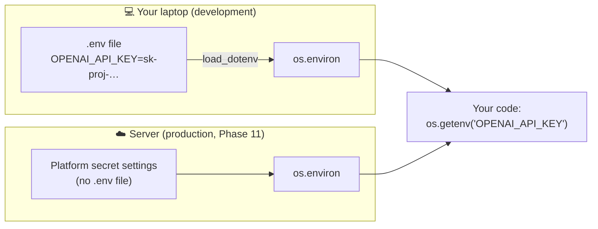

<div align="center">

# 🔒 Concept 04 — `.env` + `python-dotenv`


**Keep secrets in a local file next to your code, not *in* your code, and load them automatically.**

[⬅️ 03 · API key](../03-api-key/) · [📂 Phase 0 index](../README.md) · [🗺️ Roadmap](../../README.md) · Next ➡️ [05 · API spending limits](../05-api-spending-limits/)

</div>

---

## 🎯 What you'll be able to do after this

- [x] Explain what environment variables are and why secrets live there
- [x] Write a correct `.env` file and a safe `.env.example`
- [x] Load `.env` with `python-dotenv` and read values with `os.getenv`
- [x] Know which value wins when the same name is set in two places
- [x] Debug "key not found" and "wrong key loaded" problems

---

## 🧠 1. Intuition

Your code is a **recipe** you'll share with teammates, GitHub and servers. Your API key is the **key to the cash register**.

You wouldn't write the register key inside the recipe. Instead, the recipe says *"use the register key from the drawer"*, and each kitchen keeps its **own** key in its **own** drawer.

| | Recipe (code) | Drawer (`.env`) |
|---|---|---|
| Shared? | ✅ Yes: Git, teammates, servers | ❌ Never. Stays on your machine |
| Contains | `os.getenv("OPENAI_API_KEY")` | `OPENAI_API_KEY=sk-proj-…` |
| Different per machine? | No, identical everywhere | Yes: your laptop, a teammate's laptop, and production each have their own |

---

## ⚙️ 2. Technical Explanation

### Environment variables (a quick recap from Concept 01)

An **environment variable** is a named text value that every running program (a **process**) receives from whatever started it. Your terminal has dozens: `PATH`, `HOME`, `VIRTUAL_ENV`… Python sees them all in **`os.environ`**, which behaves like a dictionary.

| Code | Returns |
|---|---|
| `os.environ["HOME"]` | `"/Users/sujithkumar"`, or a **`KeyError`** crash if the name is missing |
| `os.getenv("HOME")` | `"/Users/sujithkumar"`, or **`None`** if missing (no crash) |
| `os.getenv("APP_ENV", "development")` | The value, or the **default** `"development"` if missing |

Configuration read from the environment is the standard for backend services (it's one rule of the widely used **"Twelve-Factor App"** guidelines). The same code runs everywhere, and only the environment changes.

### The problem `.env` solves

Real environment variables must be set **before** Python starts (e.g. `export OPENAI_API_KEY=...` in the terminal). That's annoying, gets forgotten in new tabs, and saves the key into your **shell history** (the file where your terminal records past commands).

A **`.env` file** is a plain text file of `NAME=value` lines. **`python-dotenv`** reads it at startup and copies each line into `os.environ`. Your code just calls `os.getenv(...)`: it neither knows nor cares where the value came from.



### Who wins when a name is set twice?

By default, **a real environment variable beats `.env`**. `load_dotenv()` does **not** overwrite names that already exist (`override=False`). That lets a server or a one-off terminal command override your local file.

| Real env var set? | In `.env`? | `os.getenv` returns |
|---|---|---|
| ❌ | ✅ `A` | `A` (from `.env`) |
| ✅ `B` | ✅ `A` | **`B`** (the real env var wins) |
| ✅ `B` | ✅ `A`, with `load_dotenv(override=True)` | `A` |
| ❌ | ❌ | `None` |

### How `load_dotenv()` finds the file

`find_dotenv()` starts in the **folder of the script being run** and walks **upward** through parent folders, stopping at the first `.env` it finds. *(In the interactive Python prompt or a debugger, it starts from the current working directory instead.)*

```text
phase-00-setup/04-env-and-dotenv/.env   ✗ not here
phase-00-setup/.env                     ✗ not here
AI-claude/.env                          ✓ FOUND → stop
ai/.env                                 (never reached)
```

> [!WARNING]
> **Trap on this machine:** `ai/.env` (one level above this repo) holds your **old** key. If `AI-claude/.env` is missing or misnamed, the search keeps climbing and **silently loads the old key**. That's why our script prints *which* file it found.

### `.env` vs `.env.example`

| File | Contains | Committed to Git? |
|---|---|---|
| `.env` | Real secrets | ❌ **Never** (Concept 06 adds it to `.gitignore`) |
| `.env.example` | The **names** needed, with fake placeholder values | ✅ Yes. It tells others which variables to set |

---

## 🔢 3. Tiny Example

`.env`:
```text
# comments start with #
OPENAI_API_KEY=sk-proj-abc123
APP_ENV=development
MAX_RETRIES=3
```

After `load_dotenv()`:

| Code | Result | Note |
|---|---|---|
| `os.getenv("APP_ENV")` | `"development"` | |
| `os.getenv("MAX_RETRIES")` | `"3"` | ⚠️ A **string**, not the number 3. Use `int(os.getenv("MAX_RETRIES"))` |
| `os.getenv("DEBUG")` | `None` | Not defined anywhere |
| `os.getenv("DEBUG", "false")` | `"false"` | Default used. Also a string, not `False` |

> [!IMPORTANT]
> Environment variables are **always text**. Convert numbers and booleans yourself.

### `.env` format rules

| ✅ Do | ❌ Avoid |
|---|---|
| `OPENAI_API_KEY=sk-proj-abc` | `OPENAI_API_KEY = sk-proj-abc` (spaces around `=` break other tools, like the shell) |
| One variable per line | Several on one line |
| `UPPER_SNAKE_CASE` names | `openaiKey` |
| Quotes only if the value has spaces: `GREETING="hello there"` | `OPENAI_API_KEY="sk-proj-abc` (unclosed quote) |

---

## 💻 4. Code & Commands

> Terminal in `AI-claude/`, venv active: `(.venv) ... AI-claude %`

### Step 1 — Install python-dotenv and record it

```bash
python -m pip install python-dotenv
```

Then add a line to **`requirements.txt`**, so it now reads:

```text
requests==2.34.2
python-dotenv==1.2.3
```

Note the naming: you **install** `python-dotenv` but **import** `dotenv`. The package name on PyPI and the name you import don't have to match.

### Step 2 — Create `AI-claude/.env` (you do this; never share its contents)

In PyCharm, right-click `AI-claude` → **New → File** → name it exactly `.env` → add one line with your key from Concept 03 → **Cmd+S**:

```text
OPENAI_API_KEY=sk-proj-...your-real-key...
```

No spaces, no quotes. If you've lost the key, revoke it and create a new one ([Concept 03](../03-api-key/)).

**Optional hardening:** make the file readable only by your user account.

```bash
chmod 600 .env
```

`chmod` changes file permissions. `600` means *owner can read + write; everyone else gets nothing*.

### Step 3 — The template: [`.env.example`](../../.env.example) (already created at the repo root)

```text
OPENAI_API_KEY=your-openai-project-key-here
```

### Step 4 — Load and check: [`load_key.py`](load_key.py)

```python
import os

from dotenv import find_dotenv, load_dotenv

print("Key in environment before loading?", "OPENAI_API_KEY" in os.environ)

env_path = find_dotenv()
print(".env file found at:", env_path)

load_dotenv(env_path)

api_key = os.getenv("OPENAI_API_KEY")
if api_key is None:
    raise SystemExit("❌ OPENAI_API_KEY not found. Check AI-claude/.env")

print("Key in environment after loading? ", "OPENAI_API_KEY" in os.environ)
print("Key loaded:", api_key[:8] + "..." + api_key[-4:])
```

**Line by line**

| Line | What it does |
|---|---|
| `import os` | Built-in module for talking to the operating system, including `os.environ` |
| `from dotenv import find_dotenv, load_dotenv` | The two functions we need from `python-dotenv` |
| `"OPENAI_API_KEY" in os.environ` | `True`/`False`: is the name set **before** we load anything? Should be `False`. We never print the value itself |
| `find_dotenv()` | Walks up from this script's folder; returns the path of the first `.env`, or `""` if none |
| `load_dotenv(env_path)` | Reads that file and copies each `NAME=value` into `os.environ` (without overriding existing names) |
| `os.getenv("OPENAI_API_KEY")` | Reads the value; `None` if missing |
| `raise SystemExit("...")` | Stops the program with a clear message instead of crashing later with a confusing error. **Fail fast.** |
| `api_key[:8] + "..." + api_key[-4:]` | Masked display, same as Concept 03 |

```bash
python phase-00-setup/04-env-and-dotenv/load_key.py
```

Expected:

```text
Key in environment before loading? False
.env file found at: /Users/sujithkumar/Documents/ai/AI-claude/.env
Key in environment after loading?  True
Key loaded: sk-proj-...SDwA
```

✅ **Check two things:** the path ends in **`AI-claude/.env`** (not `ai/.env`), and the last 4 characters match your new key (`SDwA`).

---

## 🎤 5. Interview Answer

> *"I never hardcode secrets. The code reads configuration from environment variables with `os.getenv`, and locally I keep those values in a `.env` file loaded by `python-dotenv`. That file is git-ignored, and I commit a `.env.example` with just the variable names. In production there's no `.env`: the platform or a secrets manager injects real environment variables, which take precedence, so the same code runs unchanged everywhere."*

---

## 📌 Cheat Sheet

| Task | Code / command |
|---|---|
| Install | `python -m pip install python-dotenv` |
| Load `.env` | `from dotenv import load_dotenv` → `load_dotenv()` |
| Which file was found? | `from dotenv import find_dotenv` → `print(find_dotenv())` |
| Read, may be missing | `os.getenv("NAME")` → value or `None` |
| Read with default | `os.getenv("NAME", "default")` |
| Read, must exist | `os.environ["NAME"]` → `KeyError` if missing |
| Let `.env` win over real env vars | `load_dotenv(override=True)` |
| Number from env | `int(os.getenv("MAX_RETRIES", "3"))` |
| Lock file permissions | `chmod 600 .env` |

---

## ⚠️ Common Mistakes

| Mistake | Symptom | Fix |
|---|---|---|
| File named `env`, `.env.txt` or `dotenv` | Key not found | Name must be exactly `.env` (macOS may hide the dot; check with `ls -a`) |
| `.env` in the wrong folder | Wrong or old key loaded, or none | Print `find_dotenv()`; it must point to `AI-claude/.env` |
| IDE Run button uses the system Python | First output line shows `/usr/bin/python3 ...`; the script may still "work" if that Python happens to have the package | Set the IDE interpreter to `AI-claude/.venv/bin/python`, or run from the terminal with the venv active |
| Forgot `load_dotenv()` | `os.getenv` returns `None` | Call it once, at the top of the program, before reading |
| `import python_dotenv` | `ModuleNotFoundError` | The import is `from dotenv import ...` |
| Old value exported in the terminal | `.env` edits "don't work" | A real env var wins; `unset OPENAI_API_KEY` or open a new terminal |
| Treating values as numbers/booleans | `"3" + 1` crashes; `"false"` is truthy | Convert: `int(...)`, `== "true"` |
| Committing `.env` | Secret leaked | `.gitignore` *(Concept 06)*; if it happened, revoke the key |
| Printing the key for debugging | Key ends up in logs and screenshots | Print a masked version only |

---

## 📖 Glossary

| Term | Plain meaning |
|---|---|
| **Environment variable** | A named text value a program receives from whatever started it |
| **Process** | A running program |
| **`os.environ`** | Python's dictionary-like view of the environment variables |
| **`.env` file** | A local text file of `NAME=value` lines for development secrets and config |
| **`python-dotenv`** | Package that loads `.env` into `os.environ` |
| **`.env.example`** | A committed template listing required variable names with fake values |
| **Shell history** | The file where your terminal saves commands you've typed |
| **Precedence** | Which source wins when a value is defined in more than one place |
| **Fail fast** | Stop immediately with a clear error instead of failing confusingly later |
| **Secrets manager** | A production service that stores and injects secrets securely *(Phase 11)* |
| **`chmod`** | Command that changes who may read/write/run a file |
| **Twelve-Factor App** | A popular set of guidelines for building backend services; one rule is "store config in the environment" |

---

<div align="center">

**Status:** ✅ DONE · completed Mon 28 Sep 2026 · `AI-claude/.env` loaded (key `sk-proj-...vGcA`, the user's existing key)

[⬅️ 03 · API key](../03-api-key/) · [📂 Phase 0 index](../README.md) · [🗺️ Roadmap](../../README.md)

</div>
