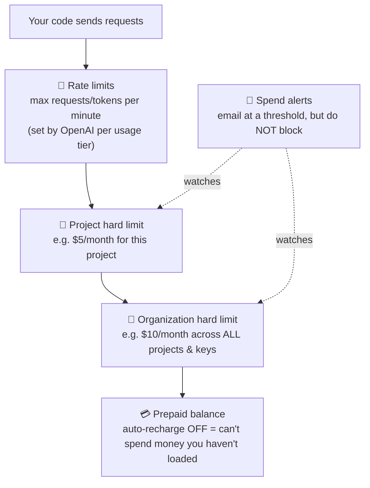

<div align="center">

# 💰 Concept 05 — API Spending Limits


**Make sure a bug, a loop or a leaked key can only cost you a small, known amount.**

[⬅️ 04 · .env + python-dotenv](../04-env-and-dotenv/) · [📂 Phase 0 index](../README.md) · [🗺️ Roadmap](../../README.md) · Next ➡️ [06 · Git basics](../06-git-basics/)

</div>

---

## 🎯 What you'll be able to do after this

- [x] Explain why AI APIs need spending guards
- [x] Tell **spend alerts**, **hard spend limits** and **rate limits** apart
- [x] Set organization- and project-level hard limits on OpenAI
- [x] Recognize the different kinds of `429` error and react correctly in code

---

## 🧠 1. Intuition

A normal backend bug wastes CPU time. An AI backend bug **spends real money on every loop iteration**.

Spending limits work like a **prepaid phone with a monthly cap**. Even if your kid (or a bug, or a stranger with your key) makes calls all night, the bill can't go past the cap. Calls simply stop working until next month.

| Without limits 😱 | With limits 😌 |
|---|---|
| A `while True:` loop calls the API all night | Calls start failing at $10 |
| A leaked key gets used by strangers | Damage is capped at $10 |
| You find out from your bank statement | You get an email alert at $5 |

---

## ⚙️ 2. Technical Explanation

### Layers of protection (defense in depth)

**Defense in depth** = several independent safety layers, so if one fails, another still catches the problem.



| Control | What it does | Blocks requests? | Who sets it |
|---|---|:-:|---|
| **Spend alert** | Emails you when monthly spend crosses a threshold | ❌ No, it only notifies | You |
| **Hard spend limit** (project) | Blocks this project's requests once its monthly spend hits the cap | ✅ Yes | You |
| **Hard spend limit** (organization) | Blocks **all** requests in your account once total monthly spend hits the cap | ✅ Yes | You |
| **Prepaid balance** | Requests fail when credit reaches $0 (if auto-recharge is off) | ✅ Yes | You (by how much you load) |
| **Rate limit** | Caps *speed*: requests per minute (**RPM**) and tokens per minute (**TPM**) | ✅ Temporarily | OpenAI, based on your **usage tier** |

- **Organization (org)** = your whole OpenAI account. Every project and every key lives inside it.
- **Usage tier** = a level OpenAI assigns based on how much you've paid over time and how old the account is. Higher tier = higher rate limits. New accounts start at the lowest tier.

### Important details (from OpenAI's docs, Sep 2026)

- Hard limits are **monthly** and reset with the next monthly billing cycle.
- Enforcement is **not instant**: spend can slightly **overshoot** the cap before blocking kicks in. Set the cap a bit **below** what you're truly willing to spend.
- Alerts keep working alongside hard limits: an alert warns you *before* the hard limit cuts you off.
- There is **no per-key** spend limit. Limits attach to projects and the organization. That's one more reason to use one project per app.

### All four "429"s look alike, but they need different reactions

Every limit above answers with HTTP status **`429`**. Only the **error code** inside the JSON body tells you which one:

| `error.code` | Meaning | Retry? |
|---|---|:-:|
| `rate_limit_exceeded` | Too fast for your tier | ✅ Wait a moment, then retry |
| `insufficient_quota` | Prepaid balance is empty | ❌ Add credit |
| `project_spend_limit_exceeded` | Project hit its monthly cap | ❌ Raise the cap or wait for next month |
| `organization_spend_limit_exceeded` | Whole account hit its monthly cap | ❌ Raise the cap or wait for next month |

> [!WARNING]
> A classic production bug: code that **retries every 429 forever**. For rate limits, that's correct. For spend limits, it just hammers the API uselessly and floods your logs. **Read the error code; only retry what can succeed.**

---

## 🔢 3. Tiny Example

Settings: **org hard limit $10**, **alert at $5**, **project hard limit $5**. A buggy script burns $1 per hour.

| Hour | Project spend | What happens |
|:-:|:-:|---|
| 1–4 | $1 → $4 | Normal |
| 5 | $5 | 📧 Alert email **and** 🛑 project limit reached → `429 project_spend_limit_exceeded` |
| 6+ | ~$5 (slight overshoot possible) | Every request is blocked. The bug costs **nothing more** |

Without limits, the same bug running for a weekend (48 h) = **$48**. At 10× the speed = **$480**.

---

## 💻 4. Code & Settings

### Step 1 — Find out which project your key belongs to

You're using your existing key (`sk-proj-...vGcA`). Open [platform.openai.com/api-keys](https://platform.openai.com/api-keys) and find that key in the list. Note which **project** it belongs to. That's the project whose limit protects your code.

### Step 2 — Organization hard limit (the master safety net)

Go to [**Organization limits**](https://platform.openai.com/settings/organization/limits) → **Spend** → **Edit spend limit**:

- **Monthly spend limit:** `10` (or whatever you're comfortable with)
- **Enforce a hard limit:** ✅ **ON**
- Add a **spend alert** at `5`

This covers **every** project and **every** key, including old ones you've forgotten about.

### Step 3 — Project hard limit

[**Project settings**](https://platform.openai.com/settings/) → select the project from Step 1 → **Limits** → **Spend** → **Edit spend limit**:

- **Monthly spend limit:** `5`
- **Enforce a hard limit:** ✅ **ON**

### Step 4 — Billing check

Dashboard → **Billing**: confirm **auto-recharge is OFF**. Then your prepaid balance is the final hard wall.

### Step 5 — Peek at your rate limits

On the **Limits** page, look at the rate-limits table: your **usage tier** and the **RPM / TPM** allowed per model. Nothing to change; just know where to find it.

*(Dashboard labels change over time. If a name differs slightly, look for the closest match.)*

### Step 6 — Code: tell the 429s apart: [`classify_429.py`](classify_429.py)

No API call and no cost: we feed the script **sample error bodies** shaped like OpenAI's real error responses (simplified).

```python
import json

SAMPLE_ERROR_BODIES = [
    '{"error": {"code": "rate_limit_exceeded", "message": "Rate limit reached for requests per minute"}}',
    '{"error": {"code": "insufficient_quota", "message": "You exceeded your current quota"}}',
    '{"error": {"code": "project_spend_limit_exceeded", "message": "Project spend limit reached"}}',
    '{"error": {"code": "organization_spend_limit_exceeded", "message": "Organization spend limit reached"}}',
]

RETRYABLE_CODES = {"rate_limit_exceeded"}

for body in SAMPLE_ERROR_BODIES:
    error = json.loads(body)["error"]
    code = error["code"]

    if code in RETRYABLE_CODES:
        action = "slow down, wait, then retry"
    else:
        action = "stop: retrying won't help, a human must act"

    print(f"429 {code:<35} → {action}")
```

**Line by line**

| Line | What it does |
|---|---|
| `import json` | Built-in module for converting JSON text ⇄ Python objects |
| `SAMPLE_ERROR_BODIES = [...]` | A list of raw **response bodies** (the text part of a response), as strings, exactly as they'd arrive over HTTP. `UPPER_CASE` names signal "constant: don't change this" |
| `RETRYABLE_CODES = {"rate_limit_exceeded"}` | A **set** (unordered, fast membership check) of codes worth retrying. Easy to extend later |
| `json.loads(body)` | "load string": turns JSON text into a Python dict. `["error"]` picks the inner error object |
| `code = error["code"]` | The machine-readable reason. **Branch on this, never on the human-readable `message`**, which can change wording at any time |
| `if code in RETRYABLE_CODES:` | Set membership test |
| `f"429 {code:<35} → {action}"` | f-string; `:<35` **left-aligns** the code in a 35-character column so the arrows line up |

```bash
python phase-00-setup/05-api-spending-limits/classify_429.py
```

Output:

```text
429 rate_limit_exceeded                 → slow down, wait, then retry
429 insufficient_quota                  → stop: retrying won't help, a human must act
429 project_spend_limit_exceeded        → stop: retrying won't help, a human must act
429 organization_spend_limit_exceeded   → stop: retrying won't help, a human must act
```

In Phase 10 this grows into real retry logic with **exponential backoff** (waiting longer after each failed retry).

---

## 🎤 5. Interview Answer

> *"LLM APIs bill per token, so a runaway loop or a leaked key turns directly into money. I layer defenses: hard monthly spend limits at both the project and organization level, spend alerts below those caps, prepaid credit without auto-recharge in development, and one project per app so limits and usage stay isolated. In code, I branch on the error code: rate-limit 429s get retried with backoff, while quota or spend-limit 429s fail fast and alert, because retrying can't fix them."*

---

## 📌 Cheat Sheet

| Task | Where |
|---|---|
| Org spend limit + alerts | [Settings → Organization → Limits](https://platform.openai.com/settings/organization/limits) |
| Project spend limit | Settings → *(project)* → Limits |
| Auto-recharge on/off | Settings → Billing |
| Rate limits & usage tier | Limits page |
| Spend per project / key | Usage page |
| Error codes | `rate_limit_exceeded` (retry) · `insufficient_quota` / `*_spend_limit_exceeded` (don't) |

---

## ⚠️ Common Mistakes

| Mistake | Consequence | Fix |
|---|---|---|
| Only setting alerts | Emails arrive; spending continues | Turn **Enforce a hard limit** ON |
| Only a project limit | Old keys in other projects are unprotected | Always set an **org** limit too |
| Cap set exactly at your max budget | Overshoot takes you slightly past it | Set the cap a bit below your true maximum |
| Auto-recharge on while learning | A leak keeps refilling itself | Keep it off until you're in production |
| Retrying every 429 | Endless useless retries on spend-limit errors | Branch on `error.code` |
| Branching on the error `message` text | Breaks when OpenAI rewords messages | Use `error.code` |
| Using the old key without knowing its project | Your project limit protects the wrong project | Check the key's project on the API keys page |

---

## 📖 Glossary

| Term | Plain meaning |
|---|---|
| **Spend alert** | A notification at a spend threshold; doesn't block anything |
| **Hard spend limit** | A monthly cap that blocks requests once reached |
| **Organization (org)** | Your whole OpenAI account, containing all projects and keys |
| **Rate limit** | A cap on request *speed* (per minute/day), not on money |
| **RPM / TPM** | Requests per minute / tokens per minute |
| **Usage tier** | Your account level; decides your rate limits; rises with paid history and account age |
| **Defense in depth** | Several independent safety layers |
| **Overshoot** | Spend slightly exceeding a cap because enforcement lags behind |
| **Response body** | The data part of an HTTP response (here, JSON text) |
| **Error code** | A stable, machine-readable reason inside an error response |
| **Set** | A Python collection of unique items with fast `in` checks |
| **Exponential backoff** | Retry strategy that waits longer after each failure (1s, 2s, 4s, …) *(Phase 10)* |

---

<div align="center">

**Status:** ✅ DONE · completed Mon 28 Sep 2026 · spend limits configured in the OpenAI dashboard · `classify_429.py` verified

[⬅️ 04 · .env + python-dotenv](../04-env-and-dotenv/) · [📂 Phase 0 index](../README.md) · [🗺️ Roadmap](../../README.md)

</div>

<sub>Sources: [OpenAI — Spend limits](https://developers.openai.com/api/docs/guides/spend-limits) · [OpenAI — Production best practices](https://developers.openai.com/api/docs/guides/production-best-practices)</sub>
