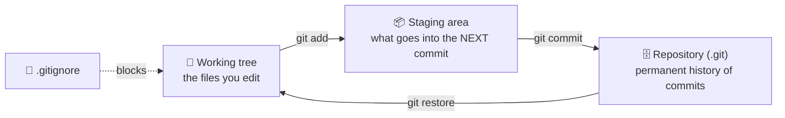

<div align="center">

# 🌱 Concept 06 — Git Basics


**Save snapshots of your project, see exactly what changed, undo mistakes, and make sure secrets never get saved.**

[⬅️ 05 · API spending limits](../05-api-spending-limits/) · [📂 Phase 0 index](../README.md) · [🗺️ Roadmap](../../README.md) · Next ➡️ `07 · Hello LLM`

</div>

---

## 🎯 What you'll be able to do after this

- [ ] Explain repository, working tree, staging area and commit
- [ ] Create a repo, stage files and commit them
- [ ] Use `.gitignore` to keep `.env` and `.venv` out forever
- [ ] Inspect history and changes (`log`, `diff`) and undo uncommitted edits
- [ ] Know what to do if a secret *was* committed

---

## 🧠 1. Intuition

Git is **save points in a video game** for your code.

- You play (edit files).
- At a good moment you **save** (commit) with a note: *"beat the boss, got the key"*.
- If you break something later, you can see **exactly** what changed since the last save, or go back to it.

`.gitignore` is a **"do not save" list**. Anything on it (like your `.env` key) is never included in any save point, even by accident.

---

## ⚙️ 2. Technical Explanation

### The three places your files live



| Term | Meaning |
|---|---|
| **Repository (repo)** | A project tracked by Git. All history lives in a hidden `.git` folder at its root |
| **Working tree** | The actual files on disk that you edit |
| **Staging area** (also called the *index*) | A "packing box" where you choose which changes go into the next commit |
| **Commit** | A saved snapshot of the staged files, plus a message, author, date and a unique ID |
| **Commit hash** | The commit's unique ID, e.g. `a1b2c3d…` (a **hash** is a fingerprint computed from the content) |
| **Branch** | A named line of commits. Ours is called `main`. *(More on branches later; we stay on `main` for now)* |
| **HEAD** | Git's pointer to "the commit you're currently on" |

Why a staging area? It lets you commit **some** changes and not others. Example: you fixed a bug *and* started a new feature; you can commit just the bug fix.

### File states

| State | Meaning | `git status --short` shows |
|---|---|:-:|
| **Untracked** | Git sees the file but has never saved it | `??` |
| **Staged** | Will be in the next commit | `A` (new) / `M` (modified), green |
| **Modified** | Changed since the last commit, not yet staged | ` M`, red |
| **Ignored** | Matched by `.gitignore`: invisible to Git | *(not shown)* |

### How `.gitignore` patterns work

| Pattern | Matches | Doesn't match |
|---|---|---|
| `.env` | a file named exactly `.env` (in any folder) | `.env.example` ✅ (stays tracked, good) |
| `.venv/` | the folder `.venv` and everything inside | |
| `*.pyc` | any file ending in `.pyc` (`*` = "anything") | |
| `__pycache__/` | Python's auto-generated cache folders | |

> [!IMPORTANT]
> `.gitignore` only affects files Git is **not already tracking**. If `.env` was committed before you ignored it, Git keeps tracking it. That's why we create `.gitignore` **before** the first commit.

### Local vs remote

Everything in this lesson is **local**: history lives only on your Mac. A **remote** (e.g. GitHub) is a copy of the repo on a server, used for backup and collaboration. Sending commits there is called **pushing**. We'll do that later; `.gitignore` is what makes pushing safe.

---

## 🔢 3. Tiny Example

One file's journey:

```text
echo "print('hi')" > app.py     → ?? app.py     untracked
git add app.py                  → A  app.py     staged (new)
git commit -m "Add app"         → (clean)       saved as commit 3f2a9c1
edit app.py                     →  M app.py     modified (red)
git diff                        → shows -print('hi') / +print('hello')
git restore app.py              → (clean)       edit thrown away, back to the commit
```

And the one that matters most:

```text
.env exists, no .gitignore      → ?? .env       😱 one "git add ." away from leaking your key
add ".env" to .gitignore        → (not shown)   🔒 Git can't see it anymore
```

---

## 💻 4. Commands

> Terminal in `AI-claude/`. Your prompt should end in `AI-claude %`.

### Step 1 — Check your identity (already set on this Mac ✅)

Every commit records an author. Yours is configured already; to see it:

```bash
git config --global user.name
```
```bash
git config --global user.email
```

### Step 2 — Create the repository

```bash
git init
```

Creates the hidden `.git` folder. `AI-claude/` is now a repo on branch `main`.

### Step 3 — See the danger first

```bash
git status
```

Look at the **Untracked files** list. You'll see **`.env`** and **`.venv/`**. Right now, `git add .` would put your API key and ~thousands of venv files into history. Don't add anything yet.

### Step 4 — Create `.gitignore` from the template

```bash
cp phase-00-setup/06-git-basics/gitignore.template .gitignore
```

What's inside ([`gitignore.template`](gitignore.template)):

```text
# Secrets: never commit real keys
.env

# Virtual environment: rebuilt from requirements.txt
.venv/

# Python cache files: generated automatically
__pycache__/
*.pyc

# macOS Finder metadata
.DS_Store

# IDE settings
.idea/
.vscode/
```

| Entry | Why ignore it |
|---|---|
| `.env` | Contains your secret key |
| `.venv/` | Huge, machine-specific, and rebuildable from `requirements.txt` (Concept 02) |
| `__pycache__/`, `*.pyc` | **Bytecode cache**: files Python auto-generates to start faster; always rebuildable |
| `.DS_Store` | Hidden files macOS creates in folders to remember view settings |
| `.idea/`, `.vscode/` | Personal editor settings |

### Step 5 — Confirm the danger is gone

```bash
git status
```

`.env` and `.venv/` have **disappeared** from the list. `.env.example` is still there, which is what we want. Prove it explicitly:

```bash
git check-ignore -v .env .venv
```

Expected:

```text
.gitignore:2:.env	.env
.gitignore:5:.venv/	.venv
```

Read it as *"file `.gitignore`, line 2, pattern `.env` → ignores `.env`"*. If a path prints **nothing**, it is **not** ignored.

### Step 6 — Stage and review

```bash
git add .
```

`.` means "everything in this folder (except ignored files)".

```bash
git status --short
```

🔍 **Always read this list before committing.** You should see `A` lines for READMEs, `.py` files, `requirements.txt`, `.env.example` and `.gitignore`, and **no `.env`** and **nothing from `.venv/`**.

### Step 7 — Your first commit

```bash
git commit -m "Phase 0 setup: venv, pip, API key, dotenv, spend limits"
```

`-m` = the commit **message**. Good messages are short and say *what* the commit does.

> [!TIP]
> Forgot `-m`? Git opens a text editor called **vim** in the terminal. To escape: press `Esc`, type `:q!`, press `Enter`, and run the command again with `-m`.

### Step 8 — Look at the history

```bash
git log --oneline
```

One line per commit: short hash + message.

### Step 9 — See a change, then undo it

Open `phase-00-setup/01-virtual-environment/check_env.py`, add a line at the bottom such as `print("testing git")`, and save. Then:

```bash
git status --short
```
```bash
git diff
```

`git diff` shows exactly what changed: lines starting with `+` were added, lines with `-` were removed. Now throw the edit away:

```bash
git restore phase-00-setup/01-virtual-environment/check_env.py
```

The file is back to the committed version. `git status` is clean again.

---

## 🚨 If a secret ever gets committed

Removing the file in a new commit is **not enough**: it still exists in older commits, and anyone with the history can read it.

1. **Revoke the key immediately** on the provider's dashboard. This is the only step that truly makes you safe.
2. Stop tracking the file (it stays on disk): `git rm --cached .env`
3. Make sure `.env` is in `.gitignore`, then commit.
4. Create a new key and put it in `.env`.

Assume any key that was ever committed, even for a minute, **is leaked**.

---

## 🎤 5. Interview Answer

> *"Git tracks a project as a series of commits: I edit files in the working tree, stage the changes I want with `git add`, and record a snapshot with `git commit`, so I can always inspect and revert history. Before the first commit I add a `.gitignore` for secrets like `.env`, the virtualenv and generated files, and I check `git status` before every commit. If a secret is ever committed, I treat it as leaked: revoke and rotate it first, then remove it from tracking, because it still lives in the history."*

---

## 📌 Cheat Sheet

| Task | Command |
|---|---|
| Create a repo | `git init` |
| What's changed? | `git status` / `git status --short` |
| Stage one file / everything | `git add file.py` / `git add .` |
| Commit | `git commit -m "message"` |
| History | `git log --oneline` |
| Unstaged changes, line by line | `git diff` |
| Staged changes, line by line | `git diff --staged` |
| Discard edits to a file | `git restore file.py` |
| Unstage (keep the edits) | `git restore --staged file.py` |
| Is this file ignored, and why? | `git check-ignore -v .env` |
| Stop tracking but keep on disk | `git rm --cached .env` |

---

## ⚠️ Common Mistakes

| Mistake | Consequence | Fix |
|---|---|---|
| `git add .` before creating `.gitignore` | `.env` and `.venv/` staged | `git restore --staged .env` (or unstage all: `git reset`), add `.gitignore`, add again |
| Adding `.gitignore` *after* committing `.env` | Git keeps tracking it | `git rm --cached .env`, commit, **revoke the key** |
| Committing without reading `git status` | Surprise files in history | Always check `git status --short` first |
| `git init` in the wrong folder | Repo wraps the wrong files (e.g. all of `ai/`) | Check `pwd`; a mistaken repo can be removed by deleting its `.git` folder |
| Pattern `.env*` in `.gitignore` | `.env.example` is ignored too | Use exactly `.env` |
| Committed without `-m` | Stuck in vim | `Esc`, `:q!`, `Enter` |
| Vague messages like "update" | History is useless for finding changes | Say what changed: "Add dotenv loading" |

---

## 📖 Glossary

| Term | Plain meaning |
|---|---|
| **Git** | A tool that records snapshots of your project over time |
| **Repository (repo)** | A Git-tracked project; history is in the `.git` folder |
| **Working tree** | Your actual files on disk |
| **Staging area / index** | Where you choose what goes into the next commit |
| **Commit** | A saved snapshot with a message, author, date and ID |
| **Hash** | A fingerprint computed from content; used as the commit ID |
| **Branch** | A named line of commits (ours: `main`) |
| **HEAD** | Pointer to the commit you're currently on |
| **Tracked / untracked** | Files Git has saved before / never saved |
| **`.gitignore`** | List of patterns Git should never track |
| **Diff** | The line-by-line difference between two versions |
| **Remote** | A copy of the repo on a server, e.g. GitHub |
| **Push** | Sending your commits to a remote |
| **Bytecode cache** | Auto-generated `.pyc` files that help Python start faster |
| **vim** | A terminal text editor Git may open; exit with `Esc` → `:q!` |

---

<div align="center">

**Status:** 🟡 In progress → say **`done`** after your first commit (Step 7) and the diff/restore practice (Step 9).

[⬅️ 05 · API spending limits](../05-api-spending-limits/) · [📂 Phase 0 index](../README.md) · [🗺️ Roadmap](../../README.md)

</div>
