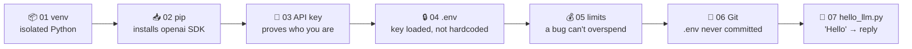

<div align="center">

# 🏁 Concept 07 — Hello LLM (Phase 0 Milestone)


**Everything from Phase 0 comes together: send "Hello" to a real LLM and print its reply.**

[⬅️ 06 · Git basics](../06-git-basics/) · [📂 Phase 0 index](../README.md) · [🗺️ Roadmap](../../README.md) · Next ➡️ Phase 1 · LLM Foundations

</div>

---

## 🎯 What you'll be able to do after this

- [ ] Explain what an SDK is and why we use one instead of raw HTTP
- [ ] Install the OpenAI SDK and record it
- [ ] Send a prompt to a model and print the reply
- [ ] Recognize the common first-call errors and fix them

---

## 🧠 1. Intuition

An **LLM** (Large Language Model) is a program that **reads text and writes text back**. You'll learn how it really works in Phase 1; for now it's enough to know you send words and get words back.

The **SDK** is a **phone with the number pre-saved**. In Concept 03 you "dialed by hand" with `requests`: URL, headers, JSON parsing. The SDK does all of that for you, so your code reads like plain English: *"client, create a response with this model and this input."*

Every earlier concept has a job in this one script:



---

## ⚙️ 2. Technical Explanation

### SDK vs raw HTTP

An **SDK** (Software Development Kit), also called a **client library**, is a package a provider publishes to make their API easy to use from one language.

| | Raw HTTP (`requests`, Concept 03) | OpenAI SDK (`openai`) |
|---|---|---|
| URL | You type it | Built in |
| Auth header | You build `Authorization: Bearer …` | Reads `OPENAI_API_KEY` from the environment automatically |
| Response | Raw JSON you dig through | Python objects with helpers like `.output_text` |
| Errors | Check status codes yourself | Raises named **exceptions** (`AuthenticationError`, `RateLimitError`, …) |
| Retries | You write them | Retries some temporary failures automatically (2 retries by default) |

Under the hood the SDK **still sends an HTTP request** to `https://api.openai.com/v1/responses`. Same idea as Concept 03, just packaged for you.

### The Responses API

OpenAI has two main text-generation endpoints:

| Endpoint | Status |
|---|---|
| **Responses API** (`client.responses.create`) | ✅ OpenAI's current recommended API; used in their quickstart. **We use this.** |
| Chat Completions API (`client.chat.completions.create`) | Older, still widely used; you'll see it in many tutorials and codebases |

The full anatomy of a call (messages, roles, parameters) is **Phase 1**. Today we only use two parameters: `model` and `input`.

### Which model?

A **model ID** is the exact name of the model you want, as a string. Checked on OpenAI's models and pricing pages (Sep 2026):

| Model ID | Positioned for | Price per **1M** tokens (input / output) |
|---|---|---|
| `gpt-6-astra` | Hardest, most complex work | $10.00 / $50.00 |
| `gpt-6-sol` | Balance of intelligence and cost | $2.00 / $10.00 |
| **`gpt-6-luna`** ⭐ | **Cost-sensitive, high-volume tasks** | **$0.10 / $0.50** |

We use **`gpt-6-luna`**: it's by far the cheapest current model, and "say hello" doesn't need a genius.

> [!NOTE]
> Prices are per **1 million tokens**. **Input** tokens = what you send; **output** tokens = what the model writes back (output costs more). Exact token counting and cost math are Phase 1 topics.

---

## 🔢 3. Tiny Example

A rough cost estimate for one "Hello" call (token counts are **estimates**; we'll measure them exactly in Phase 1):

| | Tokens (approx.) | Price per token | Cost |
|---|:-:|---|---|
| Input `"Hello"` + overhead | ~10 | $0.10 ÷ 1,000,000 | $0.000001 |
| Output (a friendly greeting) | ~20 | $0.50 ÷ 1,000,000 | $0.00001 |
| **Total** | | | **≈ $0.00001** |

That's about **one thousandth of a cent**. Your $5 of credit would cover roughly **hundreds of thousands** of calls like this.

---

## 💻 4. Code & Commands

> ⚠️ Run in the **terminal with the venv active**, or with PyCharm set to `AI-claude/.venv/bin/python`. The `openai` package exists **only in the venv**, so `/usr/bin/python3` will fail with `ModuleNotFoundError: No module named 'openai'`.

```bash
cd /Users/sujithkumar/Documents/ai/AI-claude
```
```bash
source .venv/bin/activate
```

### Step 1 — Install the SDK and record it

```bash
python -m pip install openai
```

Watch pip pull in several **transitive** dependencies (Concept 02): `httpx2` (the HTTP engine), `pydantic` (data validation, which you'll use directly in Phase 8), `anyio`, `jiter` and more.

Update **`requirements.txt`**:

```text
requests==2.34.2
python-dotenv==1.2.3
openai==3.19.2
```

### Step 2 — The milestone script: [`hello_llm.py`](hello_llm.py)

```python
from dotenv import load_dotenv
from openai import OpenAI

MODEL = "gpt-6-luna"

load_dotenv()

client = OpenAI()

response = client.responses.create(
    model=MODEL,
    input="Hello",
)

print(response.output_text)
```

**Line by line**

| Line | What it does |
|---|---|
| `from dotenv import load_dotenv` | Concept 04's loader |
| `from openai import OpenAI` | The SDK's **client class**: the object that talks to OpenAI's servers |
| `MODEL = "gpt-6-luna"` | The model ID as a **constant** at the top, so it's easy to find and change later |
| `load_dotenv()` | Copies `OPENAI_API_KEY` from `AI-claude/.env` into the environment |
| `client = OpenAI()` | Creates the client. With no arguments it **reads `OPENAI_API_KEY` from the environment by itself**. That's why the variable name matters |
| `client.responses.create(...)` | Sends the HTTP request to the Responses API and **waits** for the answer |
| `model=MODEL` | Which model should answer |
| `input="Hello"` | What you're saying to it (the **prompt**: the text you send to a model) |
| `response.output_text` | A convenience helper that joins all the text the model produced into one string |

```bash
python phase-00-setup/07-hello-llm/hello_llm.py
```

Expected: a friendly greeting. The exact words **will differ every run**; that's normal for LLMs (Phase 1 explains why). Something like:

```text
Hello! How can I help you today?
```

🎉 **That's the Phase 0 "done when": a script sends "Hello" to an LLM and prints the reply.**

### Step 3 — Check your usage

Open the OpenAI dashboard → **Usage**. After a few minutes you'll see your request and its tiny cost, attributed to the key's project. That's Concept 05's tracking in action.

### Step 4 — Commit the milestone

```bash
git status --short
```

You should see `requirements.txt` modified and the new `07-hello-llm/` folder, and **no `.env`**. Then:

```bash
git add .
```
```bash
git commit -m "Phase 0 complete: first LLM call"
```

---

## 🚑 First-call errors and fixes

The SDK raises named **exceptions** (Python's way of signaling an error) that map to HTTP status codes:

| Error | HTTP | Likely cause | Fix |
|---|:-:|---|---|
| `ModuleNotFoundError: No module named 'openai'` | — | Running the wrong Python (e.g. `/usr/bin/python3`) | Activate the venv / set the PyCharm interpreter |
| `OpenAIError: Missing credentials. Please pass an api_key ... or set the OPENAI_API_KEY ...` | — | `OPENAI_API_KEY` not in the environment | Check `AI-claude/.env` and that `load_dotenv()` runs before `OpenAI()` |
| `AuthenticationError` | 401 | Wrong or revoked key | Re-check the key in `.env` (Concept 03's script can test it) |
| `NotFoundError` / `PermissionDeniedError` | 404 / 403 | Model ID typo, or the key's project can't use that model | Check spelling; check the project's allowed models in the dashboard |
| `RateLimitError` | 429 | Rate limit, **or** no credit / spend limit hit | Read `error.code` (Concept 05) |
| `APIConnectionError` | — | No internet, VPN or proxy problem | Check your connection |

---

## 🎤 5. Interview Answer

> *"For a first integration I use the provider's official SDK rather than raw HTTP: it handles authentication from the `OPENAI_API_KEY` environment variable, request building, typed responses, some automatic retries and named exceptions. The minimal flow is: load config from the environment, create a client once, call `responses.create` with a model ID and an input, and read `output_text`. I pin the SDK version in `requirements.txt`, and I pick the cheapest model that does the job, keeping the model ID in one constant so it's easy to swap."*

---

## 📌 Cheat Sheet

| Task | Code / command |
|---|---|
| Install SDK | `python -m pip install openai` |
| Create client | `client = OpenAI()` (reads `OPENAI_API_KEY`) |
| Pass the key explicitly | `OpenAI(api_key=os.getenv("OPENAI_API_KEY"))` |
| Send a prompt | `client.responses.create(model="gpt-6-luna", input="Hello")` |
| Get the text | `response.output_text` |
| Check spend | Dashboard → Usage |

---

## ⚠️ Common Mistakes

| Mistake | Symptom | Fix |
|---|---|---|
| IDE runs system Python | `ModuleNotFoundError: No module named 'openai'` | Use the venv interpreter |
| `OpenAI()` created before `load_dotenv()` | `OpenAIError: Missing credentials` | Load the environment first |
| Hardcoding the key: `OpenAI(api_key="sk-...")` | Key ends up in Git | Always read it from the environment |
| Using the most expensive model for everything | Needless cost | Start with the cheapest model that works |
| Expecting the same reply every run | Confusion when tests "fail" | LLM output varies; Phase 1 covers `temperature` |
| Model ID copied from an old tutorial | 404 model not found | Check the current models page; model names change often |

---

## 📖 Glossary

| Term | Plain meaning |
|---|---|
| **LLM (Large Language Model)** | A program that takes text in and generates text out *(explained properly in Phase 1)* |
| **SDK / client library** | A provider's package that wraps their HTTP API in easy functions for one language |
| **Client** | The SDK object you create once and use to send requests |
| **Responses API** | OpenAI's current recommended endpoint for generating model output |
| **Chat Completions API** | OpenAI's older text-generation endpoint, still common in tutorials |
| **Model ID** | The exact string naming a model, e.g. `gpt-6-luna` |
| **Prompt** | The text you send to a model |
| **Input / output tokens** | Tokens you send / tokens the model generates; priced separately |
| **Exception** | Python's way of signaling an error that stops the program unless handled |
| **Constant** | A variable meant never to change, written in `UPPER_CASE` by convention |

---

<div align="center">

**Status:** 🟡 In progress → say **`done`** after the script prints a reply and the milestone is committed.

[⬅️ 06 · Git basics](../06-git-basics/) · [📂 Phase 0 index](../README.md) · [🗺️ Roadmap](../../README.md)

</div>

<sub>Sources: [OpenAI — Quickstart](https://developers.openai.com/api/docs/quickstart) · [OpenAI — Models](https://developers.openai.com/api/docs/models) · [OpenAI — Pricing](https://developers.openai.com/api/docs/pricing) · [PyPI — openai](https://pypi.org/project/openai/)</sub>
