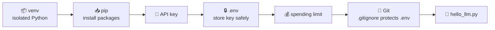

# 🧱 Phase 0 — Setup

**Build a clean, safe Python workspace that can talk to an LLM.**

[🗺️ Back to roadmap](../README.md)

---

## 🏁 Goal

> **Done when:** a script sends `"Hello"` to an LLM and prints the reply.

## 🧩 Concepts

| # | Concept | What you learn | Status |
|:-:|---|---|:-:|
| 01 | [Virtual environment](01-virtual-environment/) | Give each project its own isolated Python packages | ✅ |
| 02 | [pip & `requirements.txt`](02-pip-and-requirements/) | Install packages and record exact versions | ✅ |
| 03 | [API key](03-api-key/) | What an API key is and how to get one | ✅ |
| 04 | [`.env` + `python-dotenv`](04-env-and-dotenv/) | Keep secrets out of your code | ✅ |
| 05 | [API spending limits](05-api-spending-limits/) | Make sure a bug can't cost you real money | ✅ |
| 06 | [Git basics](06-git-basics/) | Track changes and never commit secrets | ✅ |
| 07 | [🏁 Hello LLM](07-hello-llm/) | Your first API call | 🟡 |

**Legend:** ✅ Done · 🟡 In progress · ⬜ Not started

## 🔗 How the pieces connect

