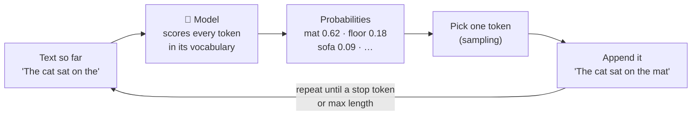

<div align="center">

# 🧠 Concept 01 — What an LLM Is


**An LLM is a next-token predictor: it writes by repeatedly guessing the next small piece of text. It has no memory between calls and no internet unless you give it one.**

[📂 Phase 1 index](../README.md) · [🗺️ Roadmap](../../README.md) · Next ➡️ [02 · Tokens and tiktoken](../02-tokens-and-tiktoken/)

</div>

---

## 🎯 What you'll be able to do after this

- [x] Explain "next-token prediction" in plain words
- [x] Explain training vs inference, and where an LLM's knowledge comes from
- [x] Explain why replies vary from run to run
- [x] Prove that an LLM has **no memory** between API calls
- [x] Explain why it has **no internet** by default and what a knowledge cutoff is

---

## 🧠 1. Intuition

Your phone keyboard suggests the next word as you type. Tap the suggestion again and again, and it "writes" a sentence.

An **LLM** is that same idea, scaled up enormously. It has read a gigantic amount of text, so its guesses about "what comes next" are good enough to answer questions, write code and hold conversations.

| | 📱 Phone autocomplete | 🧠 LLM |
|---|---|---|
| Learned from | Your own typing | A huge share of books, websites, code |
| Looks at | The last word or two | The **entire** text so far (up to a limit, see Concept 03) |
| Output | One word suggestion | Keeps predicting, piece by piece, until a whole answer is done |

Three facts to take away:

1. 🔮 **It predicts.** It doesn't look answers up; it generates the most plausible continuation.
2. 🧽 **No memory.** Each API call starts from a blank slate.
3. 🔌 **No internet by default.** It only knows what it learned during training plus what you send it.

---

## ⚙️ 2. Technical Explanation

### The name

| Word | Meaning |
|---|---|
| **Language Model** | A program that predicts the next piece of text given the text before it |
| **Large** | Trained on enormous text, with **billions of parameters** |

**Parameters** (also called **weights**) are the numbers inside the model that were adjusted during training. They are the model's "knowledge", stored as numbers.

### Two stages: training vs inference

| Stage | Who does it | What happens | Cost |
|---|---|---|---|
| **Training** | The provider (OpenAI, Anthropic, …) | The model reads huge amounts of text and its parameters get tuned to predict the next piece well | Months, thousands of specialized chips, huge cost. *Not in our roadmap* |
| **Inference** | **You**, via the API | The trained model **uses** its frozen parameters to generate text for your input | Fractions of a cent per call |

After basic training, providers train further on examples of helpful conversations (**instruction tuning**). That's why `"Hello"` gets *"Hi! How can I help you today?"* instead of just a random continuation of the word "Hello".

### Next-token prediction: the core loop

A **token** is a small piece of text: a word, part of a word, or punctuation *(Concept 02 goes deep)*. The model's **vocabulary** is the fixed list of all tokens it knows (on the order of 100,000+).



| Term | Meaning |
|---|---|
| **Probability distribution** | A score between 0 and 1 for every possible next token; all scores add up to 1 |
| **Sampling** | Picking the next token *at random, weighted by those probabilities*: a 0.62 token is picked ~62% of the time |
| **Autoregressive** | Each new token is fed back in as input for predicting the next one |
| **Stop token** | A special token meaning "the answer is finished" |

**Why replies vary:** because of sampling, the same input can take different paths. Run `hello_llm.py` twice and the wording changes. *(Concept 07 · Temperature controls how adventurous the sampling is.)*

**Why it can be confidently wrong:** it generates the *most plausible-sounding* text, not verified facts. Plausible and true usually overlap, but not always. *(Concept 10 · Hallucinations.)*

### 🧽 No memory

The parameters are **frozen** during inference. Nothing you send changes them. Each API call is **independent**: the model sees *only* the text in that one request.

> [!NOTE]
> So how does ChatGPT "remember" the conversation? The **application** resends the earlier messages with every new request. The model itself remembers nothing. You'll build exactly this in Concept 06 (statelessness and chat history). *(The Responses API also has an optional `previous_response_id` parameter that does this resending for you on the server side. Same idea, covered there.)*

### 🔌 No internet by default

The model's knowledge = its training data, which stops at a **knowledge cutoff** date. It can't browse, check the weather or read today's news. It doesn't even know **today's date** unless you tell it.

Apps give LLMs fresh information in two ways:
- **Put the information in the prompt** (that's **RAG**, Phase 3)
- **Let the model call tools**, e.g. a web search tool (Phase 8)

---

## 🔢 3. Tiny Example

**Training text** (our whole "internet"): 5 short sentences. Count what follows `the`:

| Next word | Times seen | Probability |
|---|:-:|:-:|
| cat | 3 | 3/10 = **0.3** |
| mat | 2 | 0.2 |
| dog | 2 | 0.2 |
| sofa | 1 | 0.1 |
| food | 1 | 0.1 |
| fish | 1 | 0.1 |
| **Total** | **10** | **1.0** |

Generating from `the`: sample → `cat` (30% chance) → after `cat`, sample → `sat` → `on` → `the` → `mat` → `.` → stop.

**Result:** `the cat sat on the mat .` Run it again and you might get `the dog ate the fish .`

---

## 💻 4. Code

### Part A — Build a toy language model from scratch: [`toy_next_word.py`](toy_next_word.py)

No API and no cost. A **bigram model**: it predicts the next word from only the **one** previous word. Real LLMs are vastly more complex, but the *loop* is the same.

**Piece 1: "training" = counting what follows what**

```python
import random
from collections import Counter, defaultdict

TRAINING_TEXT = """
the cat sat on the mat .
the cat sat on the sofa .
the dog sat on the mat .
the dog ate the food .
the cat ate the fish .
"""

follow_counts = defaultdict(Counter)
words = TRAINING_TEXT.split()
for current_word, next_word in zip(words, words[1:]):
    follow_counts[current_word][next_word] += 1
```

| Line | What it does |
|---|---|
| `Counter` | A dict that counts things; missing keys start at 0 |
| `defaultdict(Counter)` | A dict that auto-creates an empty `Counter` for any new key, so `follow_counts["the"]` always works |
| `TRAINING_TEXT.split()` | Splits on whitespace → `['the', 'cat', 'sat', ...]`. The `.` is a separate "word" that marks the end |
| `zip(words, words[1:])` | Pairs each word with the one after it: `('the','cat')`, `('cat','sat')`, … |
| `follow_counts[current][next] += 1` | Records "`next` came after `current`" once more. These counts are our model's **parameters** |

**Piece 2: counts → probabilities**

```python
def next_word_probabilities(word):
    counts = follow_counts[word]
    total = sum(counts.values())
    return {candidate: round(count / total, 2) for candidate, count in counts.items()}
```

Divides each count by the total, so the scores add up to 1: a **probability distribution**. `round(..., 2)` just keeps the printout tidy.

**Piece 3: the generation loop (next-token prediction)**

```python
def generate(start_word, max_words=10):
    output = [start_word]
    for _ in range(max_words):
        probabilities = next_word_probabilities(output[-1])
        if not probabilities:
            break
        candidates = list(probabilities.keys())
        weights = list(probabilities.values())
        next_word = random.choices(candidates, weights=weights)[0]
        output.append(next_word)
        if next_word == ".":
            break
    return " ".join(output)
```

| Line | What it does | LLM equivalent |
|---|---|---|
| `output[-1]` | The last word so far | The model reads the **whole** text; ours reads only 1 word |
| `if not probabilities: break` | Word never seen in training → nothing to predict | Knowledge limited to training data |
| `random.choices(candidates, weights=weights)[0]` | Weighted random pick. Returns a list, so `[0]` takes the one item | **Sampling** |
| `output.append(next_word)` | Feed the prediction back in | **Autoregressive** |
| `if next_word == ".": break` | End of sentence | **Stop token** |
| `max_words=10` | Safety cap on length | **Max output tokens** (Concept 08) |

**Run it:**

```bash
python phase-01-llm-foundations/01-what-is-an-llm/toy_next_word.py
```

Real output (the "Generated" lines change every run):

```text
After 'the' : {'cat': 0.3, 'mat': 0.2, 'sofa': 0.1, 'dog': 0.2, 'food': 0.1, 'fish': 0.1}
After 'sat' : {'on': 1.0}

Generated   : the mat .
Generated   : the dog ate the fish .
Generated   : the cat ate the dog ate the mat .
Unknown word: pizza
```

**Read the output like an engineer:**

| Observation | Lesson |
|---|---|
| `'sat'` → `{'on': 1.0}` | In training, `sat` was always followed by `on`, so the model is 100% sure |
| Different sentences each run | **Sampling** → varied output |
| `the cat ate the dog ate the mat .` | Grammatical-looking **nonsense**: each step was plausible, the whole is false. That's a tiny **hallucination**, and it happens because the model only looked at 1 previous word |
| `pizza` → nothing generated | It can't produce what it never learned: **knowledge = training data** |

### Part B — Prove "no memory" and "no internet" with a real model: [`no_memory_demo.py`](no_memory_demo.py)

Three **separate** calls. Cost: roughly a hundredth of a cent in total.

```python
from dotenv import load_dotenv
from openai import OpenAI

MODEL = "gpt-6-luna"

load_dotenv()
client = OpenAI()

first = client.responses.create(
    model=MODEL,
    input="My name is Sujith. Please remember it.",
)
print("Call 1 reply:", first.output_text)
print()

second = client.responses.create(
    model=MODEL,
    input="What is my name?",
)
print("Call 2 reply:", second.output_text)
print()

third = client.responses.create(
    model=MODEL,
    input="What is today's date? Answer in one short sentence.",
)
print("Call 3 reply:", third.output_text)
```

The setup lines are the same as `hello_llm.py`. What's new: **three independent calls**, stored as `first`, `second`, `third`.

```bash
python phase-01-llm-foundations/01-what-is-an-llm/no_memory_demo.py
```

**What to expect**

| Call | Likely reply | Lesson |
|---|---|---|
| 1 | "Nice to meet you, Sujith! …" (it may even *say* it will remember) | It's only generating a polite continuation. Nothing is saved |
| 2 | "I don't know your name…" | 🧽 **No memory**: call 2 never saw call 1's text |
| 3 | "I can't know today's date…", **or** a confident but wrong date | 🔌 **No internet / no clock**: at best it guesses from training data |

> [!TIP]
> Call 1 claiming *"I'll remember that!"* is a mini-hallucination: the most plausible polite reply, not a fact about what the system does.

---

## 🎤 5. Interview Answer

> *"An LLM is a neural network trained to predict the next token given the text so far. At inference it generates autoregressively, sampling one token at a time from a probability distribution, which is why outputs vary and can sound confident while being wrong. Its weights are frozen at inference, so it has no memory between calls (chat apps resend the history) and no internet or knowledge past its training cutoff unless we inject context through RAG or give it tools."*

---

## 📌 Cheat Sheet

| Fact | One-liner |
|---|---|
| What it does | Predicts the next token, over and over |
| Knowledge source | Training data, frozen at a knowledge cutoff |
| Why output varies | Sampling from probabilities |
| Why it can be wrong | Optimizes for *plausible*, not *true* |
| Memory | None between calls; apps resend history |
| Internet | None by default; add via RAG (Phase 3) or tools (Phase 8) |
| Today's date | Unknown unless you put it in the prompt |

---

## ⚠️ Common Misconceptions

| Misconception | Reality |
|---|---|
| "It searches the internet for answers" | It generates from learned patterns; no browsing unless given a tool |
| "It learns from my conversations as I chat" | Weights are frozen during inference; nothing you send changes the model |
| "It said it will remember, so it will" | That's just a plausible reply; the next API call starts blank |
| "It looks up facts in a database" | There's no lookup: facts are compressed into parameters, imperfectly |
| "Same input → same output" | Sampling makes outputs vary *(controllable, Concept 07)* |
| "It knows today's date" | Only if you tell it |

---

## 📖 Glossary

| Term | Plain meaning |
|---|---|
| **LLM (Large Language Model)** | A very large model trained to predict the next token of text |
| **Parameters / weights** | The learned numbers inside a model; its stored "knowledge" |
| **Training** | Tuning the parameters on huge text; done once by the provider |
| **Inference** | Using a trained model to generate output; what API calls do |
| **Instruction tuning** | Extra training on example conversations so the model follows instructions and chats |
| **Token** | A small piece of text: a word, part of a word, or punctuation *(Concept 02)* |
| **Vocabulary** | The fixed list of all tokens a model knows |
| **Next-token prediction** | Scoring every possible next token given the text so far |
| **Probability distribution** | Scores from 0 to 1 over all options, summing to 1 |
| **Sampling** | Randomly picking the next token, weighted by probability |
| **Autoregressive** | Each generated token is fed back in to predict the next |
| **Stop token** | A special token that ends generation |
| **Knowledge cutoff** | The date the training data ends |
| **Bigram model** | A toy language model that predicts from only the previous 1 word |
| **Hallucination** | Fluent, confident output that is false *(Concept 10)* |

---

<div align="center">

**Status:** ✅ DONE · completed Mon 28 Sep 2026

[📂 Phase 1 index](../README.md) · [🗺️ Roadmap](../../README.md)

</div>
