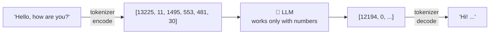

<div align="center">

# 🔤 Concept 02 — Tokens and `tiktoken`


**LLMs don't read letters or words. They read tokens. Tokens are what you pay for and what fills the model's memory limit.**

[⬅️ 01 · What an LLM is](../01-what-is-an-llm/) · [📂 Phase 1 index](../README.md) · [🗺️ Roadmap](../../README.md) · Next ➡️ [03 · Context window](../03-context-window/)

</div>

---

## 🎯 What you'll be able to do after this

- [x] Explain what a token is and why models use them
- [x] Estimate tokens from text with the rule of thumb
- [x] Count tokens exactly with `tiktoken`
- [x] Read the real token usage from an API response
- [x] Explain why names, numbers and non-English text cost more tokens

---

## 🧠 1. Intuition

Think of **LEGO bricks**. The model can't handle raw text; it only understands a fixed set of bricks. Before your text reaches the model, it's broken into bricks from that set:

- Common words are **one big brick**: `Hello` → `[Hello]`
- Rare words are built from **several small bricks**: `unbelievable` → `[un][bel][ievable]`
- Anything can be built, because the smallest bricks are single characters (even single bytes)

Those bricks are **tokens**. The model reads tokens, predicts tokens (Concept 01), and you're **billed per token**.

---

## ⚙️ 2. Technical Explanation

### Text → token IDs → model → token IDs → text



| Term | Meaning |
|---|---|
| **Token** | One piece of text from the model's fixed vocabulary: a word, part of a word, punctuation, a space+word, or even a single byte |
| **Token ID** | The integer that represents a token. The model only ever sees these numbers |
| **Tokenizer** | The program that converts text → token IDs (**encode**) and back (**decode**) |
| **Encoding** (in `tiktoken`) | A specific tokenizer with its own vocabulary, e.g. `o200k_base` |
| **Vocabulary size** | How many distinct tokens exist. `o200k_base` has **~200,000** |

### Why not just use letters or whole words?

| Approach | Problem |
|---|---|
| One token per **letter** | Texts become very long sequences → slow and expensive |
| One token per **whole word** | Infinite words (names, typos, new slang) can't all fit in a vocabulary |
| **Subword tokens** ✅ | Common words = 1 token; rare words = a few pieces; nothing is ever "unknown" |

Tokenizers learn these pieces with an algorithm called **BPE** (Byte Pair Encoding): start from single bytes, then repeatedly **merge the most frequent neighboring pair** into a new token, until the vocabulary reaches its target size. Frequent text ends up with big tokens; rare text stays in small pieces.

### Rules of thumb for English

| | ≈ |
|---|---|
| 1 token | ~4 characters |
| 1 token | ~¾ of a word |
| 100 tokens | ~75 words |

Our test paragraph (simple English): **900 characters, 180 words → 201 tokens** ≈ 4.5 characters per token. Rules of thumb are for *estimating*; `tiktoken` or the API gives the *exact* count.

### What costs more tokens

| Text type | Why |
|---|---|
| **Names, rare words** | Not in the vocabulary as whole words: `Sujith` → `S` `uj` `ith` = 3 |
| **Numbers, dates** | Split into chunks: `2026-09-28` → 6 tokens |
| **Non-English** | Less training text → fewer merged tokens. Newer tokenizers are much better at this (see below) |
| **Code** | Symbols and indentation add up |
| **Leading space** | `"hello"` and `" hello"` are **different** tokens (different IDs) |

### `tiktoken` and which encoding to use

**`tiktoken`** is OpenAI's open-source tokenizer library. It counts tokens **locally**: no API call, no cost, no key.

| Encoding | Used by |
|---|---|
| `cl100k_base` (~100k vocab) | Older models (GPT-4, GPT-3.5) |
| `o200k_base` (~200k vocab) | GPT-4o, o-series, GPT-5 family (per `tiktoken 0.14.0`'s own model table) |

> [!IMPORTANT]
> **Real-world snag, found while building this lesson:** `tiktoken.encoding_for_model("gpt-6-luna")` fails with *"Could not automatically map gpt-6-luna to a tokeniser"*. The newest models aren't in tiktoken's table yet. We use `get_encoding("o200k_base")` (the latest general encoding) as a **close estimate**, and treat the API's reported `usage` as the **source of truth**. Script 2 checks how close the estimate is.

### Why tokens matter to a backend engineer

| Reason | Where it comes up |
|---|---|
| 💵 **Cost:** you pay per input token + per output token | Concept 12 · Cost calculation |
| 📏 **Limits:** a model can only see so many tokens at once | Concept 03 · Context window |
| ✂️ **Reply length** is capped in tokens, not words | Concept 08 · Max output tokens |
| 🧩 **Chunking** documents for RAG is often done by token count | Phase 3 |
| 🚦 **Rate limits** are counted in tokens per minute (TPM) | Phase 0 · Concept 05 |

---

## 🔢 3. Tiny Example

Real output from `o200k_base`:

| Text | Characters | Tokens | Pieces |
|---|:-:|:-:|---|
| `Hello` | 5 | **1** | `Hello` |
| `Hello, how are you?` | 19 | **6** | `Hello` `,` ` how` ` are` ` you` `?` |
| `unbelievable` | 12 | **3** | `un` `bel` `ievable` |
| `Sujith` | 6 | **3** | `S` `uj` `ith` |
| `2026-09-28` | 10 | **6** | `202` `6` `-` `09` `-` `28` |
| `வணக்கம்` (Tamil "hello") | 7 | **3** | `வ` `ண` `க்கம்` |

**Same word, two tokenizers:** `வணக்கம்` = **11 tokens** in the older `cl100k_base`, but **3 tokens** in `o200k_base`. That's 3.7× cheaper, because the bigger vocabulary has more non-English pieces.

---

## 💻 4. Code

### Step 1 — Install and record

```bash
python -m pip install tiktoken
```

`requirements.txt` becomes:

```text
requests==2.34.2
python-dotenv==1.2.3
openai==3.19.2
tiktoken==0.14.0
```

*(On first use, tiktoken downloads the encoding's vocabulary file once and caches it, so the first run needs internet.)*

### Step 2 — Look inside tokens: [`explore_tokens.py`](explore_tokens.py)

No API, no cost.

```python
import tiktoken

encoding = tiktoken.get_encoding("o200k_base")

texts = [
    "Hello",
    " hello",
    "Hello, how are you?",
    "unbelievable",
    "Sujith",
    "2026-09-28",
    "வணக்கம்",
]

for text in texts:
    token_ids = encoding.encode(text)
    pieces = [encoding.decode([token_id]) for token_id in token_ids]
    print(f"{text!r:<22} {len(token_ids)} tokens  ids={token_ids}  pieces={pieces}")

print()
round_trip = encoding.decode(encoding.encode("Hello, how are you?"))
print("Round trip:", round_trip)

paragraph = "The quick brown fox jumps over the lazy dog. " * 20
print(f"Paragraph: {len(paragraph)} characters, {len(paragraph.split())} words, "
      f"{len(encoding.encode(paragraph))} tokens")
```

**Line by line**

| Line | What it does |
|---|---|
| `tiktoken.get_encoding("o200k_base")` | Loads that tokenizer (vocabulary + merge rules) |
| `encoding.encode(text)` | Text → list of token IDs (integers) |
| `encoding.decode([token_id])` | One ID → its text piece. `decode` expects a **list**, hence `[token_id]` |
| `[... for token_id in token_ids]` | List comprehension: the text piece for every ID |
| `{text!r:<22}` | `!r` prints the `repr` (with quotes, so the leading space in `' hello'` is visible); `:<22` left-aligns in 22 characters |
| `encoding.decode(encoding.encode(...))` | **Round trip**: encode then decode gives back the exact original text. Tokenization loses nothing |
| `"..." * 20` | Repeats the sentence 20 times to make a paragraph |
| `len(paragraph.split())` | Word count (split on spaces) |

```bash
python phase-01-llm-foundations/02-tokens-and-tiktoken/explore_tokens.py
```

Output:

```text
'Hello'                1 tokens  ids=[13225]  pieces=['Hello']
' hello'               1 tokens  ids=[40617]  pieces=[' hello']
'Hello, how are you?'  6 tokens  ids=[13225, 11, 1495, 553, 481, 30]  pieces=['Hello', ',', ' how', ' are', ' you', '?']
'unbelievable'         3 tokens  ids=[373, 9880, 45794]  pieces=['un', 'bel', 'ievable']
'Sujith'               3 tokens  ids=[50, 5848, 437]  pieces=['S', 'uj', 'ith']
'2026-09-28'           6 tokens  ids=[1323, 21, 12, 3114, 12, 2029]  pieces=['202', '6', '-', '09', '-', '28']
'வணக்கம்'              3 tokens  ids=[6215, 8670, 102411]  pieces=['வ', 'ண', 'க்கம்']

Round trip: Hello, how are you?
Paragraph: 900 characters, 180 words, 201 tokens
```

Notice: `'Hello'` is ID `13225` but `' hello'` is ID `40617`, a completely different token. Spaces usually attach to the **start** of the next word.

### Step 3 — Compare the estimate with the API's real count: [`compare_with_api.py`](compare_with_api.py)

One tiny API call (well under a hundredth of a cent).

```python
import tiktoken
from dotenv import load_dotenv
from openai import OpenAI

MODEL = "gpt-6-luna"
PROMPT = "Explain what a token is in one sentence."

encoding = tiktoken.get_encoding("o200k_base")
print("tiktoken count of prompt :", len(encoding.encode(PROMPT)))

load_dotenv()
client = OpenAI()
response = client.responses.create(model=MODEL, input=PROMPT)

usage = response.usage
print("Reply                    :", response.output_text)
print()
print("API input_tokens         :", usage.input_tokens)
print("API output_tokens        :", usage.output_tokens)
print("  of which reasoning     :", usage.output_tokens_details.reasoning_tokens)
print("API total_tokens         :", usage.total_tokens)
print("tiktoken count of reply  :", len(encoding.encode(response.output_text)))
```

**What's new**

| Line | What it does |
|---|---|
| `response.usage` | Every API response reports the **exact** tokens you were billed for |
| `usage.input_tokens` | Tokens the model **read**: your prompt **plus** a few hidden formatting tokens the API adds around it |
| `usage.output_tokens` | Tokens the model **generated** (billed at the higher output price) |
| `usage.output_tokens_details.reasoning_tokens` | Hidden "thinking" tokens some models generate before answering. **Billed as output, but not shown to you** *(Concept 11)* |
| `usage.total_tokens` | input + output |

```bash
python phase-01-llm-foundations/02-tokens-and-tiktoken/compare_with_api.py
```

**How to read your results**

| Comparison | Expected | Why |
|---|---|---|
| tiktoken prompt (**9**) vs API `input_tokens` | API is a few tokens **higher** | The API wraps your text in formatting tokens you don't see |
| tiktoken reply vs API `output_tokens` | Equal, or API **much higher** | If `reasoning` > 0, the model "thought" in hidden tokens, and you pay for those too |

> [!TIP]
> **Engineering rule:** use `tiktoken` to *estimate before sending* (e.g. "will this document fit?", "roughly what will this cost?"), and log `response.usage` to know the *actual* cost after. You'll do exactly this in the Phase 1 chatbot.

---

## 🎤 5. Interview Answer

> *"LLMs operate on tokens, subword units produced by a tokenizer like BPE, not on characters or words. In English a token averages about four characters, or three-quarters of a word, but names, numbers, code and non-English text tokenize less efficiently. Tokens drive cost, context-window limits and rate limits, so I estimate counts locally with tiktoken before sending, and treat the API's `usage` field, including hidden reasoning tokens, as the source of truth for billing."*

---

## 📌 Cheat Sheet

| Task | Code |
|---|---|
| Install | `python -m pip install tiktoken` |
| Load an encoding | `enc = tiktoken.get_encoding("o200k_base")` |
| Encoding for a known model | `tiktoken.encoding_for_model("gpt-4o")` *(fails for newest models)* |
| Count tokens | `len(enc.encode(text))` |
| IDs → text | `enc.decode(ids)` |
| Exact usage from API | `response.usage.input_tokens` / `.output_tokens` / `.total_tokens` |
| Hidden thinking tokens | `response.usage.output_tokens_details.reasoning_tokens` |
| Quick estimate (English) | tokens ≈ characters ÷ 4 ≈ words ÷ 0.75 |

---

## ⚠️ Common Mistakes

| Mistake | Consequence | Fix |
|---|---|---|
| Treating words as tokens | Cost and limit estimates off by ~25%+ | Count tokens, not words |
| Wrong encoding for the model | Counts silently off | Match the encoding to the model; verify against `usage` |
| Assuming `encoding_for_model` knows every model | `KeyError` for new models | Fall back to `get_encoding("o200k_base")` and verify |
| Trusting tiktoken as the final bill | Misses formatting + reasoning tokens | Log `response.usage` |
| Using the English rule of thumb for Tamil/Hindi/code | Big underestimates | Count with tiktoken |
| Forgetting output tokens cost more | Budget blows up on long replies | Cap replies *(Concept 08)*; price both sides *(Concept 12)* |

---

## 📖 Glossary

| Term | Plain meaning |
|---|---|
| **Token** | A piece of text from the model's fixed vocabulary |
| **Token ID** | The integer that stands for a token |
| **Tokenizer** | Converts text ⇄ token IDs |
| **Encode / decode** | Text → IDs / IDs → text |
| **Encoding (tiktoken)** | A named tokenizer, e.g. `o200k_base` |
| **Vocabulary size** | Number of distinct tokens a tokenizer knows |
| **Subword** | A piece smaller than a word, like `un` or `ievable` |
| **BPE (Byte Pair Encoding)** | Tokenizer-building method: repeatedly merge the most frequent adjacent pair |
| **Round trip** | Encode then decode, giving back the identical text |
| **`usage`** | The token counts an API response reports; the billing source of truth |
| **Reasoning tokens** | Hidden tokens a model generates while "thinking"; billed as output |
| **`repr`** | Python's developer-facing text form of a value; shows quotes and spaces clearly |

---

<div align="center">

**Status:** ✅ DONE · completed Mon 28 Sep 2026

[⬅️ 01 · What an LLM is](../01-what-is-an-llm/) · [📂 Phase 1 index](../README.md) · [🗺️ Roadmap](../../README.md)

</div>

<sub>Sources: [PyPI — tiktoken](https://pypi.org/project/tiktoken/) · [GitHub — openai/tiktoken](https://github.com/openai/tiktoken) · token counts produced with tiktoken 0.14.0 on 28 Sep 2026</sub>
