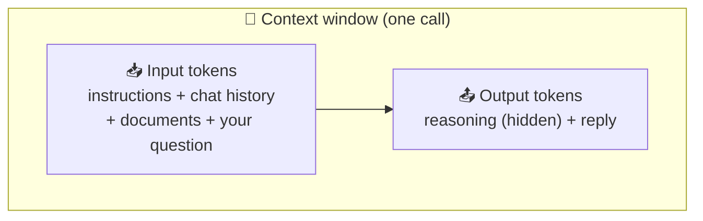

<div align="center">

# 📏 Concept 03 — Context Window


**The maximum number of tokens a model can handle in one call: everything you send *plus* everything it writes back.**

[⬅️ 02 · Tokens and tiktoken](../02-tokens-and-tiktoken/) · [📂 Phase 1 index](../README.md) · [🗺️ Roadmap](../../README.md) · Next ➡️ [04 · API call anatomy](../04-api-call-anatomy/)

</div>

---

## 🎯 What you'll be able to do after this

- [x] Explain what a context window is and what counts toward it
- [x] Look up a model's context window and max output tokens
- [x] Budget input vs output tokens for a call
- [x] Explain what happens when you exceed the window, and the options for handling it
- [x] Explain why "it fits" doesn't mean "it's a good idea"

---

## 🧠 1. Intuition

Picture the model reading through a **fixed-size window**, like a desk that can only hold so many sheets of paper.

- Everything the model can "think about" in one call must be **on the desk**: your instructions, the chat so far, any documents, **and** the answer it's writing.
- If the pile is too big, something has to come off the desk. Whatever's off the desk, the model **cannot see at all**.

Remember Concept 01: the model has **no memory**. So the desk isn't just its working space; for that one call, **it's everything the model knows about you.**

---

## ⚙️ 2. Technical Explanation

### Definition

The **context window** (also called **context length**) is the maximum number of **tokens** (Concept 02) that one API call can involve:

```text
input tokens  +  output tokens (including hidden reasoning tokens)  ≤  context window
```



Two separate limits apply:

| Limit | What it caps | `gpt-6-luna` (checked 30 Sep 2026) |
|---|---|---|
| **Context window** | Input + output together | **1,050,000** tokens |
| **Max output tokens** | Output alone (reasoning + visible reply) | **128,000** tokens |

So a reply can never exceed 128K tokens, and a huge input leaves less room for the reply: with 1,000,000 input tokens, at most 50,000 are left for output.

Other facts from the same model page: **knowledge cutoff 18 May 2026**, and it's a **reasoning model** *(Concept 11)*.

### Why is there a limit at all?

Inside the model, every token is compared with every other token in the window to work out what matters. That work (and the memory it needs) grows **faster than the length**: double the tokens → much more than double the work. So each model is built and served with a maximum length it can handle.

### What happens when you exceed it

In OpenAI's Responses API it's controlled by the **`truncation`** parameter (from the SDK 3.19.2 docs):

| `truncation=` | Behavior |
|---|---|
| `"disabled"` **(default)** | The request **fails** with HTTP **400** (`BadRequestError` in the SDK). Nothing is silently lost |
| `"auto"` | The API **drops items from the beginning of the conversation** until it fits |

**Truncation** means cutting something off to make it fit. Either way, **you** must decide what the model gets to see. In production you usually manage this yourself, e.g.:

| Strategy | Idea | Where you'll learn it |
|---|---|---|
| **Sliding window** | Keep only the most recent N messages/tokens | This lesson's code; Concept 06 |
| **Summarize old history** | Replace old messages with a short summary | Phase 12 (context engineering) |
| **Retrieve only what's relevant** | Don't send the whole PDF, send the 5 relevant chunks | **Phase 3 (RAG)**, the main reason RAG exists |

### "It fits" ≠ "it's a good idea"

A 1M-token window is huge, but filling it has costs:

| Cost | Why |
|---|---|
| 💵 **Money** | You pay for every input token, **on every call**. And for `gpt-6-luna`, prompts over **272,000** input tokens are billed at **2× the input rate and 1.5× the output rate** for the whole request |
| ⏱️ **Latency** | More tokens to read = slower responses. **Latency** = the time you wait for a response |
| 🎯 **Quality** | Models tend to use information at the **start and end** of a long context better than information buried in the **middle** (researchers call this *"lost in the middle"*). More text can mean more distraction |

The long-context-vs-RAG trade-off gets its own lesson in Phase 6.

---

## 🔢 3. Tiny Example

**How big is 1,050,000 tokens?**

| Step | Math | Result |
|---|---|---|
| 1 page | ~500 words ÷ 0.75 words per token | ≈ 667 tokens |
| Pages that fit | 1,050,000 ÷ 667 | **≈ 1,570 pages** |
| Long-context threshold | 272,000 ÷ 667 | ≈ 408 pages |

**What does a full window cost per call?**

| | Math | Cost |
|---|---|---|
| Normal input rate | 1,050,000 × $0.10 / 1,000,000 | $0.105 |
| ×2 long-context rate (> 272K) | $0.105 × 2 | **$0.21 per call** (input only) |
| A 10-message chat that resends it all every time *(Concept 06)* | $0.21 × 10 | **$2.10** |

Compared with our "Hello" at ~$0.00001, that's **~21,000× more per call** (× = "times as much": $0.21 ÷ $0.00001 = 21,000).

**Input vs output budget**, same model:

| Input tokens | Room left in window | Max output allowed | Effective output cap |
|---:|---:|---:|---:|
| 10,000 | 1,040,000 | 128,000 | **128,000** (output limit wins) |
| 1,000,000 | 50,000 | 128,000 | **50,000** (window wins) |

---

## 💻 4. Code

### Simulate a context window from scratch: [`context_budget.py`](context_budget.py)

No API, no cost. We pretend the model's window is only **60 tokens** so we can overflow it with a short chat, then trim like `truncation="auto"` does: **drop the oldest first**.

**Piece 1: settings and a token counter**

```python
import tiktoken

CONTEXT_WINDOW = 60          # a tiny pretend model, so we can overflow it easily
RESERVED_FOR_REPLY = 20      # tokens kept free for the model's answer

encoding = tiktoken.get_encoding("o200k_base")


def count_tokens(messages):
    return sum(len(encoding.encode(message)) for message in messages)
```

| Line | What it does |
|---|---|
| `CONTEXT_WINDOW = 60` | Our fake model's limit. Real `gpt-6-luna`: 1,050,000 |
| `RESERVED_FOR_REPLY = 20` | The window is shared with the output, so we **reserve** room for the answer. Input budget = 60 − 20 = **40** |
| `sum(len(encoding.encode(m)) for m in messages)` | Tokens in every message, added up. The `(... for ...)` inside `sum` is a **generator expression**: like a list comprehension, but it produces values one at a time without building a list |

**Piece 2: trim the oldest messages until it fits**

```python
def trim_to_fit(messages):
    budget = CONTEXT_WINDOW - RESERVED_FOR_REPLY
    trimmed = list(messages)
    while trimmed and count_tokens(trimmed) > budget:
        dropped = trimmed.pop(0)
        print(f"   ✂️  dropped oldest: {dropped!r}")
    return trimmed
```

| Line | What it does |
|---|---|
| `trimmed = list(messages)` | Makes a **copy**, so we don't change the caller's list by surprise |
| `while trimmed and ... > budget` | Keep going while there's something left **and** it's still too big |
| `trimmed.pop(0)` | Removes and returns the item at index 0: the **oldest** message |

**Piece 3: a chat that grows turn by turn**

```python
conversation = []
turns = [
    "Hi, my name is Sujith.",
    "I work as a backend engineer and I mostly write Python.",
    "Right now I am learning how to build AI features.",
    "Today I am studying context windows and tokens.",
    "What is my name?",
]

for turn in turns:
    conversation.append(turn)
    input_budget = CONTEXT_WINDOW - RESERVED_FOR_REPLY
    print(f"Added turn → {count_tokens(conversation)} / {input_budget} input tokens")
    conversation = trim_to_fit(conversation)

print("\nWhat the model would actually see:")
for message in conversation:
    print("  •", message)
```

```bash
python phase-01-llm-foundations/03-context-window/context_budget.py
```

Real output:

```text
Added turn → 9 / 40 input tokens
Added turn → 21 / 40 input tokens
Added turn → 32 / 40 input tokens
Added turn → 41 / 40 input tokens
   ✂️  dropped oldest: 'Hi, my name is Sujith.'
Added turn → 37 / 40 input tokens

What the model would actually see:
  • I work as a backend engineer and I mostly write Python.
  • Right now I am learning how to build AI features.
  • Today I am studying context windows and tokens.
  • What is my name?
```

**Read it like an engineer:** the turns cost 9 + 12 + 11 + 9 tokens. Turn 4 pushed the total to **41 > 40**, so the oldest message (**the one with the name**) was dropped. Now the user asks *"What is my name?"*, and the only message that contained the answer is **gone**. The model will say it doesn't know, or worse, guess.

> [!IMPORTANT]
> This is exactly how long chats "forget" early details. Dropping the oldest is simple but blind: it doesn't know which messages were **important**. Smarter strategies (summaries, retrieval) come later.

**Try it:** change `CONTEXT_WINDOW` to `70` and run again. Does the name survive?

> ✅ **Answer:** yes. Input budget = 70 − 20 = **50**, and all five turns total 9 + 12 + 11 + 9 + 5 = **46 ≤ 50**, so nothing is trimmed. Same chat, bigger window, and the name stays visible.

---

## 🎤 5. Interview Answer

> *"The context window is the maximum number of tokens a model can process in one call, and it's shared between the input (instructions, chat history, documents) and the output, including hidden reasoning tokens; there's also a separate cap on output tokens. If a request exceeds it, the API either rejects it or truncates from the start, so in practice I budget tokens explicitly, reserve room for the reply, and trim, summarize or retrieve only relevant context. Even with million-token windows, stuffing the context raises cost and latency and can hurt accuracy, which is why retrieval still matters."*

---

## 📌 Cheat Sheet

| Fact / task | Value / code |
|---|---|
| Budget rule | input + output ≤ context window |
| `gpt-6-luna` window / max output | 1,050,000 / 128,000 tokens |
| `gpt-6-luna` long-context pricing | > 272K input → 2× input, 1.5× output (whole request) |
| Default on overflow | HTTP 400 (`truncation="disabled"`) |
| Auto-drop oldest | `client.responses.create(..., truncation="auto")` |
| Check before sending | `len(encoding.encode(text))` vs your budget |
| Where to find limits | The model's page on OpenAI's docs (context window, max output, cutoff) |

---

## ⚠️ Common Mistakes

| Mistake | Consequence | Fix |
|---|---|---|
| Forgetting output shares the window | Reply cut short, or request fails | Reserve tokens for the reply |
| Forgetting hidden reasoning tokens | Output budget smaller than expected | Leave extra room for reasoning models |
| Sending entire documents "because they fit" | High cost, slow, worse answers | Send only relevant parts (RAG) |
| Unbounded chat history | Costs grow every turn; eventually a 400 | Trim or summarize history |
| Blind oldest-first trimming | Important early facts (like a name) vanish | Keep key facts or instructions pinned; summarize |
| Assuming all models have the same window | Works on one model, breaks on another | Check each model's page |

---

## 📖 Glossary

| Term | Plain meaning |
|---|---|
| **Context window / context length** | Max tokens (input + output) in one call |
| **Max output tokens** | Separate cap on how many tokens the model may generate |
| **Knowledge cutoff** | The date the model's training data ends |
| **Truncation** | Cutting content off so it fits |
| **`truncation` parameter** | Responses API setting: `"disabled"` (fail with 400) or `"auto"` (drop oldest items) |
| **Sliding window** | Keeping only the most recent part of a conversation |
| **Reserve (tokens)** | Budget set aside in advance, e.g. for the reply |
| **Latency** | The time you wait for a response |
| **Long-context pricing** | Higher per-token rates once input exceeds a threshold |
| **"Lost in the middle"** | Models using info at the start/end of long contexts better than info in the middle |
| **Generator expression** | `(x for x in items)`: produces values one by one without building a list |
| **`list.pop(0)`** | Remove and return the first item of a list |

---

<div align="center">

**Status:** ✅ DONE · completed Wed 30 Sep 2026

[⬅️ 02 · Tokens and tiktoken](../02-tokens-and-tiktoken/) · [📂 Phase 1 index](../README.md) · [🗺️ Roadmap](../../README.md)

</div>

<sub>Sources: [OpenAI — GPT-6 Luna model page](https://developers.openai.com/api/docs/models/gpt-6-luna) · `openai` 3.19.2 SDK docstring for `truncation` · token counts from tiktoken 0.14.0</sub>
