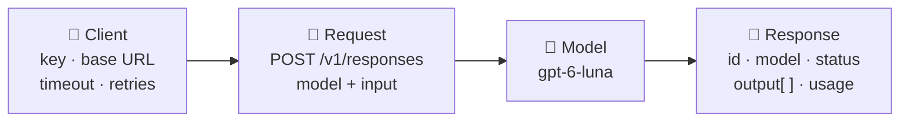

<div align="center">

# 📨 Concept 04 — API Call Anatomy


**Every LLM call has four parts: a client that connects, a model that answers, the input you send, and a response object you unpack.**

[⬅️ 03 · Context window](../03-context-window/) · [📂 Phase 1 index](../README.md) · [🗺️ Roadmap](../../README.md) · Next ➡️ `05 · Message roles`

</div>

---

## 🎯 What you'll be able to do after this

- [x] Name the four parts of an LLM API call and what each does
- [x] Make the same call with raw HTTP **and** with the SDK
- [x] Read the raw JSON response and find the reply text by hand
- [x] Explain what `output_text` does for you
- [x] Configure a client (timeout, retries) and know why you create it once

---

## 🧠 1. Intuition

Ordering food by phone:

| Phone order | API call |
|---|---|
| 📞 The phone line to the restaurant | **Client**: the connection + your credentials |
| 👨‍🍳 Which chef cooks it | **Model**: e.g. `gpt-6-luna` |
| 📝 Your order | **Input**: text, or a list of **messages** |
| 🧾 The delivery bag: food + receipt + order number | **Response**: the reply + usage (tokens) + id + status |

In Phase 0 you used this in one line and printed `output_text`. Today we open the bag and look at **everything** inside.

---

## ⚙️ 2. Technical Explanation

### The four parts



#### 1️⃣ Client

The object that knows **how to reach** the API and **who you are**.

| Setting | Default in `openai` 3.19.2 | Meaning |
|---|---|---|
| `api_key` | read from `OPENAI_API_KEY` | Who you are |
| `base_url` | `https://api.openai.com/v1` | Where to send requests. Changing it lets the same SDK talk to other compatible servers |
| `timeout` | **600 s** to read (5 s to connect) | How long to wait before giving up |
| `max_retries` | **2** | Automatic retries on temporary failures |

> [!TIP]
> A 10-minute default timeout is long for a web backend: a user won't wait that long. Setting something like `timeout=60` is common. Also, **create the client once and reuse it**: it keeps the network connection open between calls (**connection pooling**), so later calls are faster.

#### 2️⃣ Model

A string **model ID**, e.g. `"gpt-6-luna"`. The response's `model` field may show a longer, dated name. That's the exact **snapshot** (a frozen version of the model) that served your request.

#### 3️⃣ Input

The `input` parameter accepts two shapes:

| Shape | Example | When |
|---|---|---|
| **Plain string** | `input="Name one planet."` | Quick one-off prompts |
| **List of messages** | `input=[{"role": "user", "content": "Name one planet."}]` | Real apps: chats, instructions, history |

A **message** is a small dict with a **`role`** (who's speaking) and **`content`** (what they said). The roles (`system`, `user`, `assistant`) are the next concept. For now, only `"user"` = you.

#### 4️⃣ Response

The response is a **JSON object** (Python: a `Response` object from the SDK). Its key fields:

| Field | Meaning |
|---|---|
| `id` | Unique ID of this response, e.g. `resp_…`. Log it; it helps when debugging with the provider |
| `model` | The exact model snapshot that answered |
| `status` | `completed`, or e.g. `incomplete` if the reply was cut off *(Concept 08)* |
| `output` | A **list of output items**. Not just one string! |
| `usage` | Token counts: `input_tokens`, `output_tokens`, `total_tokens` *(Concept 02)* |

### Why `output` is a list

The model can produce **several kinds of items** in one response, each with a `type`:

| Item `type` | What it is |
|---|---|
| `reasoning` | The model's hidden thinking step (reasoning models, Concept 11) |
| `message` | The actual reply. Its `content` is itself a list of parts, e.g. `output_text` |
| `function_call`, `web_search_call`, … | Tool use *(Phase 8)* |

So the reply text is nested: **`output` → item with `type="message"` → `content` → part with `type="output_text"` → `text`**.

`response.output_text` is an SDK **convenience property** that walks this structure and joins all `output_text` parts for you. Script 1 does that walk by hand, so you know what's being hidden.

### Raw HTTP vs SDK

| | Raw HTTP (`requests`) | SDK (`openai`) |
|---|---|---|
| Request | You build URL, headers, JSON body | `client.responses.create(model=..., input=...)` |
| Response | A **dict** from `.json()`: `data["output"][1]["content"][0]["text"]` | An **object** with attributes: `response.output_text` |
| Errors | You check `status_code` | Named exceptions |
| Retries / timeouts | You handle them | Built in |

Same HTTP request underneath: `POST https://api.openai.com/v1/responses`. **POST** = the HTTP method for "send data to create something", here a new response.

---

## 🔢 3. Tiny Example

An **abbreviated** response for `input: "Name one planet. Answer in one word."` (fields trimmed; your IDs, numbers and wording will differ):

```json
{
  "id": "resp_abc123",
  "object": "response",
  "status": "completed",
  "model": "gpt-6-luna",
  "output": [
    { "type": "reasoning", "id": "rs_456", "summary": [] },
    {
      "type": "message",
      "id": "msg_789",
      "role": "assistant",
      "status": "completed",
      "content": [
        { "type": "output_text", "text": "Mars", "annotations": [] }
      ]
    }
  ],
  "usage": { "input_tokens": 16, "output_tokens": 12, "total_tokens": 28 }
}
```

Walk it by hand:

| Step | Path | Value |
|---|---|---|
| 1 | `data["output"]` | list of 2 items |
| 2 | item where `type == "message"` | `output[1]` (not `[0]`! `[0]` is the reasoning item) |
| 3 | `["content"]` | list of 1 part |
| 4 | part where `type == "output_text"` → `["text"]` | **`"Mars"`** |

> [!WARNING]
> Never hardcode `data["output"][0]`. The position of the message item changes depending on whether reasoning or tool items come first. **Search by `type`**, as the script does.

---

## 💻 4. Code

> Terminal, `AI-claude/`, venv active. Each script makes one tiny call (≈ $0.00001).

### Script 1 — The call built by hand: [`raw_http_call.py`](raw_http_call.py)

**Piece 1: build the request**

```python
import json
import os

import requests
from dotenv import load_dotenv

load_dotenv()

url = "https://api.openai.com/v1/responses"
headers = {
    "Authorization": f"Bearer {os.getenv('OPENAI_API_KEY')}",
    "Content-Type": "application/json",
}
body = {
    "model": "gpt-6-luna",
    "input": "Name one planet. Answer in one word.",
}
```

| Line | What it does |
|---|---|
| `url = ".../v1/responses"` | The Responses API endpoint (`v1` = API version 1) |
| `"Authorization": f"Bearer {...}"` | Your key, the same header as Phase 0 · Concept 03 |
| `"Content-Type": "application/json"` | Tells the server "the body I'm sending is JSON" |
| `body = {...}` | The request **body**: the data you send. Just `model` + `input` |

**Piece 2: send it and check the status**

```python
http_response = requests.post(url, headers=headers, json=body, timeout=60)
print("HTTP status:", http_response.status_code)
if http_response.status_code != 200:
    raise SystemExit(http_response.text)
```

| Line | What it does |
|---|---|
| `requests.post(...)` | Sends an HTTP **POST** (Concept 03 used GET, which only reads) |
| `json=body` | `requests` converts the dict to JSON text and sends it as the body |
| `raise SystemExit(http_response.text)` | Not 200? Stop and show the error body (e.g. `insufficient_quota`) instead of crashing later |

**Piece 3: look at everything, then dig out the reply**

```python
data = http_response.json()
print(json.dumps(data, indent=2))

reply_parts = []
for item in data["output"]:
    if item["type"] == "message":
        for part in item["content"]:
            if part["type"] == "output_text":
                reply_parts.append(part["text"])

print("\nReply extracted by hand:", "".join(reply_parts))
```

| Line | What it does |
|---|---|
| `http_response.json()` | Parses the JSON body into a Python dict |
| `json.dumps(data, indent=2)` | Turns the dict back into **pretty-printed** JSON text (2-space indents) so you can read the whole structure |
| outer `for item in data["output"]` | Walk every output item… |
| `if item["type"] == "message"` | …keep only reply messages (skip reasoning/tool items) |
| inner `for part in item["content"]` | A message can have several content parts… |
| `if part["type"] == "output_text"` | …keep only text parts |
| `"".join(reply_parts)` | Glue all text parts into one string. **This is what `output_text` does** |

```bash
python phase-01-llm-foundations/04-api-call-anatomy/raw_http_call.py
```

📖 Scroll through the printed JSON. You'll see many more fields than in the Tiny Example (`temperature`, `tools`, `truncation`, `max_output_tokens`…). Each is a setting that can be sent in the request; several are coming up in this phase.

### Script 2 — Same call with the SDK: [`sdk_call.py`](sdk_call.py)

```python
from dotenv import load_dotenv
from openai import OpenAI

MODEL = "gpt-6-luna"

load_dotenv()

client = OpenAI(timeout=60, max_retries=2)

response = client.responses.create(
    model=MODEL,
    input=[
        {"role": "user", "content": "Name one planet. Answer in one word."},
    ],
)

print("id          :", response.id)
print("model       :", response.model)
print("status      :", response.status)
print("output items:", [item.type for item in response.output])
print("reply       :", response.output_text)
print("usage       :", response.usage.input_tokens, "in /", response.usage.output_tokens, "out")
```

| Line | What it does |
|---|---|
| `OpenAI(timeout=60, max_retries=2)` | Client with an explicit 60 s timeout (instead of 600 s) and 2 retries |
| `input=[{"role": "user", "content": ...}]` | **Message-list** form of input: a list with one user message. Same meaning as the plain string |
| `response.id` / `.model` / `.status` | Attributes (dot access), not dict keys: the SDK turned the JSON into an object |
| `[item.type for item in response.output]` | The **type** of each output item, e.g. `['reasoning', 'message']` |
| `response.output_text` | The convenience property that does Script 1's loop for you |
| `response.usage.input_tokens` | Billing numbers (Concept 02) |

```bash
python phase-01-llm-foundations/04-api-call-anatomy/sdk_call.py
```

**Compare your two outputs:** same reply, same kind of usage numbers. Script 1 needed ~15 lines to do what `output_text` does in one.

---

## 🎤 5. Interview Answer

> *"An LLM API call has four parts: a client configured with credentials, base URL, timeout and retries (created once and reused); a model ID; the input, either a string or a list of role-tagged messages; and a response object. With OpenAI's Responses API it's a POST to `/v1/responses`, and the response carries an id, the model snapshot, a status, usage token counts, and an `output` list of typed items (reasoning, messages, tool calls), where the text lives in message content parts. SDK helpers like `output_text` just walk that structure, which is worth knowing when you need to handle tool calls or incomplete responses."*

---

## 📌 Cheat Sheet

| Task | Code |
|---|---|
| Client with sane timeout | `client = OpenAI(timeout=60, max_retries=2)` |
| String input | `client.responses.create(model=M, input="...")` |
| Message input | `input=[{"role": "user", "content": "..."}]` |
| Reply text | `response.output_text` |
| Item types | `[item.type for item in response.output]` |
| Did it finish? | `response.status == "completed"` |
| Tokens | `response.usage.input_tokens` / `.output_tokens` |
| Raw endpoint | `POST https://api.openai.com/v1/responses` |
| Pretty-print a dict as JSON | `print(json.dumps(data, indent=2))` |

---

## ⚠️ Common Mistakes

| Mistake | Consequence | Fix |
|---|---|---|
| `data["output"][0]["content"][0]["text"]` | `KeyError` when item 0 is a `reasoning` item | Find items **by `type`** |
| Creating a new client per request | Slower (no connection reuse) | Create once, reuse |
| Keeping the 600 s default timeout in a web app | Requests hang for minutes | Set a timeout that fits your use case |
| Ignoring `status` | Using a cut-off reply as if complete | Check `status == "completed"` *(Concept 08)* |
| Not logging `response.id` | Hard to investigate problems later | Log id + usage for every call |
| Mixing up `requests` responses and SDK responses | `.json()` vs attributes confusion | Raw HTTP → dicts; SDK → objects |

---

## 📖 Glossary

| Term | Plain meaning |
|---|---|
| **Client** | The SDK object holding connection settings and credentials |
| **Base URL** | The address all API paths are added to |
| **Timeout** | Max time to wait for a response |
| **Connection pooling** | Reusing open network connections for faster requests |
| **Model snapshot** | A frozen, dated version of a model |
| **Request body** | The data sent with a request (here, JSON) |
| **POST** | HTTP method for sending data to create something |
| **`Content-Type`** | Header saying what format the body is in |
| **Message** | A `{"role": ..., "content": ...}` dict in the input list |
| **Output item** | One typed entry in `response.output` (`message`, `reasoning`, tool calls) |
| **Content part** | One piece inside a message's `content`, e.g. `output_text` |
| **Convenience property** | An SDK shortcut computed from other data, like `output_text` |
| **Pretty-printing** | Printing structured data with indentation for readability |

---

<div align="center">

**Status:** ✅ DONE · completed Wed 30 Sep 2026

[⬅️ 03 · Context window](../03-context-window/) · [📂 Phase 1 index](../README.md) · [🗺️ Roadmap](../../README.md)

</div>

<sub>Sources: `openai` 3.19.2 SDK (defaults: timeout 600 s read / 5 s connect, `max_retries=2`; `Response` fields; output item types) · [OpenAI — Quickstart](https://developers.openai.com/api/docs/quickstart)</sub>
