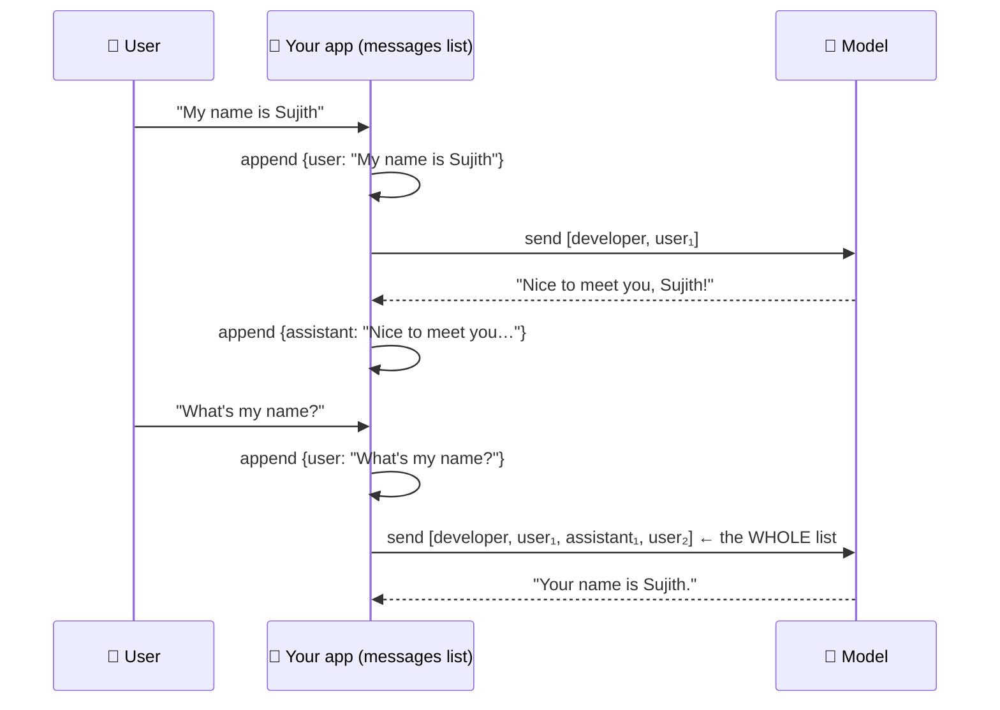

<div align="center">

# 🔁 Concept 06 — Statelessness & Chat History


**The model remembers nothing. Your app gives it "memory" by keeping the conversation in a list and resending the whole list on every turn.**

[⬅️ 05 · Message roles](../05-message-roles/) · [📂 Phase 1 index](../README.md) · [🗺️ Roadmap](../../README.md) · Next ➡️ [07 · Temperature](../07-temperature/)

</div>

---

## 🎯 What you'll be able to do after this

- [x] Explain what "stateless" means and why LLM APIs work this way
- [x] Build chat memory with a `messages` list (append user → call → append assistant)
- [x] Explain why every turn costs more than the last
- [x] Compare client-side history with server-side options (`previous_response_id`, Conversations API)

---

## 🧠 1. Intuition

Imagine a brilliant helper with **total amnesia**. Every time you speak, they've forgotten everything before.

The trick: you keep a **notebook** of the whole conversation, and before every question you **hand them the entire notebook**. They read it top to bottom, then answer as if they'd remembered all along.

| | The helper | Your app |
|---|---|---|
| Amnesia | Forgets after each answer | The model is **stateless** |
| The notebook | Written by you, handed over every time | The **`messages` list**, sent as `input` every call |
| Notebook gets thicker | More to read each time | **More input tokens each turn** → more cost, closer to the context window |

You already saw both halves: Concept 01 proved the model forgets between calls, and Concept 05 showed it trusts whatever `assistant` messages you put in the list. Today you combine them.

---

## ⚙️ 2. Technical Explanation

### Stateless

**Stateless** = the server keeps **no memory** of previous requests; every request must carry everything needed to answer it. (The opposite, **stateful**, means the server remembers things between requests, like a logged-in session.)

LLM inference is stateless by design: the model's weights are frozen (Concept 01), and each call is computed from its input alone. It's also good backend design: any server can handle any request, which makes scaling easy.

### The chat loop



Three steps per turn:

1. **Append** the user's message to `messages`
2. **Send** the **entire** list as `input`
3. **Append** the model's reply as an `assistant` message

Forget step 3 and the model won't know what it said. Forget to send the whole list and it won't know anything at all.

### The cost of memory

Each turn resends everything before it, so:

- **Input tokens per turn grow linearly** (a straight line upward: each turn adds roughly the same amount)
- **Total input tokens over a conversation grow quadratically** (faster and faster: doubling the turns roughly **quadruples** the total)

And eventually the list hits the **context window** (Concept 03), so long chats need trimming or summarizing.

### Who keeps the history: three options

| Option | How | Pros | Cons |
|---|---|---|---|
| **Client-side list** ⭐ (today) | You keep `messages` and resend it | Full control: trim, edit, store in your own database, switch providers (Phase 10) | You manage it |
| **`previous_response_id`** | Pass the previous response's `id`; OpenAI looks up the earlier messages | Less code | Tied to OpenAI; stored responses kept 30 days by default |
| **Conversations API** | A durable conversation object with its own id | Persists across sessions/devices | Tied to OpenAI |

> [!IMPORTANT]
> Server-side options are **convenience, not savings**. OpenAI's docs say that with `previous_response_id`, *"all previous input tokens for responses in the chain are billed as input tokens."* The model still reads the whole history every time; you just don't send it yourself.

We build it client-side first (from scratch, so you know what the shortcuts do), and because real backends (Phase 9 · multi-user chat sessions) store conversations in their own database anyway.

### A note for reasoning models

`gpt-6-luna` is a reasoning model (Concept 11). OpenAI recommends that when you manage history yourself, you resend **every output item** (including hidden reasoning items), not just the text:

```python
messages += response.output          # recommended for reasoning models
```

Our script appends just the **text** (`{"role": "assistant", "content": reply}`). That's simpler, provider-independent, and works fine for a chat. The difference is that the model loses its earlier hidden reasoning, which can matter for long, multi-step tasks.

---

## 🔢 3. Tiny Example

Assume a 30-token developer message, 20-token user messages and 60-token replies. Real output of [`history_growth.py`](history_growth.py):

```text
turn | input tokens WITH history | input tokens WITHOUT history
   1 |                        50 |                           50
   2 |                       130 |                           50
   3 |                       210 |                           50
   ...
  10 |                       770 |                           50

Total input tokens over 10 turns: 4100 with history, 500 without (8.2× more)
```

**Where the numbers come from**

| | Math | Result |
|---|---|---|
| Turn 1 | 30 (developer) + 20 (user) | 50 |
| Each extra turn adds | 20 (old user msg) + 60 (old reply) | +80 |
| Turn 10 | 50 + 9 × 80 | 770 |
| Total, 10 turns | 10 × 50 + 80 × (0+1+…+9) = 500 + 80 × 45 | **4,100** |
| vs no memory | 10 × 50 | 500 |
| Ratio | 4,100 ÷ 500 | **8.2×** ("×" = "times as many") |

Memory makes this 10-turn chat cost **8.2 times** as many input tokens. That's the price of the model "remembering". At `gpt-6-luna`'s $0.10 per 1M input tokens, 4,100 tokens is $0.00041: tiny for one chat, real money at 100,000 chats a day.

---

## 💻 4. Code

### Script 1 — Why memory costs more: [`history_growth.py`](history_growth.py)

No API, no cost. It just does the arithmetic from the Tiny Example.

```python
DEVELOPER_TOKENS = 30   # the developer message, sent on every turn
USER_TOKENS = 20        # a typical user message
REPLY_TOKENS = 60       # a typical assistant reply
TURNS = 10

with_history_total = 0
without_history_total = 0

print("turn | input tokens WITH history | input tokens WITHOUT history")
for turn in range(1, TURNS + 1):
    previous_turns = turn - 1
    with_history = DEVELOPER_TOKENS + previous_turns * (USER_TOKENS + REPLY_TOKENS) + USER_TOKENS
    without_history = DEVELOPER_TOKENS + USER_TOKENS

    with_history_total += with_history
    without_history_total += without_history
    print(f"{turn:>4} | {with_history:>25} | {without_history:>28}")

print(f"\nTotal input tokens over {TURNS} turns: {with_history_total} with history, "
      f"{without_history_total} without ({with_history_total / without_history_total:.1f}× more)")
```

| Line | What it does |
|---|---|
| `range(1, TURNS + 1)` | Turns 1…10 (`range` stops *before* its end value) |
| `previous_turns * (USER_TOKENS + REPLY_TOKENS)` | Every earlier exchange gets resent |
| `{turn:>4}` | Right-align in 4 characters, for a neat table |
| `:.1f` | Format a number with 1 decimal place |

```bash
python phase-01-llm-foundations/06-statelessness-and-chat-history/history_growth.py
```

### Script 2 — A real chat with memory: [`chat_with_memory.py`](chat_with_memory.py)

This is the **skeleton of the Phase 1 build**. Each turn costs a tiny fraction of a cent.

**Piece 1: the notebook starts with your rules**

```python
messages = [
    {"role": "developer", "content": "You are a friendly assistant. Keep answers under 3 sentences."},
]
```

The developer message is sent on **every** turn, because the model forgets it too.

**Piece 2: read input, with a way out**

```python
while True:
    user_text = input("You: ").strip()
    if user_text.lower() in {"quit", "exit"}:
        break
    if not user_text:
        continue
```

| Line | What it does |
|---|---|
| `while True:` | Loop forever, until `break` |
| `input("You: ")` | Waits for the user to type a line in the terminal |
| `.lower() in {"quit", "exit"}` | Case-insensitive check against a set of exit words |
| `if not user_text: continue` | Empty line? Skip it (don't pay for an empty call) and ask again |

**Piece 3: the three steps of a turn**

```python
    messages.append({"role": "user", "content": user_text})      # 1. append user
    sent_count = len(messages)

    response = client.responses.create(model=MODEL, input=messages)   # 2. send WHOLE list
    reply = response.output_text

    messages.append({"role": "assistant", "content": reply})     # 3. append reply
```

`sent_count` records how many messages went into this call, *before* the reply is added.

**Piece 4: show the growth**

```python
    print(f"AI: {reply}")
    print(f"    [sent {sent_count} messages · input tokens this turn: {response.usage.input_tokens}]\n")
```

Watch `input tokens this turn` climb with every message: Script 1's table, live.

```bash
python phase-01-llm-foundations/06-statelessness-and-chat-history/chat_with_memory.py
```

**Try this conversation:**

```text
You: Hi, my name is Sujith and I'm learning AI engineering.
You: What's a good first project for me?
You: What's my name, and what am I learning?
You: quit
```

The third answer should get both facts right, because they're in the notebook. Note the input tokens on each turn.

> [!TIP]
> **Experiment:** comment out step 3 (`messages.append({"role": "assistant", ...})`) and chat again. The model still knows *your* messages, but not what *it* said. Ask "what did you just suggest?" and watch it struggle.

---

## 🎤 5. Interview Answer

> *"LLM APIs are stateless: each request is computed only from its input, so conversation memory is something the application implements. The standard pattern is to keep a list of role-tagged messages, append the user turn, send the whole list, and append the assistant reply, which means input tokens grow every turn and total cost grows roughly quadratically until you hit the context window, so you trim or summarize. Server-side options like `previous_response_id` reduce code but still bill the full history as input, so I usually keep history in my own store for control and portability."*

---

## 📌 Cheat Sheet

| Task | Code |
|---|---|
| Start a chat | `messages = [{"role": "developer", "content": "..."}]` |
| Each turn | append user → `create(input=messages)` → append assistant |
| Append reply (simple) | `messages.append({"role": "assistant", "content": response.output_text})` |
| Append reply (reasoning-model recommended) | `messages += response.output` |
| Server-side chaining | `create(..., previous_response_id=previous.id)` |
| Watch growth | `response.usage.input_tokens` per turn |

---

## ⚠️ Common Mistakes

| Mistake | Consequence | Fix |
|---|---|---|
| Not appending the assistant reply | Model forgets its own answers | Append after every call |
| Sending only the latest user message | No memory at all | Send the whole list |
| Creating `messages = [...]` **inside** the loop | History resets every turn | Create it **once**, before the loop |
| Unbounded history | Cost keeps climbing; eventually a context-window error | Trim or summarize (Concept 03) |
| Thinking `previous_response_id` saves tokens | Surprise bills | It's billed the same; it just saves code |
| Dropping the developer message when trimming | The bot loses its rules mid-chat | Always keep the developer message; trim from the oldest user/assistant pairs |
| One global `messages` list in a web server | Users see each other's conversations | One history **per user/session** *(Phase 9)* |

---

## 📖 Glossary

| Term | Plain meaning |
|---|---|
| **Stateless** | The server keeps no memory between requests |
| **Stateful** | The server remembers things between requests |
| **Chat history** | The list of past messages your app resends each turn |
| **Turn** | One user message + the model's reply |
| **Linear growth** | Increases by about the same amount each step |
| **Quadratic growth** | Grows faster and faster; doubling the steps roughly quadruples the total |
| **`previous_response_id`** | Responses API parameter that makes OpenAI prepend an earlier response's conversation |
| **Conversations API** | OpenAI service storing a durable conversation object |
| **`store`** | Whether OpenAI saves the response (default: kept 30 days) |
| **Output items** | The full `response.output` list, including reasoning items (Concept 04) |
| **`input()`** | Python built-in that reads a line typed in the terminal |

---

<div align="center">

**Status:** ✅ DONE · completed Thu 01 Oct 2026

[⬅️ 05 · Message roles](../05-message-roles/) · [📂 Phase 1 index](../README.md) · [🗺️ Roadmap](../../README.md)

</div>

<sub>Sources: [OpenAI — Conversation state guide](https://developers.openai.com/api/docs/guides/conversation-state) (billing of `previous_response_id`, 30-day storage, replaying output items)</sub>
