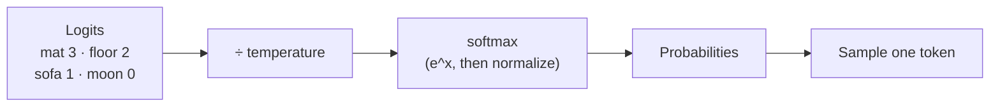

<div align="center">

# 🌡️ Concept 07 — Temperature


**Temperature controls how adventurous the model is when it picks each next token: low = safe and repeatable, high = varied and creative.**

[⬅️ 06 · Statelessness & chat history](../06-statelessness-and-chat-history/) · [📂 Phase 1 index](../README.md) · [🗺️ Roadmap](../../README.md) · Next ➡️ [08 · Max output tokens](../08-max-output-tokens/)

</div>

---

## 🎯 What you'll be able to do after this

- [x] Explain temperature in plain words and in terms of probabilities
- [x] Implement temperature from scratch (scores → softmax → sampling)
- [x] Choose a sensible temperature for a task
- [x] Explain why many reasoning models reject the `temperature` parameter

---

## 🧠 1. Intuition

Remember Concept 01: the model scores every possible next token, then **samples** (picks randomly, weighted by probability).

Temperature is a **"boldness" dial** on that pick:

| Dial | Behavior | Like a… |
|---|---|---|
| 🧊 **Low** (near 0) | Almost always picks the top choice | Careful accountant: same answer every time |
| 🌤️ **Medium** (≈ 1) | Usually the top choice, sometimes the runner-up | Normal conversation |
| 🔥 **High** (≈ 2) | Unlikely choices get a real chance | Brainstorming poet; can drift into nonsense |

It doesn't make the model smarter or dumber. It only changes **how often it takes the less-likely path**.

---

## ⚙️ 2. Technical Explanation

### From scores to probabilities: softmax

For each candidate token, the model first produces a raw score called a **logit** (any number, positive or negative). Scores become probabilities with a function called **softmax**:

```text
probability(word) = e^(score / T)  ÷  sum over all words of e^(score / T)
```

| Symbol | Meaning |
|---|---|
| `e^x` | The **exponential** function (`math.exp` in Python): always positive, and grows fast. Bigger scores → much bigger values |
| `T` | **Temperature**: every score is divided by it before exponentiating |
| `÷ sum` | Dividing by the total makes all probabilities add up to 1 |

**What dividing by T does:**

| T | Effect on the scores | Effect on probabilities |
|---|---|---|
| **< 1** (e.g. 0.2) | Gaps between scores get **bigger** (3 ÷ 0.2 = 15) | Top choice takes almost everything → **sharper** |
| **= 1** | Unchanged | The model's "natural" probabilities |
| **> 1** (e.g. 2) | Gaps get **smaller** (3 ÷ 2 = 1.5) | Probabilities even out → **flatter** |
| **0** | Can't divide by zero; treated as a special case | Always pick the highest score: **greedy decoding** |

**Greedy decoding** = always choosing the single most likely next token, with no randomness.



### Related knob: `top_p`

`top_p` (also called **nucleus sampling**) is a different way to limit randomness: keep only the smallest set of top tokens whose probabilities add up to `p` (e.g. 0.9), then sample among those. The common advice: **adjust temperature or top_p, not both.**

### Which temperature for which job?

| Task | Typical setting | Why |
|---|---|---|
| Extraction, classification, data → JSON | **0 – 0.2** | You want the same correct answer every time |
| Q&A, RAG answers, support bots | **0.2 – 0.7** | Accurate but natural-sounding |
| Brainstorming, names, stories | **0.8 – 1.3** | Variety is the goal |
| Above ~1.5 | Rarely useful | Starts producing odd or broken text |

> [!NOTE]
> Even temperature 0 is **not a 100% guarantee** of identical outputs on hosted APIs: tiny numerical differences on the provider's hardware can occasionally change a token. "Mostly repeatable", not "perfectly deterministic". **Deterministic** = same input always gives the exact same output.

### ⚠️ Reasoning models and temperature

Classic models accept `temperature` freely. **Reasoning models** (Concept 11) often **reject it** with HTTP 400 *"Unsupported parameter: 'temperature'"*: they manage their own sampling while thinking. Developer reports for the GPT-6 family said `temperature` is only accepted when reasoning is turned off with `reasoning={"effort": "none"}`. OpenAI's own docs don't spell this out clearly, so **our script tested it directly**, and **confirmed it** for `gpt-6-luna` (see Script 2's verified result).

That's an important habit in this field: when docs are unclear, **run a small experiment and handle the error** rather than guessing.

---

## 🔢 3. Tiny Example

Logits for the word after *"The cat sat on the"*: `mat 3`, `floor 2`, `sofa 1`, `moon 0`.

**T = 1** (worked by hand):

| Word | score ÷ 1 | e^score | ÷ total (30.19) | Probability |
|---|:-:|:-:|:-:|:-:|
| mat | 3 | 20.09 | 20.09 ÷ 31.20 | **0.64** |
| floor | 2 | 7.39 | 7.39 ÷ 31.20 | 0.24 |
| sofa | 1 | 2.72 | 2.72 ÷ 31.20 | 0.09 |
| moon | 0 | 1.00 | 1.00 ÷ 31.20 | 0.03 |
| **total** | | **31.20** | | **1.00** |

These match the script's `T=1.0` line exactly.

**Same scores, three temperatures** (real script output):

| T | mat | floor | sofa | moon |
|:-:|:-:|:-:|:-:|:-:|
| 0.2 | **0.99** | 0.01 | 0.00 | 0.00 |
| 1.0 | 0.64 | 0.24 | 0.09 | 0.03 |
| 2.0 | 0.46 | 0.28 | 0.17 | **0.10** |

At T = 2 the absurd "moon" jumps from 3% to 10%: **more than 3× as likely** (0.10 ÷ 0.03 ≈ 3.3). That's exactly how high temperatures produce weird text.

---

## 💻 4. Code

### Script 1 — Temperature from scratch: [`temperature_from_scratch.py`](temperature_from_scratch.py)

No API, no cost. This is what happens inside the model at every token.

**Piece 1: the scores**

```python
import math
import random

SCORES = {"mat": 3.0, "floor": 2.0, "sofa": 1.0, "moon": 0.0}
```

Made-up logits for four candidates. A real model has ~200,000 candidates (its vocabulary, Concept 02).

**Piece 2: softmax with temperature**

```python
def probabilities(scores, temperature):
    scaled = {word: score / temperature for word, score in scores.items()}
    exponentials = {word: math.exp(value) for word, value in scaled.items()}
    total = sum(exponentials.values())
    return {word: value / total for word, value in exponentials.items()}
```

| Line | What it does |
|---|---|
| `score / temperature` | The only place temperature acts: stretch or squash the gaps |
| `math.exp(value)` | e^value, turning every score positive and widening differences |
| `total = sum(...)` | Add them all up |
| `value / total` | Normalize, so the probabilities sum to 1 |

**Piece 3: sampling (with the T = 0 special case)**

```python
def sample(scores, temperature):
    if temperature == 0:
        return max(scores, key=scores.get)
    probs = probabilities(scores, temperature)
    return random.choices(list(probs.keys()), weights=list(probs.values()))[0]
```

| Line | What it does |
|---|---|
| `if temperature == 0` | Dividing by 0 is impossible, so T = 0 means **greedy**: just take the best |
| `max(scores, key=scores.get)` | The dict key with the highest value → `"mat"` |
| `random.choices(..., weights=...)[0]` | Weighted random pick, same as Concept 01's toy model |

**Piece 4: compare three temperatures**

```python
for temperature in [0.2, 1.0, 2.0]:
    probs = probabilities(SCORES, temperature)
    shown = ", ".join(f"{word} {p:.2f}" for word, p in probs.items())
    picks = [sample(SCORES, temperature) for _ in range(10)]
    print(f"T={temperature}: {shown}")
    print(f"       10 picks: {' '.join(picks)}")

print("T=0  : always picks", sample(SCORES, 0))
```

```bash
python phase-01-llm-foundations/07-temperature/temperature_from_scratch.py
```

Real output (the "picks" lines change every run):

```text
T=0.2: mat 0.99, floor 0.01, sofa 0.00, moon 0.00
       10 picks: mat mat mat mat mat mat mat mat mat mat
T=1.0: mat 0.64, floor 0.24, sofa 0.09, moon 0.03
       10 picks: mat mat mat mat floor mat sofa floor mat mat
T=2.0: mat 0.46, floor 0.28, sofa 0.17, moon 0.10
       10 picks: sofa moon sofa floor mat mat floor floor floor moon
T=0  : always picks mat
```

Ten picks at T = 0.2: all "mat". At T = 2.0: "moon" twice, and "mat" only twice.

### Script 2 — Temperature on the real API: [`temperature_api.py`](temperature_api.py)

Up to 12 tiny calls (well under a tenth of a cent). It asks for coffee-shop names three times per setting, and **catches the 400 error** if a combination isn't allowed.

```python
import openai
from dotenv import load_dotenv
from openai import OpenAI

MODEL = "gpt-6-luna"
PROMPT = "Invent a name for a coffee shop. Reply with the name only."

load_dotenv()
client = OpenAI(timeout=60, max_retries=2)


def three_names(temperature, effort):
    names = []
    for _ in range(3):
        response = client.responses.create(
            model=MODEL,
            input=PROMPT,
            temperature=temperature,
            reasoning={"effort": effort},
        )
        names.append(response.output_text.strip())
    return names


for effort in ["none", "medium"]:
    for temperature in [0.0, 1.5]:
        try:
            names = three_names(temperature, effort)
            print(f"effort={effort:<6} temperature={temperature}: {names}")
        except openai.BadRequestError as error:
            print(f"effort={effort:<6} temperature={temperature}: ❌ 400 {error.message[:120]}")
```

| Line | What it does |
|---|---|
| `temperature=temperature` | The API parameter: same idea as our `/ temperature` |
| `reasoning={"effort": effort}` | How much the model "thinks" first. `"none"` = no reasoning, `"medium"` = the model's default *(Concept 11)* |
| `for _ in range(3)` | Same prompt three times, to see variety (or the lack of it) |
| `try: ... except openai.BadRequestError` | Catch HTTP 400 (invalid request) so one rejected combination doesn't crash the whole script |
| `error.message[:120]` | The first 120 characters of the API's explanation |

```bash
python phase-01-llm-foundations/07-temperature/temperature_api.py
```

**✅ Verified result (real run, 01 Oct 2026):**

```text
effort=none   temperature=0.0: ['The Daily Grindstone', 'The Daily Grindstone', 'The Daily Grindstone']
effort=none   temperature=1.5: ['The Daily Grindstone', 'The Daily Grindstone', 'The Daily Grindhouse']
effort=medium temperature=0.0: ❌ 400 ... "Unsupported parameter: 'temperature' is not supported with this model."
effort=medium temperature=1.5: ❌ 400 ... "Unsupported parameter: 'temperature' is not supported with this model."
```

| Finding | Lesson |
|---|---|
| `effort=none` + T=0 → identical ×3 | Greedy-like: the top token wins every time |
| `effort=none` + T=1.5 → only **one** of three differed | Temperature can only **reshape** the model's probabilities. When the model is very confident (like `sat → on` at 1.0 in Concept 01), even a high T leaves the top choice dominant. Prompts with many good answers ("write a poem") show far more variety |
| `effort=medium` + any T → **400** | Confirmed: `gpt-6-luna` accepts `temperature` **only with reasoning off** (`effort: "none"`) |

---

## 🎤 5. Interview Answer

> *"At each step the model produces logits for every token; temperature divides those logits before the softmax, so values below 1 sharpen the distribution toward the top token and values above 1 flatten it, with 0 meaning greedy decoding. I use low temperature for extraction, classification and grounded RAG answers, and higher values for creative generation, and tune either temperature or top_p, not both. Many reasoning models don't accept temperature at all unless reasoning is disabled, so I check model support and handle the 400 rather than assuming the parameter applies."*

---

## 📌 Cheat Sheet

| Task | Code / value |
|---|---|
| Set temperature | `client.responses.create(..., temperature=0.2)` |
| Disable reasoning (needed for temperature on some reasoning models) | `reasoning={"effort": "none"}` |
| Catch an unsupported parameter | `except openai.BadRequestError as error:` |
| Extraction / JSON | 0 – 0.2 |
| Q&A / RAG | 0.2 – 0.7 |
| Creative | 0.8 – 1.3 |
| Softmax with T | `exp(score / T) / sum(exp(s / T) for s in scores)` |

---

## ⚠️ Common Mistakes

| Mistake | Consequence | Fix |
|---|---|---|
| High temperature for factual tasks | More made-up details | Keep it low for facts |
| Expecting T=0 to be perfectly repeatable | Rare surprise differences | Treat as "mostly repeatable"; validate outputs |
| Tuning temperature **and** top_p together | Hard-to-predict behavior | Change one |
| Sending temperature to a reasoning model blindly | HTTP 400 | Check support; disable reasoning or drop the parameter |
| Using temperature to "fix" wrong answers | Doesn't add knowledge | Improve the prompt or the context (RAG) |
| Very high T (> 1.5) | Garbled output | Stay ≤ ~1.3 for creative work |

---

## 📖 Glossary

| Term | Plain meaning |
|---|---|
| **Temperature** | Number that sharpens (low) or flattens (high) next-token probabilities |
| **Logit** | Raw score for a candidate token before it becomes a probability |
| **Softmax** | Turns scores into probabilities with exponentials, then divides by the total |
| **Exponential (e^x)** | `math.exp(x)`: always positive, grows quickly |
| **Greedy decoding** | Always pick the most likely token (temperature 0) |
| **Deterministic** | Same input → exactly the same output every time |
| **`top_p` / nucleus sampling** | Sample only from the top tokens whose probabilities add up to p |
| **Reasoning effort** | How much a reasoning model "thinks" before answering (`none` … `max`) *(Concept 11)* |
| **`BadRequestError`** | SDK exception for HTTP 400: the request itself was invalid |

---

<div align="center">

**Status:** ✅ DONE · completed Thu 01 Oct 2026 · verified: `gpt-6-luna` rejects `temperature` unless `reasoning={"effort": "none"}`

[⬅️ 06 · Statelessness & chat history](../06-statelessness-and-chat-history/) · [📂 Phase 1 index](../README.md) · [🗺️ Roadmap](../../README.md)

</div>

<sub>Sources: [OpenAI — Reasoning guide](https://developers.openai.com/api/docs/guides/reasoning) (effort values) · [OpenAI — GPT-6 Luna](https://developers.openai.com/api/docs/models/gpt-6-luna) · developer reports on GPT-6 rejecting `temperature` unless effort is `none`, e.g. [vectorize-io/hindsight#4720](https://github.com/vectorize-io/hindsight/issues/4720), [absolutejs/ai#6](https://github.com/absolutejs/ai/issues/6)</sub>
