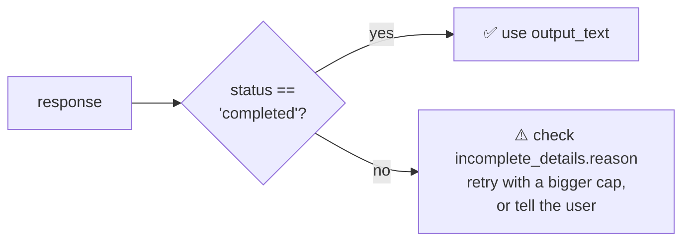

<div align="center">

# ✂️ Concept 08 — Max Output Tokens


**A hard cap on how many tokens the model may generate, hidden reasoning included. It limits length and cost, and when it's hit, the reply is cut off.**

[⬅️ 07 · Temperature](../07-temperature/) · [📂 Phase 1 index](../README.md) · [🗺️ Roadmap](../../README.md) · Next ➡️ [09 · Prompt structure & few-shot](../09-prompt-structure-and-few-shot/)

</div>

---

## 🎯 What you'll be able to do after this

- [x] Set `max_output_tokens` and explain what it does (and doesn't) do
- [x] Detect a cut-off reply with `status` and `incomplete_details`
- [x] Explain why a too-small cap on a reasoning model can return **no text at all**
- [x] Use the cap to bound worst-case cost

---

## 🧠 1. Intuition

It's a **word limit on an exam answer**, enforced by a teacher who **snatches the paper** the moment you hit it, even mid-sentence.

- It does **not** make the student write concisely. It just stops them.
- If the student spends the whole limit on **scratch work** (thinking) before writing the answer, they hand in **nothing**.

Your Concept 01 toy model already had this: `max_words=10` in `generate()` was a max-output cap.

---

## ⚙️ 2. Technical Explanation

### The parameter

```python
client.responses.create(model=MODEL, input=PROMPT, max_output_tokens=400)
```

The SDK docs define it as *"an upper bound for the number of tokens that can be generated for a response, including visible output tokens and reasoning tokens."*

| It **does** | It **does not** |
|---|---|
| Stop generation once the cap is reached | Make the model *plan* a shorter answer |
| Bound the worst-case **output cost** | Count your input tokens |
| Protect against runaway, rambling replies | Guarantee a complete answer |

It works **inside** the model's own maximum (128,000 for `gpt-6-luna`, Concept 03). You can only lower the limit, not raise it.

> [!TIP]
> To get **shorter answers**, ask for them in the prompt ("in 2 sentences", "under 50 words"). Use `max_output_tokens` as a **safety net**, not a style tool.

### How to tell it was cut off

| Field | Completed reply | Cut-off reply |
|---|---|---|
| `response.status` | `"completed"` | `"incomplete"` |
| `response.incomplete_details` | `None` | object with `.reason` |
| `.reason` | n/a | `"max_output_tokens"` (other possible values in SDK 3.19.2: `"content_filter"`, `"max_messages"`, `"steered"`) |



### The reasoning-model trap

`gpt-6-luna` is a reasoning model: it may generate **hidden reasoning tokens before** the visible answer (Concept 11). Both count toward the cap:

```text
max_output_tokens = 50
├── reasoning tokens:  50  ← the whole budget spent thinking
└── visible text:       0  ← nothing left: output_text == ""
```

You pay for those 50 tokens and get an **empty reply**. With reasoning models, leave generous headroom, or use a lower reasoning effort.

### Older names you'll see in tutorials

| API | Parameter |
|---|---|
| Responses API (ours) | `max_output_tokens` |
| Chat Completions (newer) | `max_completion_tokens` |
| Chat Completions (older, deprecated) | `max_tokens` |

Same idea, different names.

---

## 🔢 3. Tiny Example

**Worst-case output cost per call** at `gpt-6-luna`'s $0.50 per 1M output tokens:

| Cap | Math | Worst-case output cost |
|---|---|---|
| none (model max 128,000) | 128,000 × $0.50 ÷ 1,000,000 | **$0.064** |
| 2,000 | 2,000 × $0.50 ÷ 1,000,000 | $0.001 |
| 500 | 500 × $0.50 ÷ 1,000,000 | **$0.00025** |

With a 500 cap, a bug can cost at most **256× less** per call than with no cap (0.064 ÷ 0.00025 = 256). Across 100,000 calls a day, that's the difference between **$6,400** and **$25** of worst-case output.

**A cut-off in action** (cap = 20 tokens, reasoning off; illustrative, your wording will differ):

```text
status = incomplete, reason = max_output_tokens
"A refrigerator keeps food cold by moving heat from inside to outside using a refrigerant that"
```

It stopped mid-sentence: the model didn't "know" about the limit; it was simply stopped.

---

## 💻 4. Code — [`max_tokens_demo.py`](max_tokens_demo.py)

4 calls, a fraction of a cent in total.

### Piece 1: a safe way to read the reply

```python
def reply_or_warning(response):
    if response.status == "completed":
        return response.output_text
    reason = response.incomplete_details.reason if response.incomplete_details else "unknown"
    return f"⚠️ INCOMPLETE ({reason}). Partial text: {response.output_text!r}"
```

| Line | What it does |
|---|---|
| `if response.status == "completed"` | Only trust `output_text` as a full answer when the response finished |
| `... if response.incomplete_details else "unknown"` | A **conditional expression** (`A if condition else B`). Guards against `incomplete_details` being `None` |
| `{response.output_text!r}` | `!r` shows quotes, so an **empty** reply prints visibly as `''` |

This is a pattern you'll reuse: **never blindly trust `output_text`**.

### Piece 2: one call with a given cap and reasoning effort

```python
def ask(max_tokens, effort):
    response = client.responses.create(
        model=MODEL,
        input=PROMPT,
        max_output_tokens=max_tokens,
        reasoning={"effort": effort},
    )
    usage = response.usage
    print(f"effort={effort:<6} max_output_tokens={max_tokens:<5} status={response.status:<10} "
          f"output_tokens={usage.output_tokens:<4} (reasoning {usage.output_tokens_details.reasoning_tokens})")
    print(f"    → {reply_or_warning(response)[:160]}\n")
```

| Line | What it does |
|---|---|
| `max_output_tokens=max_tokens` | The cap under test |
| `reasoning={"effort": effort}` | `"none"` = answer directly; `"medium"` = think first (the default) |
| `usage.output_tokens_details.reasoning_tokens` | How much of the output budget went to hidden thinking (Concept 02) |
| `[:160]` | Print at most 160 characters so long answers don't flood the terminal |

### Piece 3: four experiments

```python
ask(20, "none")       # tiny cap, no thinking   → cut off mid-sentence
ask(400, "none")      # enough room             → completed
ask(50, "medium")     # tiny cap, WITH thinking → likely empty: budget spent on reasoning
ask(2000, "medium")   # generous cap            → completed, with reasoning tokens shown
```

The prompt asks for ~150 words (≈ 200 tokens), so 20 is far too small and 400 is enough.

```bash
python phase-01-llm-foundations/08-max-output-tokens/max_tokens_demo.py
```

**Predict, then check:**

| Call | Expected `status` | Expected text |
|---|---|---|
| 20, none | `incomplete` | A sentence fragment |
| 400, none | `completed` | Full ~150-word answer |
| 50, medium | `incomplete` | Possibly **`''`** (all budget spent reasoning) |
| 2000, medium | `completed` | Full answer; note the reasoning token count |

---

## 🎤 5. Interview Answer

> *"`max_output_tokens` is a hard cap on generated tokens, including hidden reasoning tokens on reasoning models, so it bounds latency and worst-case output cost but doesn't make the model plan a shorter answer; for brevity you ask in the prompt. When the cap is hit, the response comes back with status `incomplete` and reason `max_output_tokens`, so production code checks the status instead of trusting the text, and either retries with more room or degrades gracefully. With reasoning models I leave generous headroom, because a tight cap can be consumed entirely by reasoning and return an empty answer."*

---

## 📌 Cheat Sheet

| Task | Code |
|---|---|
| Cap output | `create(..., max_output_tokens=500)` |
| Finished? | `response.status == "completed"` |
| Why not? | `response.incomplete_details.reason` → `"max_output_tokens"` |
| How much was thinking? | `response.usage.output_tokens_details.reasoning_tokens` |
| Worst-case output cost | `cap × output_price ÷ 1,000,000` |
| Shorter answers | Ask in the prompt: "in 2 sentences" |

---

## ⚠️ Common Mistakes

| Mistake | Consequence | Fix |
|---|---|---|
| Using the cap to make answers short | Answers end mid-sentence | Ask for brevity in the prompt; the cap is a safety net |
| Not checking `status` | Showing users half-answers as if complete | Check `status`, handle `incomplete` |
| Tiny cap on a reasoning model | Paid for thinking, got `''` | Leave headroom, or lower reasoning effort |
| No cap at all in production | One runaway reply can cost far more than planned | Always set a sensible cap |
| Confusing it with the context window | Wrong budgeting | Window = input + output; this cap = output only |

---

## 📖 Glossary

| Term | Plain meaning |
|---|---|
| **`max_output_tokens`** | Upper limit on generated tokens (visible + reasoning) for one response |
| **`status`** | Whether the response finished: `completed`, `incomplete`, … |
| **`incomplete_details.reason`** | Why it stopped early, e.g. `max_output_tokens` |
| **Truncated / cut-off reply** | Output stopped before the model finished |
| **Headroom** | Extra budget left above what you expect to need |
| **Worst-case cost** | The most a call can cost given its caps |
| **Conditional expression** | `A if condition else B` in one line |
| **`max_completion_tokens` / `max_tokens`** | The same idea's names in the Chat Completions API |

---

<div align="center">

**Status:** ✅ DONE · completed Thu 01 Oct 2026

[⬅️ 07 · Temperature](../07-temperature/) · [📂 Phase 1 index](../README.md) · [🗺️ Roadmap](../../README.md)

</div>

<sub>Sources: `openai` 3.19.2 SDK (`max_output_tokens` docstring; `IncompleteDetails.reason` values) · [OpenAI — GPT-6 Luna](https://developers.openai.com/api/docs/models/gpt-6-luna) (128,000 max output, $0.50/1M output)</sub>
