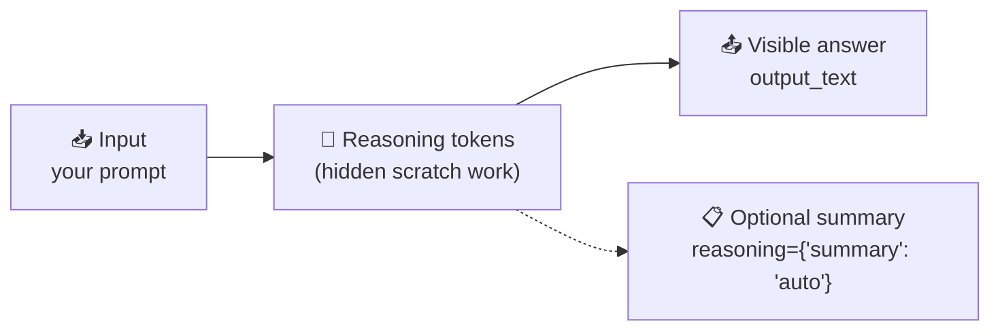

<div align="center">

# 🤔 Concept 11 — Reasoning Models


**Reasoning models generate hidden "thinking" tokens before they answer. More thinking → better on hard problems, but slower and more expensive.**

[⬅️ 10 · Hallucinations](../10-hallucinations/) · [📂 Phase 1 index](../README.md) · [🗺️ Roadmap](../../README.md) · Next ➡️ [12 · Cost calculation](../12-cost-calculation/)

</div>

---

## 🎯 What you'll be able to do after this

- [x] Explain what a reasoning model does differently
- [x] Choose a reasoning effort for a task (accuracy vs latency vs cost)
- [x] Measure reasoning tokens, time and cost per call
- [x] Read a reasoning **summary**
- [x] Connect the dots: why temperature, `max_output_tokens` and chat history behaved the way they did

---

## 🧠 1. Intuition

Two ways to answer *"What's 17 × 24?"*:

| | ⚡ Blurt it out | 📝 Scratch paper first |
|---|---|---|
| How | Say the first number that feels right | Work it out step by step, then answer |
| Speed | Instant | Slower |
| Accuracy on hard problems | Often wrong | Much better |
| Accuracy on easy problems | Fine | Fine, but wasted time |

A **reasoning model** can use **scratch paper**: before the visible answer, it generates **hidden reasoning tokens** where it works the problem out. You pay for the scratch paper, but you never see it (only an optional summary).

---

## ⚙️ 2. Technical Explanation

### What happens inside one call



| Fact | Detail |
|---|---|
| Reasoning tokens are **hidden** | You get an optional **summary**, not the raw thinking |
| They're **billed as output tokens** | At the higher output price (Concept 02) |
| You can **see how many** | `response.usage.output_tokens_details.reasoning_tokens` |
| They take **time** | More reasoning → higher **latency** (time until you get the answer) |
| They appear as a `reasoning` **output item** | `response.output` = `['reasoning', 'message']` (Concept 04) |

### Reasoning effort: the dial

You control how much thinking with `reasoning={"effort": ...}`. Your SDK (`openai` 3.19.2) lists: `none`, `minimal`, `low`, `medium`, `high`, `xhigh`, `max`, noting *"not all reasoning models support every value."* For `gpt-6-luna`, OpenAI's model page lists **`none`, `low`, `medium` (default), `high`, `xhigh`, `max`**.

| Effort | Use for | Trade-off |
|---|---|---|
| `none` | Classification, extraction, simple chat, formatting | Fastest, cheapest; may slip on tricky logic |
| `low` | Light reasoning, most everyday Q&A | Good balance |
| `medium` (default) | Multi-step questions, code, analysis | Slower, costs more |
| `high` / `xhigh` / `max` | Hard math, complex code, planning, tricky edge cases | Much slower and pricier; use only when it measurably helps |

The SDK docs put it simply: *"Reducing reasoning effort can result in faster responses and fewer tokens used on reasoning."*

### Everything you've seen so far, explained

| Earlier surprise | Why (reasoning models) |
|---|---|
| Concept 02: `output_tokens` ≫ the tiktoken count of the reply | Hidden reasoning tokens were included |
| Concept 04: `output[0]` wasn't the reply | It was the `reasoning` item |
| Concept 06: OpenAI recommends `messages += response.output` | To keep reasoning items across turns |
| Concept 07: `temperature` → 400 | Rejected unless `effort="none"` (verified) |
| Concept 08: tiny cap → empty reply | Reasoning used the whole `max_output_tokens` budget |

### Prompting reasoning models

| Do | Don't |
|---|---|
| State the **goal**, constraints and output format clearly | Micromanage with step-by-step instructions it would work out itself |
| Give the context it needs (RAG, documents) | Add "think step by step": it already does |
| Ask for a short final answer if that's all you need | Expect to read or parse the raw reasoning |

**"Think step by step"** (called **chain-of-thought prompting**) was an older trick to make *non-reasoning* models write out their working in the visible answer. Reasoning models do this internally, so it's not needed.

### Why letter-counting is hard (a tokens callback)

Models see **tokens**, not letters (Concept 02). Our test phrase splits into 6 tokens:

```text
'st' | 'raw' | 'berry' | ' raspberry' | ' cranberry' | ' blueberry'
```

`" raspberry"` is **one** token, so the model can't directly "look at" its letters. It has to *recall* how the word is spelled, which is exactly the kind of task where scratch-paper thinking helps.

---

## 🔢 3. Tiny Example

**Same question at two efforts** (illustrative numbers; your run measures the real ones):

| Effort | Reasoning tokens | Visible tokens | Output cost (× $0.50/1M) | Time |
|---|:-:|:-:|---|:-:|
| `none` | 0 | 3 | 3 × $0.0000005 = **$0.0000015** | ~0.5 s |
| `high` | 1,200 | 3 | 1,203 × $0.0000005 = **$0.0006** | ~8 s |

Same 3-token answer, **400× the output cost** (1,203 ÷ 3 ≈ 400) and ~16× the wait. Worth it only if `none` gets it **wrong** and `high` gets it **right**. That's why you measure.

**Ground truth:** `"strawberry raspberry cranberry blueberry".count("r")` = **11** (3 + 3 + 3 + 2). Python counts letters perfectly; we use it to grade the model (Concept 10's "verify in code").

---

## 💻 4. Code — [`effort_comparison.py`](effort_comparison.py)

5 calls. The `high` call may take several seconds; total cost is still well under a cent.

### Piece 1: settings, prices and ground truth

```python
import time

from dotenv import load_dotenv
from openai import OpenAI

MODEL = "gpt-6-luna"
INPUT_PRICE = 0.10 / 1_000_000    # $ per input token
OUTPUT_PRICE = 0.50 / 1_000_000   # $ per output token (reasoning tokens included)

TEXT = "strawberry raspberry cranberry blueberry"
QUESTION = f"How many times does the letter 'r' appear in: {TEXT}? Reply with just the number."
CORRECT = TEXT.count("r")          # ground truth computed by Python, not by the model
```

| Line | What it does |
|---|---|
| `import time` | Built-in module; we use it to measure how long each call takes |
| `0.10 / 1_000_000` | Price per **single** token. `_` in numbers is just a readable separator (= 1000000) |
| `TEXT.count("r")` | **Ground truth**: the known-correct answer, computed by code |

### Piece 2: four efforts, measured

```python
for effort in ["none", "low", "medium", "high"]:
    start = time.perf_counter()
    response = client.responses.create(
        model=MODEL,
        input=QUESTION,
        reasoning={"effort": effort},
    )
    seconds = time.perf_counter() - start

    usage = response.usage
    cost = usage.input_tokens * INPUT_PRICE + usage.output_tokens * OUTPUT_PRICE
    answer = response.output_text.strip()
    verdict = "✅" if answer == str(CORRECT) else "❌"

    print(f"effort={effort:<6} {verdict} answer={answer!r:<6} "
          f"reasoning_tokens={usage.output_tokens_details.reasoning_tokens:<5} "
          f"time={seconds:5.1f}s  cost=${cost:.6f}")
```

| Line | What it does |
|---|---|
| `time.perf_counter()` | A precise stopwatch reading in seconds; end − start = **latency** |
| `usage.output_tokens * OUTPUT_PRICE` | Output cost **including** reasoning (they're inside `output_tokens`) |
| `answer == str(CORRECT)` | Compare text to text: `CORRECT` is the integer 11, so convert it with `str()` |
| `{seconds:5.1f}` | 5 characters wide, 1 decimal place |
| `{cost:.6f}` | 6 decimal places, since costs are tiny |

> `timeout=120` on the client gives high-effort calls more time than our usual 60 s.

### Piece 3: read the reasoning summary

```python
response = client.responses.create(
    model=MODEL,
    input=QUESTION,
    reasoning={"effort": "medium", "summary": "auto"},
)
print("\nReasoning summary (medium effort):")
for item in response.output:
    if item.type == "reasoning":
        for part in item.summary:
            print("  •", part.text)
print("Final answer:", response.output_text)
```

| Line | What it does |
|---|---|
| `"summary": "auto"` | Ask for a readable summary of the hidden reasoning (`"auto"`, `"concise"`, or `"detailed"`) |
| `item.type == "reasoning"` | Find the reasoning item, searching by type (Concept 04) |
| `item.summary` | A list of summary parts, each with `.text` |

```bash
python phase-01-llm-foundations/11-reasoning-models/effort_comparison.py
```

**Read your results like an engineer:**

| Question | Look at |
|---|---|
| Which is the **cheapest effort that's correct**? | The first ✅ row from the top |
| How much does each step up cost? | `cost` and `reasoning_tokens` columns |
| How much slower? | `time` column |
| Was `high` worth it here? | If `low` was already ✅, no |

> [!NOTE]
> One question is a tiny sample: a model may get it right or wrong by luck on a single try. Real effort decisions are made on a test set of many questions (Phase 5 and Phase 7 style).

---

## 🎤 5. Interview Answer

> *"Reasoning models generate hidden reasoning tokens before the visible answer. Those tokens are billed as output and add latency, and we only get an optional summary. Reasoning effort is the main knob: I use none or low for extraction, classification and simple chat, and higher effort for multi-step logic, code or planning, choosing the lowest effort that passes an evaluation set. Operationally, reasoning affects other parameters too: temperature is often unsupported, `max_output_tokens` must leave headroom for reasoning, and multi-turn apps should pass reasoning items back."*

---

## 📌 Cheat Sheet

| Task | Code |
|---|---|
| Set effort | `reasoning={"effort": "low"}` |
| No reasoning | `reasoning={"effort": "none"}` |
| Get a summary | `reasoning={"effort": "medium", "summary": "auto"}` |
| Reasoning token count | `response.usage.output_tokens_details.reasoning_tokens` |
| Summary text | `item.summary[i].text` for items with `item.type == "reasoning"` |
| Measure latency | `start = time.perf_counter()` … `time.perf_counter() - start` |
| `gpt-6-luna` efforts | `none`, `low`, `medium` (default), `high`, `xhigh`, `max` |

---

## ⚠️ Common Mistakes

| Mistake | Consequence | Fix |
|---|---|---|
| Default/high effort for simple tasks | Slow, expensive classification | Use `none`/`low`; measure |
| Tight `max_output_tokens` | Empty reply (Concept 08) | Leave headroom |
| Sending `temperature` | HTTP 400 (Concept 07) | Use effort `none`, or drop it |
| Adding "think step by step" | Wasted prompt tokens | Not needed; state the goal clearly |
| Judging effort on one question | Luck looks like a pattern | Use a test set |
| Forgetting reasoning tokens in cost estimates | Bills higher than expected | Cost = `output_tokens` × price (includes reasoning) |
| Short client timeout with high effort | `APITimeoutError` | Raise the timeout for high-effort calls |

---

## 📖 Glossary

| Term | Plain meaning |
|---|---|
| **Reasoning model** | A model that generates hidden thinking tokens before answering |
| **Reasoning tokens** | The hidden "scratch paper" tokens; billed as output |
| **Reasoning effort** | Setting for how much the model thinks: `none` … `max` |
| **Reasoning summary** | An optional readable summary of the hidden reasoning |
| **Chain-of-thought prompting** | Older trick: ask a non-reasoning model to "think step by step" in its visible answer |
| **Latency** | Time from sending the request to getting the answer |
| **Ground truth** | The known-correct answer used for grading |
| **`time.perf_counter()`** | High-precision timer for measuring durations |
| **Numeric underscore** | `1_000_000`: underscores make big numbers readable; Python ignores them |

---

<div align="center">

**Status:** ✅ DONE · completed Sat 10 Oct 2026

[⬅️ 10 · Hallucinations](../10-hallucinations/) · [📂 Phase 1 index](../README.md) · [🗺️ Roadmap](../../README.md)

</div>

<sub>Sources: `openai` 3.19.2 SDK (`Reasoning` param: effort values, `summary`; `ResponseReasoningItem`) · [OpenAI — Reasoning guide](https://developers.openai.com/api/docs/guides/reasoning) · [OpenAI — GPT-6 Luna](https://developers.openai.com/api/docs/models/gpt-6-luna) · tokenization from tiktoken 0.14.0</sub>
