# 🧠 Phase 1 — LLM Foundations

**Understand what an LLM really is, how an API call is built, and what every request costs.**

[🗺️ Back to roadmap](../README.md) · [⬅️ Phase 0](../phase-00-setup/)

---

## 🔨 Build goal

> **Terminal chatbot with memory**, showing tokens and cost per message.

## 🧩 Concepts

| # | Concept | What you learn | Status |
|:-:|---|---|:-:|
| 01 | [What an LLM is](01-what-is-an-llm/) | Next-token prediction, no memory, no internet by default | ✅ |
| 02 | [Tokens and `tiktoken`](02-tokens-and-tiktoken/) | How text becomes tokens, and how to count them | ✅ |
| 03 | [Context window](03-context-window/) | The maximum text a model can see at once | ✅ |
| 04 | [API call anatomy](04-api-call-anatomy/) | Client, model, input/messages, response | 🟡 |
| 05 | Message roles | system / user / assistant | ⬜ |
| 06 | Statelessness & chat history | Giving a memoryless model "memory" | ⬜ |
| 07 | Temperature | Controlling randomness | ⬜ |
| 08 | Max output tokens | Capping reply length (and cost) | ⬜ |
| 09 | Prompt structure & few-shot | Writing prompts that work reliably | ⬜ |
| 10 | Hallucinations | Why models make things up, and how to reduce it | ⬜ |
| 11 | Reasoning models | Models that "think" before answering | ⬜ |
| 12 | Cost calculation | Input vs output token pricing | ⬜ |
| 🔨 | Build: terminal chatbot | Everything above in one program | ⬜ |

**Legend:** ✅ Done · 🟡 In progress · ⬜ Not started

## 🔗 How the pieces connect

```mermaid
flowchart LR
    A["🧠 What an LLM is"] --> B["🔤 Tokens"] --> C["📏 Context window"]
    C --> D["📨 API anatomy"] --> E["🎭 Roles"] --> F["🔁 Chat history"]
    F --> G["🌡️ Temperature"] --> H["✂️ Max tokens"] --> I["📝 Prompting"]
    I --> J["🤥 Hallucinations"] --> K["🤔 Reasoning models"] --> L["💵 Cost"]
    L --> M["🔨 Chatbot with memory + cost"]
```

