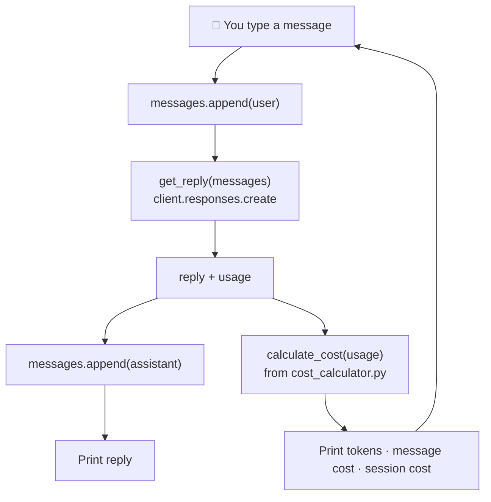
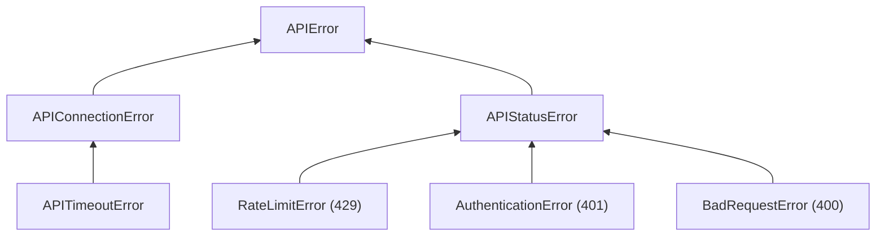
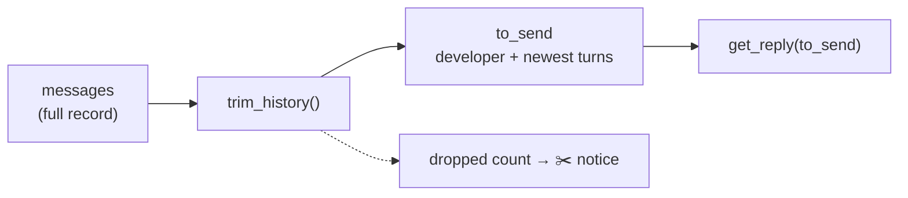

<div align="center">

# 🔨 Phase 1 Build — Terminal Chatbot


**A terminal chatbot with memory that shows tokens and cost for every message. Every Phase 1 concept, in one program.**

[⬅️ 12 · Cost calculation](../12-cost-calculation/) · [📂 Phase 1 index](../README.md) · [🗺️ Roadmap](../../README.md)

</div>

---

## 🎯 Goal

> **Done when:** you can chat in the terminal, the bot remembers the conversation, and after every reply you see the tokens used and the cost of that message and of the whole session.

## 🧭 Build plan

We build it in four small steps. Each step adds one idea to the same file, [`chatbot.py`](chatbot.py).

| Step | Adds | From concept | Status |
|:-:|---|---|:-:|
| 1 | Chat loop with memory + tokens and cost per message | 05, 06, 11, 12 | ✅ |
| 2 | Safety: output cap, incomplete-reply check, API error handling | 08, Phase 0 · 05 | ✅ |
| 3 | Context budget: trim old history, keep the developer message | 02, 03 | ✅ |
| 4 | Commands (`/stats`, `/reset`, `/help`) and a session summary | — | ✅ |

## 🏗️ How it fits together (after step 1)



| File | Role |
|---|---|
| [`chatbot.py`](chatbot.py) | The program you run |
| [`cost_calculator.py`](cost_calculator.py) | A **copy** of Concept 12's module, so `from cost_calculator import calculate_cost` works from this folder |

> [!NOTE]
> Copying a file between folders is fine for learning, but it means two copies to update when prices change. In Phase 9 you'll organize shared code into a proper package so there's only one copy.

---

## 🧱 Step 1 — Memory + tokens + cost

Nothing here is new: it's Concept 06's chat loop and Concept 12's calculator, reorganized into **functions**.

### Piece 1: settings at the top

```python
from dotenv import load_dotenv
from openai import OpenAI

from cost_calculator import calculate_cost

MODEL = "gpt-6-luna"
REASONING_EFFORT = "low"
DEVELOPER_PROMPT = (
    "You are a friendly, concise assistant. "
    "Keep answers under 4 sentences unless the user asks for more detail."
)

load_dotenv()
client = OpenAI(timeout=60, max_retries=2)
```

| Line | Why |
|---|---|
| Constants at the top | Everything you might tune (model, effort, personality) lives in one visible place |
| `REASONING_EFFORT = "low"` | A chat should feel quick and cheap (Concept 11); `low` adds a little thinking without `medium`'s extra cost (you measured 1.63× in Concept 12) |
| `DEVELOPER_PROMPT` asks for brevity | Shorter replies → fewer output tokens **and** less history to resend (Concepts 06, 08) |
| `client` created once | Connection reuse (Concept 04) |

### Piece 2: one function that talks to the model

```python
def get_reply(messages):
    response = client.responses.create(
        model=MODEL,
        input=messages,
        reasoning={"effort": REASONING_EFFORT},
    )
    return response.output_text, response.usage
```

| Line | Why |
|---|---|
| A separate function | All API details are in **one place**. Steps 2 and 3 will only change this function and what's around it, not the chat loop |
| `return a, b` | Returns a **tuple** of two values: the text and the usage |

### Piece 3: the chat loop

```python
def main():
    messages = [{"role": "developer", "content": DEVELOPER_PROMPT}]
    session_cost = 0.0

    print(f"Chatbot ready ({MODEL}, effort={REASONING_EFFORT}). Type 'quit' to exit.\n")

    while True:
        user_text = input("You: ").strip()
        if user_text.lower() in {"quit", "exit"}:
            break
        if not user_text:
            continue

        messages.append({"role": "user", "content": user_text})
        reply, usage = get_reply(messages)
        messages.append({"role": "assistant", "content": reply})
```

| Line | Why |
|---|---|
| `messages = [...]` **before** the loop | The notebook is created once and grows (Concept 06) |
| `session_cost = 0.0` | A running total for the whole chat |
| `reply, usage = get_reply(messages)` | **Unpacks** the tuple the function returned |
| append user → call → append assistant | The three steps of a turn |

### Piece 4: tokens and cost after every reply

```python
        cost = calculate_cost(
            MODEL,
            usage.input_tokens,
            usage.output_tokens,
            usage.input_tokens_details.cached_tokens,
        )
        session_cost += cost

        print(f"AI: {reply}")
        print(f"    [in {usage.input_tokens} · out {usage.output_tokens} · "
              f"this message ${cost:.6f} · session ${session_cost:.6f}]\n")

    print(f"Bye! {len(messages) - 1} messages, total cost ${session_cost:.6f}")
```

| Line | Why |
|---|---|
| `calculate_cost(...)` | Concept 12's function, fed with the real `usage` |
| `session_cost += cost` | Add this message's cost to the running total |
| `len(messages) - 1` | Don't count the developer message as part of the conversation |

### Piece 5: the entry point

```python
if __name__ == "__main__":
    main()
```

Runs `main()` only when you run this file directly (Concept 12).

### ▶️ Run it

`input()` needs a real terminal, and this folder's imports need you to run the file by its path:

```bash
cd /Users/sujithkumar/Documents/ai/AI-claude
```
```bash
source .venv/bin/activate
```
```bash
python phase-01-llm-foundations/build-terminal-chatbot/chatbot.py
```

### 🧪 Test conversation

```text
You: Hi, I'm Sujith. I'm building a chatbot in Python.
You: Suggest one feature I should add next.
You: What's my name and what am I building?
You: quit
```

**Check three things:**

| Check | Expect |
|---|---|
| Memory | The third answer gets your name and project right |
| Growth | `in` (input tokens) is larger on every turn |
| Cost | `session` equals the sum of the three `this message` values |

---

## 🛡️ Step 2 — Safety: cap, cut-off check, error handling

Step 1 works on a good day. Step 2 makes it survive a bad one: a runaway reply, a cut-off answer, no internet, an empty balance.

### Change 1: imports and a new setting

**Before**

```python
from dotenv import load_dotenv
from openai import OpenAI

from cost_calculator import calculate_cost

MODEL = "gpt-6-luna"
REASONING_EFFORT = "low"
```

**After**

```python
import openai
from dotenv import load_dotenv
from openai import OpenAI

from cost_calculator import calculate_cost

MODEL = "gpt-6-luna"
REASONING_EFFORT = "low"
MAX_OUTPUT_TOKENS = 600   # safety net: reasoning + reply (a 4-sentence answer is ~100 tokens)
```

| Change | Why |
|---|---|
| `import openai` | We need the exception classes (`openai.APIError`, …). `from openai import OpenAI` only gave us the client class |
| `MAX_OUTPUT_TOKENS = 600` | A worst-case cap per reply (Concept 08). 600 leaves **headroom** for reasoning tokens, so a normal answer is never cut. Worst case per reply: 600 × $0.50/1M = $0.0003 |

### Change 2: `get_reply` caps the output and reports cut-offs

**Before**

```python
def get_reply(messages):
    response = client.responses.create(
        model=MODEL,
        input=messages,
        reasoning={"effort": REASONING_EFFORT},
    )
    return response.output_text, response.usage
```

**After**

```python
def get_reply(messages):
    response = client.responses.create(
        model=MODEL,
        input=messages,
        reasoning={"effort": REASONING_EFFORT},
        max_output_tokens=MAX_OUTPUT_TOKENS,
    )

    warning = None
    if response.status != "completed":
        reason = response.incomplete_details.reason if response.incomplete_details else "unknown"
        warning = f"Reply was cut off ({reason})."

    return response.output_text, response.usage, warning
```

| Line | Why |
|---|---|
| `max_output_tokens=MAX_OUTPUT_TOKENS` | Applies the cap |
| `warning = None` | Default: nothing to report |
| `if response.status != "completed"` | Never blindly trust `output_text` (Concept 08) |
| `return ..., warning` | Now returns **three** values. The warning travels separately, so it is shown to the user but **not** stored in the chat history |

### Change 3: a new function that turns errors into plain messages

```python
def describe_error(error):
    if isinstance(error, openai.APIConnectionError):
        return "Could not reach OpenAI (network problem or timeout)."
    if isinstance(error, openai.RateLimitError):
        if error.code == "rate_limit_exceeded":
            return "Sending too fast (rate limit). Wait a few seconds."
        return f"Quota or spend limit reached ({error.code}). This needs fixing in the OpenAI dashboard."
    if isinstance(error, openai.AuthenticationError):
        return "The API key was rejected. Check AI-claude/.env."
    return f"API error: {error.message}"
```

| Line | Why |
|---|---|
| `isinstance(error, SomeClass)` | `True` if `error` is that kind of error (or a more specific kind of it) |
| `openai.APIConnectionError` | No response at all: network down, DNS failure, or a **timeout** (timeouts are a sub-kind of connection error in this SDK) |
| `openai.RateLimitError` + `error.code` | HTTP 429. We branch on the **code**, exactly like `classify_429.py` (Phase 0 · 05): rate limit = wait; quota/spend limit = a human must act |
| `openai.AuthenticationError` | HTTP 401: bad key |
| last line | Anything else (e.g. a 400 bad request): show the API's own message |

**The SDK's error family** (each arrow means "is a kind of"):



Catching `openai.APIError` therefore catches **all** of them.

### Change 4: the loop survives a failed call

**Before**

```python
        messages.append({"role": "user", "content": user_text})
        reply, usage = get_reply(messages)
        messages.append({"role": "assistant", "content": reply})
```

**After**

```python
        messages.append({"role": "user", "content": user_text})
        try:
            reply, usage, warning = get_reply(messages)
        except openai.APIError as error:
            messages.pop()
            print(f"    ❌ {describe_error(error)} Your message was not sent; try again.\n")
            continue
        messages.append({"role": "assistant", "content": reply})
```

| Line | Why |
|---|---|
| `try:` / `except openai.APIError as error:` | If the call fails, jump to the `except` block instead of crashing the program |
| `messages.pop()` | **Removes the user message we just appended.** Without this, the failed message stays in the history with no reply, and the next turn sends two user messages in a row. Rule: *when a step fails, undo the state you changed for it* |
| `continue` | Skip the rest of this turn (no reply to print, no cost to add) and ask for input again |

And one line where the reply is printed:

**Before**

```python
        print(f"AI: {reply}")
        print(f"    [in ...
```

**After**

```python
        print(f"AI: {reply}")
        if warning:
            print(f"    ⚠️ {warning}")
        print(f"    [in ...
```

`if warning:` is true only when there is a warning text (`None` counts as false).

### 🧪 Tested without your API key

I ran the bot against an address where nothing is listening, with a fake key, typing `hello` then `quit`:

```text
Chatbot ready (gpt-6-luna, effort=low). Type 'quit' to exit.

You:     ❌ Could not reach OpenAI (network problem or timeout). Your message was not sent; try again.

You: Bye! 0 messages, total cost $0.000000
```

The bot **didn't crash**, and `0 messages` proves `messages.pop()` kept the history clean. `describe_error()` was also checked with simulated errors:

| Simulated error | Message shown |
|---|---|
| 429 `rate_limit_exceeded` | Sending too fast (rate limit). Wait a few seconds. |
| 429 `insufficient_quota` | Quota or spend limit reached (insufficient_quota). This needs fixing in the OpenAI dashboard. |
| 401 `invalid_api_key` | The API key was rejected. Check AI-claude/.env. |
| 400 anything else | API error: *(the API's message)* |

### 🧪 Try it yourself

1. **Normal chat still works:** run it and chat two turns.
2. **See a cut-off:** temporarily set `MAX_OUTPUT_TOKENS = 20`, ask *"Explain how the internet works"*, and look for `⚠️ Reply was cut off (max_output_tokens).` Then set it back to `600`.
3. **See the network error:** turn Wi-Fi off, send a message, turn Wi-Fi back on, send again. The chat should continue as if nothing happened.

---

## ✂️ Step 3 — Context budget: trim what you send

In Concept 06 you saw input tokens grow on every turn. Left alone, a long chat gets more expensive with each message. Step 3 sets a **budget** and stops sending the oldest turns once the chat exceeds it.

**The key idea: what you *store* and what you *send* are two different things.**

| | `messages` | `to_send` |
|---|---|---|
| What it is | The **full record** of the chat | A **trimmed view** built fresh each turn |
| Ever shortened? | Never | Yes, to fit the budget |
| Used for | History, the message count, (later) saving to a database | The actual API call |



> [!NOTE]
> `gpt-6-luna`'s real window is 1,050,000 tokens, so this chat would never overflow it. Our budget of 2,000 is a **cost and speed** decision, not a technical limit. That's the normal situation in production: you trim long before the window forces you to.

### Change 1: one import, one setting

**Before**

```python
import openai
from dotenv import load_dotenv
...
MAX_OUTPUT_TOKENS = 600   # safety net: reasoning + reply (a 4-sentence answer is ~100 tokens)
```

**After**

```python
import openai
import tiktoken
from dotenv import load_dotenv
...
MAX_OUTPUT_TOKENS = 600   # safety net: reasoning + reply (a 4-sentence answer is ~100 tokens)
HISTORY_TOKEN_BUDGET = 2000   # most input tokens we are willing to send per message (a cost choice)
```

With a 2,000-token budget, the most a message's input can cost is about 2,000 × $0.10/1M = **$0.0002**, no matter how long the chat runs.

### Change 2: a token counter and the trimmer (new code after `client = ...`)

```python
encoding = tiktoken.get_encoding("o200k_base")


def count_tokens(messages):
    return sum(len(encoding.encode(message["content"])) for message in messages)


def trim_history(messages):
    developer, history = messages[0], messages[1:]
    dropped = 0
    while len(history) > 1 and count_tokens([developer] + history) > HISTORY_TOKEN_BUDGET:
        history = history[2:]
        dropped += 2
    return [developer] + history, dropped
```

| Line | Why |
|---|---|
| `tiktoken.get_encoding("o200k_base")` | Our local estimator from Concept 02 (the API's real count is a little higher because of hidden role-marker tokens) |
| `message["content"]` | Count the text of each message dict |
| `developer, history = messages[0], messages[1:]` | Split off the developer message. **It is never trimmed**, or the bot would forget its rules mid-chat |
| `messages[1:]` | A **slice**: a new list from index 1 to the end. Slicing copies, so the original `messages` is untouched |
| `while len(history) > 1 and ... > BUDGET` | Keep trimming while over budget, but always keep at least the newest user message |
| `history = history[2:]` | Drop the **two oldest** messages: one user message and its assistant reply. Dropping in **pairs** keeps the history starting with a user message, so the conversation still makes sense |
| `return [developer] + history, dropped` | The trimmed view, plus how many messages were left out |

### Change 3: send the trimmed view

**Before**

```python
        messages.append({"role": "user", "content": user_text})
        try:
            reply, usage, warning = get_reply(messages)
```

**After**

```python
        messages.append({"role": "user", "content": user_text})
        to_send, dropped = trim_history(messages)
        try:
            reply, usage, warning = get_reply(to_send)
```

Only two things changed: build `to_send`, and pass **it** (not `messages`) to the model. Everything else still appends to the full `messages` record.

And one more notice line after the reply:

```python
        if dropped:
            print(f"    ✂️ Oldest {dropped} messages were not sent (budget: {HISTORY_TOKEN_BUDGET} tokens)")
```

### 🧪 Tested offline (no API call)

With the budget temporarily set to **60** and a four-turn conversation:

```text
developer prompt tokens: 22
stored=2  sent=2  dropped=0 est_tokens_sent=31  first_after_developer='Hi, my name is Sujith.'
stored=4  sent=4  dropped=0 est_tokens_sent=48  first_after_developer='Hi, my name is Sujith.'
stored=6  sent=4  dropped=2 est_tokens_sent=44  first_after_developer='I am building a chatbot in Python.'
stored=8  sent=6  dropped=2 est_tokens_sent=59  first_after_developer='I am building a chatbot in Python.'
roles sent on last turn: ['developer', 'user', 'assistant', 'user', 'assistant', 'user']
```

| Observation | Meaning |
|---|---|
| Turn 3: `stored=6 sent=4 dropped=2` | Over 60 tokens, so the oldest pair (the one with the **name**) is left out |
| `stored` keeps growing | The full record is intact |
| Roles still alternate, developer first | Trimming in pairs kept the conversation well-formed |
| Turn 4 asks "What is my name?" | The name is no longer sent → the model can't know it. The same trade-off as Concept 03 |

### 🧪 Try it yourself

1. Set `HISTORY_TOKEN_BUDGET = 120` temporarily.
2. Chat: tell it your name, then ask three or four other questions, then ask *"What is my name?"*
3. Watch for the ✂️ line, and notice that `in` (input tokens) **stops growing** and hovers near the budget instead of climbing every turn.
4. Set it back to `2000`.

> [!TIP]
> **Limitation to notice:** oldest-first trimming forgot your name. Real products fix this by summarizing old turns or pinning key facts (Phase 12, context engineering). For now, knowing *why* it forgets is the win.

---

## 🎛️ Step 4 — Commands and a session summary

The last step makes the bot pleasant to use: built-in commands, running totals, and a summary when you leave.

**Key idea:** a line starting with `/` is handled by **your program** and never reaches the model. Commands cost **nothing**.

### Change 1: a help text (new constant)

```python
HELP_TEXT = """    Commands:
      /stats  show tokens and cost so far
      /reset  clear the conversation memory (totals are kept)
      /help   show this list
      /quit   exit
"""
```

### Change 2: two small helper functions (new, above `main`)

```python
def new_conversation():
    return [{"role": "developer", "content": DEVELOPER_PROMPT}]


def print_stats(stats, messages):
    print(f"    📊 turns: {stats['turns']} · messages in memory: {len(messages) - 1} "
          f"(~{count_tokens(messages)} tokens)")
    print(f"       tokens in: {stats['input_tokens']} · out: {stats['output_tokens']} · "
          f"cost: ${stats['cost']:.6f}\n")
```

| Function | Why |
|---|---|
| `new_conversation()` | A fresh history with just the developer message. Used at startup **and** by `/reset`, so the starting state is defined in one place |
| `print_stats(...)` | Used by `/stats` **and** by the final summary: one function, two callers |
| `{stats['turns']}` | Inside an f-string that uses double quotes, the dict key uses single quotes |

### Change 3: one `stats` dict instead of a single number

**Before**

```python
    messages = [{"role": "developer", "content": DEVELOPER_PROMPT}]
    session_cost = 0.0
```

**After**

```python
    messages = new_conversation()
    stats = {"turns": 0, "input_tokens": 0, "output_tokens": 0, "cost": 0.0}
```

**Before** (after computing `cost`)

```python
        session_cost += cost
```

**After**

```python
        stats["turns"] += 1
        stats["input_tokens"] += usage.input_tokens
        stats["output_tokens"] += usage.output_tokens
        stats["cost"] += cost
```

Four related totals travel together in one dict, so they can be passed to `print_stats` as one thing.

### Change 4: handle commands before calling the model

**Before**

```python
        user_text = input("You: ").strip()
        if user_text.lower() in {"quit", "exit"}:
            break
        if not user_text:
            continue
```

**After**

```python
        user_text = input("You: ").strip()
        if not user_text:
            continue

        if user_text.lower() in {"/quit", "/exit", "quit", "exit"}:
            break

        if user_text.startswith("/"):
            command = user_text.lower()
            if command == "/stats":
                print_stats(stats, messages)
            elif command == "/reset":
                messages = new_conversation()
                print("    🧹 Conversation memory cleared. Session totals are kept.\n")
            elif command == "/help":
                print(HELP_TEXT)
            else:
                print(f"    Unknown command {command!r}. Type /help.\n")
            continue
```

| Line | Why |
|---|---|
| `user_text.startswith("/")` | Anything beginning with `/` is a command |
| `if / elif / else` | Exactly one branch runs |
| `/reset` → `messages = new_conversation()` | Wipes the memory: the model starts fresh. The **totals stay**, because that money was really spent |
| `else: Unknown command` | A typo like `/stat` gets a hint instead of being sent to the model (and billed) |
| `continue` | After any command, go back to the prompt **without** calling the API |

### Change 5: a summary on exit

**Before**

```python
    print(f"Bye! {len(messages) - 1} messages, total cost ${session_cost:.6f}")
```

**After**

```python
    print("\nSession summary")
    print_stats(stats, messages)
    if stats["turns"]:
        print(f"    Average cost per turn: ${stats['cost'] / stats['turns']:.6f}")
    print("Bye!")
```

`if stats["turns"]:` avoids dividing by zero when you quit without chatting (0 counts as false).

### 🧪 Tested offline (commands need no API)

With a fake key and no network, typing `/help`, `/stats`, `/bogus`, `hello`, `/reset`, `/stats`, `/quit`:

```text
You:     Commands:
      /stats  show tokens and cost so far
      ...
You:     📊 turns: 0 · messages in memory: 0 (~22 tokens)
       tokens in: 0 · out: 0 · cost: $0.000000

You:     Unknown command '/bogus'. Type /help.

You:     ❌ Could not reach OpenAI (network problem or timeout). Your message was not sent; try again.

You:     🧹 Conversation memory cleared. Session totals are kept.
...
Session summary
    📊 turns: 0 · messages in memory: 0 (~22 tokens)
       tokens in: 0 · out: 0 · cost: $0.000000

Bye!
```

Every command worked without a single API call, and the failed `hello` didn't count as a turn.

### 🏁 Final test (live)

```text
You: /help
You: Hi, I'm Sujith and I'm learning AI backend engineering.
You: Give me one tip for writing good prompts.
You: /stats
You: /reset
You: What's my name?
You: /quit
```

| Check | Expect |
|---|---|
| `/stats` after two turns | `turns: 2`, 4 messages in memory, a non-zero cost |
| After `/reset`, "What's my name?" | The bot **doesn't know**: memory was cleared |
| Session summary | `turns: 3`, and the cost includes all three turns, even the ones before `/reset` |

---

## 🧩 What this build proves you can do

| Feature in `chatbot.py` | Phase 1 concept |
|---|---|
| `client.responses.create(model=..., input=...)` | 04 · API call anatomy |
| `{"role": "developer" / "user" / "assistant"}` | 05 · Message roles |
| `messages` list resent every turn | 06 · Statelessness & chat history |
| `reasoning={"effort": "low"}` | 11 · Reasoning models (and 07: why not `temperature`) |
| `max_output_tokens` + `status` check | 08 · Max output tokens |
| `DEVELOPER_PROMPT` with a clear, concise brief | 09 · Prompt structure |
| `count_tokens` + `trim_history` | 02 · Tokens, 03 · Context window |
| `calculate_cost(usage...)` per message | 12 · Cost calculation |
| `describe_error` branching on 429 codes | Phase 0 · 05 · Spending limits |

**Known limits (on purpose, fixed in later phases):** it forgets trimmed facts (Phase 12), has no knowledge beyond the model's training (Phase 3 · RAG), can't call tools (Phase 8), serves one user in one terminal (Phase 9), and waits for the whole reply instead of streaming it (Phase 9).

---

<div align="center">

**Status:** ✅ BUILD COMPLETE · Mon 12 Oct 2026 · Phase 1 finished

[⬅️ 12 · Cost calculation](../12-cost-calculation/) · [📂 Phase 1 index](../README.md) · [🗺️ Roadmap](../../README.md)

</div>
