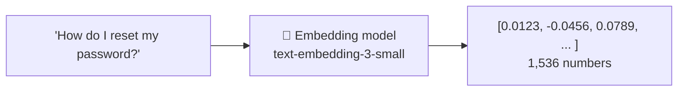

<div align="center">

# 📍 Concept 01 — Embeddings


**An embedding is a list of numbers that represents the *meaning* of a piece of text. Texts with similar meanings get similar numbers.**

[📂 Phase 2 index](../README.md) · [🗺️ Roadmap](../../README.md) · Next ➡️ `02 · Vectors and dimensions`

</div>

---

## 🎯 What you'll be able to do after this

- [ ] Explain what an embedding is and why it's useful
- [ ] Explain how an embedding model differs from a chat model
- [ ] Create an embedding with the OpenAI API and read the response
- [ ] Explain why all texts must be embedded with the **same** model
- [ ] Name the main things embeddings are used for

---

## 🧠 1. Intuition

Every place on Earth has **GPS coordinates**: two numbers. Chennai and Bengaluru have numbers that are close together; Chennai and London have numbers that are far apart. You can tell what's nearby **just by comparing numbers**, without knowing anything about the cities.

An **embedding** is GPS coordinates for **meaning**:

| | GPS | Embedding |
|---|---|---|
| Describes | A place | The meaning of a text |
| How many numbers | 2 (latitude, longitude) | Hundreds or thousands (1,536 for our model) |
| Close numbers mean | Nearby places | Similar meanings |
| Who assigns them | Satellites | An **embedding model** |

So *"How do I reset my password?"* and *"I forgot my login password"* land **near each other** on the map of meaning, even though they share few words. *"What is the capital of France?"* lands far away.

That's the trick behind search that understands what you *mean*, not just what you *typed*.

---

## ⚙️ 2. Technical Explanation

### What an embedding is

An **embedding** is a fixed-length list of decimal numbers (floats), produced by an **embedding model**, that encodes the meaning of the input text.



### Chat model vs embedding model

| | Chat model (`gpt-6-luna`) | Embedding model (`text-embedding-3-small`) |
|---|---|---|
| Input | Text | Text |
| **Output** | **Text** (generated token by token) | **Numbers** (one fixed-length list) |
| Endpoint | `client.responses.create` | `client.embeddings.create` |
| Billed for | Input **and** output tokens | **Input tokens only** (there's no generated text) |
| Randomness | Sampling makes replies vary | Same text → (practically) the same numbers |
| Speed and cost | Slower, pricier | Fast and very cheap |

### The model we use (checked 12 Oct 2026)

| Model | Numbers per embedding | Max input | Price per 1M tokens |
|---|:-:|:-:|:-:|
| **`text-embedding-3-small`** ⭐ | 1,536 | 8,192 tokens | **$0.02** |
| `text-embedding-3-large` | 3,072 | 8,192 tokens | $0.13 |
| `text-embedding-ada-002` (older) | 1,536 | 8,192 tokens | $0.10 |

`text-embedding-3-small` is **5× cheaper** than `gpt-6-luna`'s input price ($0.10 ÷ $0.02 = 5), and good enough for everything in this roadmap.

### Four properties to remember

| Property | Meaning |
|---|---|
| **Fixed length** | `"Hi"` and a 500-word paragraph both become exactly 1,536 numbers. Meaning is squeezed into the same-size list |
| **Similar meaning → similar numbers** | This is what the model was trained to do |
| **Individual numbers aren't readable** | Position 37 doesn't mean "animal-ness". Meaning is spread across all positions. Only **comparisons between embeddings** are useful |
| **Model-specific** | Embeddings from two different models live on two different "maps". You can't compare them. **Change the model → re-embed everything** |

### What embeddings are used for

| Use | How |
|---|---|
| **Semantic search** | Embed the query, find the closest document embeddings *(this phase's build)* |
| **RAG** | Semantic search + put the results in the prompt *(Phase 3)* |
| **Clustering** | Group similar texts (e.g. support tickets by topic) |
| **Classification** | Label a text by which examples it's closest to |
| **Deduplication** | Find near-identical texts |
| **Recommendations** | "Items similar to this one" |

---

## 🔢 3. Tiny Example

Real embeddings have 1,536 numbers, which is impossible to picture. So let's hand-make embeddings with just **2 numbers**: *(animal-ness, food-ness)*, each from 0 to 1.

| Word | animal-ness | food-ness |
|---|:-:|:-:|
| cat | 0.9 | 0.1 |
| dog | 0.8 | 0.2 |
| pizza | 0.1 | 0.9 |
| burger | 0.2 | 0.8 |
| chicken | 0.6 | 0.6 |

Plotted as a map (real output of `toy_meaning_map.py`):

```text
food-ness
  1.0 | . . . . . . . . . . .
  0.9 | . 3 . . . . . . . . .
  0.8 | . . 4 . . . . . . . .
  0.7 | . . . . . . . . . . .
  0.6 | . . . . . . 5 . . . .
  0.5 | . . . . . . . . . . .
  0.4 | . . . . . . . . . . .
  0.3 | . . . . . . . . . . .
  0.2 | . . . . . . . . 2 . .
  0.1 | . . . . . . . . . 1 .
  0.0 | . . . . . . . . . . .
      +----------------------
        0.0       0.5       1.0   animal-ness

1 = cat   2 = dog   3 = pizza   4 = burger   5 = chicken
```

| What you see | Meaning |
|---|---|
| 1 and 2 sit together (bottom right) | cat and dog are similar |
| 3 and 4 sit together (top left) | pizza and burger are similar |
| 5 is in the middle | chicken is both an animal **and** a food |

A real embedding model does the same thing, except it **learned** its 1,536 axes from huge amounts of text instead of us choosing two, and its axes don't have human names.

---

## 💻 4. Code

### Script 1 — A hand-made map of meaning: [`toy_meaning_map.py`](toy_meaning_map.py)

No API, no cost.

**Piece 1: the hand-made embeddings**

```python
WORDS = {
    "cat": (0.9, 0.1),
    "dog": (0.8, 0.2),
    "pizza": (0.1, 0.9),
    "burger": (0.2, 0.8),
    "chicken": (0.6, 0.6),
}

GRID_SIZE = 11  # positions 0..10 on each axis, one per 0.1 step
```

Each word maps to a **tuple** of two numbers: its coordinates.

**Piece 2: an empty grid, then place each word**

```python
grid = [["." for _ in range(GRID_SIZE)] for _ in range(GRID_SIZE)]

for number, (word, (animal, food)) in enumerate(WORDS.items(), start=1):
    column = round(animal * 10)
    row = round(food * 10)
    grid[row][column] = str(number)
    print(f"{number} = {word:<8} animal-ness {animal}, food-ness {food}")
```

| Line | What it does |
|---|---|
| `[["." for _ ...] for _ ...]` | A list of 11 rows, each a list of 11 dots: a 2-D grid |
| `enumerate(WORDS.items(), start=1)` | Gives a counter (1, 2, 3…) along with each `(word, coordinates)` pair |
| `(word, (animal, food))` | **Nested unpacking**: pulls the word and both numbers apart in one go |
| `round(animal * 10)` | Turns 0.9 into grid position 9 |
| `grid[row][column] = str(number)` | Marks that spot with the word's number |

**Piece 3: draw it**

```python
print("\nfood-ness")
for row in range(GRID_SIZE - 1, -1, -1):
    print(f"  {row / 10:.1f} | " + " ".join(grid[row]))
print("      +" + "-" * (GRID_SIZE * 2))
print("        0.0       0.5       1.0   animal-ness")
```

`range(10, -1, -1)` counts **down** from 10 to 0, so the highest food-ness is printed at the top, like a normal chart.

```bash
python phase-02-embeddings/01-embeddings/toy_meaning_map.py
```

### Script 2 — Your first real embeddings: [`first_embedding.py`](first_embedding.py)

6 tiny calls. Total cost: a few **millionths** of a dollar.

**Piece 1: setup and a helper**

```python
from dotenv import load_dotenv
from openai import OpenAI

EMBEDDING_MODEL = "text-embedding-3-small"
PRICE_PER_TOKEN = 0.02 / 1_000_000   # $0.02 per 1M tokens, checked 12 Oct 2026

load_dotenv()
client = OpenAI(timeout=60, max_retries=2)


def embed(text):
    response = client.embeddings.create(model=EMBEDDING_MODEL, input=text)
    return response.data[0].embedding, response.usage.total_tokens
```

| Line | What it does |
|---|---|
| `client.embeddings.create(...)` | The embeddings endpoint: a different door from `responses.create` |
| `model=`, `input=` | Just two parameters: which embedding model, and the text |
| `response.data` | A list with one item per input text. We sent one text, so we take `[0]` |
| `.embedding` | The list of 1,536 floats |
| `response.usage.total_tokens` | Tokens billed. There are no output tokens, because no text is generated |

**Piece 2: embed four texts and look at them**

```python
texts = [
    "How do I reset my password?",
    "I forgot my login password and need to change it.",
    "What is the capital of France?",
    "Hi",
]

total_tokens = 0
for text in texts:
    vector, tokens = embed(text)
    total_tokens += tokens
    first_five = [round(number, 4) for number in vector[:5]]
    print(f"{text!r}")
    print(f"   {len(vector)} numbers · {tokens} tokens · starts with {first_five}\n")

print(f"Total: {total_tokens} tokens = ${total_tokens * PRICE_PER_TOKEN:.8f}")
```

| Line | What it does |
|---|---|
| `vector, tokens = embed(text)` | Unpack the two returned values |
| `vector[:5]` | The first 5 numbers only (nobody wants 1,536 printed) |
| `round(number, 4)` | 4 decimal places, for readability |
| `len(vector)` | Should print **1536 for every text**, long or short |
| `:.8f` | 8 decimal places: the cost is that small |

**Piece 3: is it repeatable?**

```python
first, _ = embed("Hi")
second, _ = embed("Hi")
biggest_difference = max(abs(a - b) for a, b in zip(first, second))
print(f"Same text embedded twice, biggest difference in any position: {biggest_difference:.8f}")
```

| Line | What it does |
|---|---|
| `first, _ = embed("Hi")` | `_` is a convention for "I don't need this value" (the token count) |
| `zip(first, second)` | Pairs up position 0 with position 0, 1 with 1, … |
| `abs(a - b)` | How far apart the two numbers are, ignoring the sign |
| `max(...)` | The largest gap across all 1,536 positions |

```bash
python phase-02-embeddings/01-embeddings/first_embedding.py
```

**What to look for:**

| Check | Expect |
|---|---|
| Length | `1536 numbers` for all four texts, even `"Hi"` |
| Values | Small decimals, positive and negative, that mean nothing by eye |
| Cost | Around 26 tokens in total, roughly **$0.0000005** |
| Repeatability | A biggest difference of 0, or extremely close to 0 |

> [!NOTE]
> **The cliff-hanger:** look at the first two texts (both about passwords) and the third (France). Can you tell from the printed numbers which two are similar? **No.** Raw numbers are unreadable. You need math to compare them: that's exactly what the next concepts (vectors, dot product, cosine similarity) give you.

---

## 🎤 5. Interview Answer

> *"An embedding is a fixed-length vector of floats produced by an embedding model that encodes the meaning of a text, so semantically similar texts end up close together in that vector space. Unlike a chat model it outputs numbers rather than text, it's billed only on input tokens, and it's cheap and fast, which makes it the basis for semantic search, RAG retrieval, clustering and deduplication. The key operational rule is that embeddings are only comparable within the same model, so changing the embedding model means re-embedding the whole corpus."*

---

## 📌 Cheat Sheet

| Task | Code / fact |
|---|---|
| Create an embedding | `client.embeddings.create(model="text-embedding-3-small", input=text)` |
| Get the numbers | `response.data[0].embedding` |
| Tokens billed | `response.usage.total_tokens` |
| Length | `len(vector)` → 1536 |
| Price | $0.02 per 1M tokens (input only) |
| Max input | 8,192 tokens per text |
| Golden rule | Same model for every text you want to compare |

---

## ⚠️ Common Mistakes

| Mistake | Consequence | Fix |
|---|---|---|
| Comparing embeddings from different models | Meaningless results | One model for documents **and** queries |
| Switching models without re-embedding | Search silently breaks | Re-embed the whole collection |
| Trying to interpret single numbers | Wasted time | Only compare whole embeddings |
| Embedding text longer than 8,192 tokens | Error | Split long documents into chunks *(Phase 3)* |
| Re-embedding the same documents on every search | Slow and wasteful | Embed documents once and store them; embed only the query at search time |
| Using a chat model to "find similar text" | Slow, expensive, unreliable | Use embeddings |

---

## 📖 Glossary

| Term | Plain meaning |
|---|---|
| **Embedding** | A fixed-length list of numbers representing a text's meaning |
| **Embedding model** | A model that turns text into embeddings |
| **Vector** | A list of numbers treated as one object *(next concept)* |
| **Dimensions** | How many numbers are in the embedding *(next concept)* |
| **Semantic** | About meaning (as opposed to exact words) |
| **Semantic search** | Finding text by meaning using embeddings |
| **Corpus** | The whole collection of texts you search over |
| **Float** | A number with a decimal point |
| **`enumerate`** | Loops over items while also giving a running counter |
| **Nested unpacking** | Pulling apart nested pairs in a `for` line, e.g. `(word, (a, b))` |
| **`_`** | A variable name used by convention for a value you don't need |

---

<div align="center">

**Status:** 🟡 In progress → say **`done`** after running both scripts.

[📂 Phase 2 index](../README.md) · [🗺️ Roadmap](../../README.md)

</div>

<sub>Sources: [OpenAI — Embeddings guide](https://developers.openai.com/api/docs/guides/embeddings) · [OpenAI — Pricing](https://developers.openai.com/api/docs/pricing), both checked 12 Oct 2026 · `openai` 3.19.2 SDK (`CreateEmbeddingResponse`)</sub>
