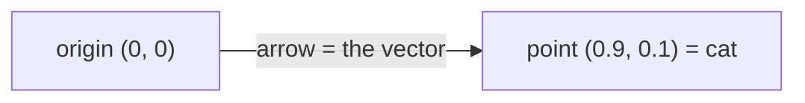

<div align="center">

# ➡️ Concept 02 — Vectors and Dimensions


**A vector is an ordered list of numbers. Its dimension is how many numbers it has. An embedding is a vector with 1,536 dimensions.**

[⬅️ 01 · Embeddings](../01-embeddings/) · [📂 Phase 2 index](../README.md) · [🗺️ Roadmap](../../README.md) · Next ➡️ [03 · NumPy arrays](../03-numpy-arrays/)

</div>

---

## 🎯 What you'll be able to do after this

- [x] Explain what a vector and a dimension are
- [x] Explain why order and equal dimensions matter
- [x] Compare two vectors position by position
- [x] Estimate how much storage embeddings need
- [x] Shorten embeddings with the `dimensions` parameter and explain the trade-off

---

## 🧠 1. Intuition

Describe a laptop with numbers: **(price, weight, screen size)** = `(65000, 1.4, 14)`.

- That ordered list is a **vector**.
- It has **3 numbers**, so it has **3 dimensions**.
- Each position always means the same thing: position 0 is *always* price. Swap the order and you've described a different laptop.

You can picture vectors up to 3 dimensions:

| Dimensions | Picture | Example |
|:-:|---|---|
| 1 | A point on a line | Temperature |
| 2 | A point on a map | (latitude, longitude) |
| 3 | A point in a room | (x, y, height) |
| 1,536 | Can't be pictured | An embedding |

Nobody can picture 1,536 dimensions, and **you don't need to**. The math that works for 2 or 3 numbers works exactly the same for 1,536. That's why we practise on tiny vectors and then apply the same code to real embeddings.

---

## ⚙️ 2. Technical Explanation

### Vocabulary

| Term | Meaning | In `[0.9, 0.1, 0.2]` |
|---|---|---|
| **Vector** | An ordered list of numbers treated as one object | the whole list |
| **Element / component** | One number in the vector | `0.1` |
| **Index** | The position of an element (Python counts from 0) | `0.1` is at index 1 |
| **Dimension** | How many elements the vector has | 3 |
| **Vector space** | All possible vectors of a given dimension; the "map" they live on | 3-D space |

### A vector is a point, and also an arrow



Every vector can be seen two ways:
- a **point**: where it sits on the map, or
- an **arrow** from the origin (all zeros) to that point. The arrow has a **direction** and a **length**.

Concepts 04–07 are all about these two properties. Similarity math compares **directions**.

### Rules that matter for embeddings

| Rule | Why |
|---|---|
| **Same dimension to compare** | Position 37 must line up with position 37. A 1,536-dim vector can't be compared with a 512-dim one |
| **Same model to compare** | Two models use the same positions for different things (Concept 01) |
| **Position-by-position math** | Comparisons combine element 0 with element 0, element 1 with element 1, and so on. This is called **element-wise** math |

### Dimensions = detail vs cost

More dimensions = more room to capture fine differences in meaning, but **more storage and slower comparisons**.

**Storage per vector:** each number is a **float**. Computers usually store floats in 4 bytes (**float32**, "32-bit float") or 8 bytes (**float64**). A **byte** is the basic unit of computer memory.

| Format | Bytes for one 1,536-dim vector |
|---|---:|
| Python list of floats | **49,592** |
| Raw float64 (8 bytes each) | 12,288 |
| Raw float32 (4 bytes each) | **6,144** |

The Python list is about **8× bigger** than raw float32 (49,592 ÷ 6,144 ≈ 8.1). That's because every Python number is a full object with extra bookkeeping. This waste is the main reason the next concept introduces **NumPy**.

### The `dimensions` parameter

`text-embedding-3` models let you ask for **shorter** embeddings:

```python
client.embeddings.create(model="text-embedding-3-small", input=text, dimensions=256)
```

| | Full (1,536) | Shortened (256) |
|---|---|---|
| Tokens billed | Same | Same, because cost depends on the input text, not the output length |
| Storage | 6,144 bytes | 1,024 bytes (**6×** smaller: 1,536 ÷ 256) |
| Comparison speed | Baseline | Faster: fewer numbers to multiply |
| Quality | Best | Somewhat lower; how much depends on your data |

Whether the quality drop matters is something you **measure** (Phase 5), not guess. For this roadmap we keep the full 1,536.

---

## 🔢 3. Tiny Example

Three 3-dimension vectors: **(animal-ness, food-ness, size)**

| Vector | animal | food | size |
|---|:-:|:-:|:-:|
| cat | 0.9 | 0.1 | 0.2 |
| dog | 0.8 | 0.2 | 0.4 |
| pizza | 0.1 | 0.9 | 0.3 |

**cat − dog, element-wise:**

| Index | cat | dog | difference |
|:-:|:-:|:-:|:-:|
| 0 | 0.9 | 0.8 | **0.1** |
| 1 | 0.1 | 0.2 | **−0.1** |
| 2 | 0.2 | 0.4 | **−0.2** |

All three differences are small, so cat and dog are close. Try cat − pizza: `[0.8, −0.8, −0.1]`, with big gaps in the first two positions, so they're far apart. In Concept 06 you'll squeeze such differences into **one** distance number.

**Storage at scale** (float32):

| Vectors | Math | Storage |
|---:|---|---:|
| 1 | 1,536 × 4 bytes | 6,144 bytes |
| 1,000 | × 1,000 | 6.1 MB |
| 1,000,000 | × 1,000,000 | **6,144 MB ≈ 6.1 GB** |

A million documents need ~6 GB just for their embeddings. That's why dimensions matter in production, and why Phase 4 introduces specialized vector storage.

---

## 💻 4. Code

### Script 1 — Vectors in plain Python: [`vector_basics.py`](vector_basics.py)

No API, no cost.

**Piece 1: vectors, dimensions, indices, order**

```python
cat = [0.9, 0.1, 0.2]
dog = [0.8, 0.2, 0.4]
pizza = [0.1, 0.9, 0.3]

print("Dimension of cat:", len(cat))
print("cat's food-ness (index 1):", cat[1])
print("Same vector?", [0.9, 0.1, 0.2] == [0.1, 0.9, 0.2])
```

| Line | What it shows |
|---|---|
| `len(cat)` | Dimension = number of elements → `3` |
| `cat[1]` | Index 1 is always food-ness → `0.1` |
| `[...] == [...]` | Same numbers, different order → `False`. **Order is meaning** |

**Piece 2: element-wise difference, and why dimensions must match**

```python
difference = [round(a - b, 2) for a, b in zip(cat, dog, strict=True)]
print("cat - dog, position by position:", difference)

try:
    [a - b for a, b in zip(cat, [0.5, 0.5], strict=True)]
except ValueError as error:
    print("3-D vs 2-D:", error)
```

| Line | What it does |
|---|---|
| `zip(cat, dog, ...)` | Pairs index 0 with index 0, 1 with 1, 2 with 2 |
| `strict=True` | **Raises an error if the lengths differ.** Without it, `zip` silently stops at the shorter list, and a wrong comparison would look fine. Available since Python 3.10 |
| `round(a - b, 2)` | Hides float noise like `0.09999999999999998` |
| `try` / `except ValueError` | Catch the mismatch error and print it instead of crashing |

**Piece 3: storage cost**

```python
DIMENSIONS = 1536
fake_embedding = [0.001 * i for i in range(DIMENSIONS)]
python_list_bytes = sys.getsizeof(fake_embedding) + sum(sys.getsizeof(x) for x in fake_embedding)
```

| Line | What it does |
|---|---|
| `fake_embedding` | 1,536 made-up floats, the same shape as a real embedding |
| `sys.getsizeof(obj)` | Memory used by one Python object, in bytes |
| `getsizeof(list) + sum(getsizeof(each float))` | The list itself (its slots) **plus** every float object it points to |

```bash
python phase-02-embeddings/02-vectors-and-dimensions/vector_basics.py
```

Real output:

```text
Dimension of cat: 3
cat's food-ness (index 1): 0.1
Same vector? False
cat - dog, position by position: [0.1, -0.1, -0.2]
3-D vs 2-D: zip() argument 2 is shorter than argument 1

One 1536-dim vector:
   as a Python list    :  49,592 bytes
   as raw 8-byte floats:  12,288 bytes
   as raw 4-byte floats:   6,144 bytes
       1,000 vectors at 4 bytes each: 6.1 MB
   1,000,000 vectors at 4 bytes each: 6,144.0 MB
```

### Script 2 — Shorter real embeddings: [`shorter_embeddings.py`](shorter_embeddings.py)

3 tiny calls.

```python
for dimensions in [1536, 512, 256]:
    response = client.embeddings.create(
        model=EMBEDDING_MODEL,
        input=TEXT,
        dimensions=dimensions,
    )
    vector = response.data[0].embedding
    print(f"asked for {dimensions:>4} → got {len(vector):>4} numbers · "
          f"{response.usage.total_tokens} tokens · "
          f"storage at 4 bytes each: {len(vector) * 4:,} bytes")
```

| Line | What it does |
|---|---|
| `dimensions=dimensions` | Ask the model for a shorter vector |
| `len(vector)` | Confirms the size you got |
| `response.usage.total_tokens` | **The same for all three**: you pay for the input text, not the vector length |
| `{...:>4}` | Right-align in 4 characters for a tidy table |

```bash
python phase-02-embeddings/02-vectors-and-dimensions/shorter_embeddings.py
```

**Expect:** 1536 / 512 / 256 numbers, the **same token count** on every line, and storage of 6,144 / 2,048 / 1,024 bytes.

---

## 🎤 5. Interview Answer

> *"A vector is an ordered list of numbers, and its dimension is how many numbers it holds; an embedding from text-embedding-3-small is a 1,536-dimension vector where each position has a consistent learned meaning. Vectors can only be compared if they come from the same model and have the same dimension, because similarity math is element-wise. Dimension is a cost lever: a 1,536-dim float32 vector is about 6 KB, so a million documents need about 6 GB, which is why models offer shorter embeddings via a `dimensions` parameter, at some measurable cost in retrieval quality."*

---

## 📌 Cheat Sheet

| Task | Code / fact |
|---|---|
| Dimension | `len(vector)` |
| One element | `vector[i]` (counting from 0) |
| Element-wise with safety | `zip(a, b, strict=True)` |
| Shorter embeddings | `client.embeddings.create(..., dimensions=256)` |
| Storage (float32) | dimensions × 4 bytes |
| 1,536-dim float32 | 6,144 bytes ≈ 6 KB |
| 1M × 1,536-dim float32 | ≈ 6.1 GB |

---

## ⚠️ Common Mistakes

| Mistake | Consequence | Fix |
|---|---|---|
| Comparing vectors of different lengths | Silent wrong results with plain `zip` | `zip(..., strict=True)` |
| `TypeError: zip() takes no keyword arguments` | `strict=` doesn't exist in your Python | You're running Python older than 3.10 (e.g. the system `/usr/bin/python3` 3.9). Use the venv's Python 3.12 |
| Mixing dimension settings (1536 stored, 256 query) | Can't compare | Use one `dimensions` setting everywhere |
| Storing embeddings as Python lists at scale | ~8× wasted memory | Use NumPy arrays *(next concept)* |
| Assuming fewer dimensions is "free" | Retrieval quality can drop | Measure before shortening *(Phase 5)* |
| Thinking you must picture 1,536-D | Unnecessary confusion | Learn on 2–3-D; the same math scales |

---

## 📖 Glossary

| Term | Plain meaning |
|---|---|
| **Vector** | An ordered list of numbers treated as one thing |
| **Element / component** | One number inside a vector |
| **Index** | An element's position (from 0) |
| **Dimension** | How many elements a vector has |
| **Vector space** | All vectors of one dimension; the "map" they live on |
| **Origin** | The all-zeros point |
| **Element-wise** | Done position by position |
| **Byte** | The basic unit of computer memory |
| **float32 / float64** | Floats stored in 4 / 8 bytes |
| **`sys.getsizeof`** | Memory size of one Python object |
| **`zip(..., strict=True)`** | Pairs items and errors if the lengths differ |
| **`dimensions` parameter** | Asks a `text-embedding-3` model for a shorter vector |

---

<div align="center">

**Status:** ✅ DONE · completed Fri 16 Oct 2026

[⬅️ 01 · Embeddings](../01-embeddings/) · [📂 Phase 2 index](../README.md) · [🗺️ Roadmap](../../README.md)

</div>

<sub>Sources: [OpenAI — Embeddings guide](https://developers.openai.com/api/docs/guides/embeddings) (`dimensions` parameter on text-embedding-3 models) · `openai` 3.19.2 SDK (`Embeddings.create` signature) · byte counts from `vector_basics.py` on Python 3.12.11</sub>
