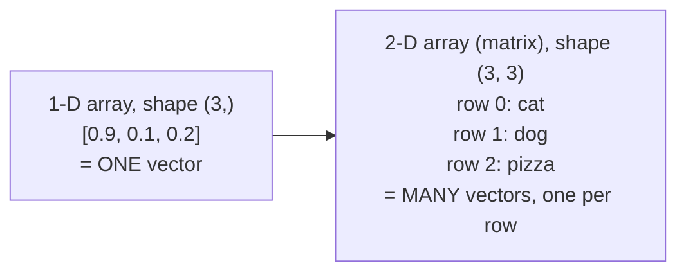

<div align="center">

# 🔢 Concept 03 — NumPy Arrays


**NumPy stores numbers in one tightly packed block and does math on the whole block at once: about 8× less memory and ~30× faster than Python lists for vector work.**

[⬅️ 02 · Vectors and dimensions](../02-vectors-and-dimensions/) · [📂 Phase 2 index](../README.md) · [🗺️ Roadmap](../../README.md) · Next ➡️ [04 · Dot product and norm](../04-dot-product-and-norm/)

</div>

---

## 🎯 What you'll be able to do after this

- [x] Explain why NumPy arrays beat Python lists for vectors
- [x] Create arrays and read their `shape`, `dtype` and `nbytes`
- [x] Do element-wise math without loops
- [x] Stack many vectors into a 2-D array (matrix) and select rows and columns
- [x] Use broadcasting to compare one query against every row at once

---

## 🧠 1. Intuition

| | 🧺 Python list | 🥚 NumPy array |
|---|---|---|
| Picture | A shelf of separate boxes, each holding a note that says where the real number is stored | An egg tray: identical slots packed side by side, each holding the number itself |
| Contents | Anything, mixed (numbers, strings, objects) | **One type only** (e.g. all 32-bit floats) |
| Math | You loop: "take box 1, then box 2, …" | One instruction for the whole tray: "subtract this from every slot" |
| Who does the work | The Python interpreter, one item at a time | Fast pre-compiled code (written in C) |

In Concept 02 you measured a 1,536-number Python list at **49,592 bytes** vs **6,144 bytes** of raw float32. NumPy *is* the raw float32 version, with a toolbox of fast math on top.

---

## ⚙️ 2. Technical Explanation

### Key terms

| Term | Meaning | Example |
|---|---|---|
| **NumPy** | Python's standard library for fast number arrays (installed with pip) | `import numpy as np` |
| **ndarray** ("array") | NumPy's array type: n-dimensional, one data type, contiguous memory | `np.array([0.9, 0.1, 0.2])` |
| **dtype** | The data type of every element | `float64` (default), `float32` |
| **shape** | The size along each axis, as a tuple | `(3,)` = 3 numbers; `(1000, 1536)` = 1,000 rows × 1,536 columns |
| **nbytes** | Total memory of the data | 3 × 8 bytes = 24 |
| **Contiguous memory** | All elements stored next to each other, with no pointers in between | why it's compact and fast |
| **Vectorization** | Running one operation over a whole array instead of a Python loop | `a - b` instead of `for` |

### 1-D array = one vector, 2-D array = many vectors



A **matrix** is a 2-D grid of numbers. For search, the standard layout is **one row per document, one column per dimension**:

```text
             dim 0   dim 1   ...   dim 1535
document 0 [  0.01   -0.03   ...    0.02  ]
document 1 [ -0.02    0.05   ...    0.00  ]
   ...
document N [  0.04    0.01   ...   -0.01  ]      shape = (N + 1, 1536)
```

### Indexing a matrix

| Code | Gives |
|---|---|
| `matrix[2]` | Row 2: one whole vector (e.g. pizza) |
| `matrix[:, 1]` | Column 1 of **every** row (`:` means "all rows") |
| `matrix[2, 1]` | One number: row 2, column 1 |
| `matrix.shape[0]` | Number of rows (vectors) |

### Broadcasting: the trick that makes search fast

**Broadcasting** = when shapes differ, NumPy automatically "stretches" the smaller array to match the bigger one, without copying data.

```text
matrix (3, 3)   -   query (3,)   →   query is applied to EVERY row   →   result (3, 3)
```

That's exactly what search needs: compare **one** query vector against **every** document vector in a single line, no loop.

### float32 vs float64

| dtype | Bytes per number | Use |
|---|:-:|---|
| `float64` (NumPy's default) | 8 | General science |
| `float32` | 4 | **Embeddings**: half the memory, plenty precise for similarity |

### ⚠️ Version note

NumPy **2.5.4** requires **Python ≥ 3.12** (checked on PyPI, 16 Oct 2026). Our venv is 3.12.11 ✅. The old system Python 3.9 that PyCharm was using can't install it, which is one more reason to switch PyCharm to the venv.

---

## 🔢 3. Tiny Example

Three items as a `(3, 3)` matrix: **(animal-ness, food-ness, size)**

```text
         animal  food  size
cat    [  0.9    0.1   0.2 ]
dog    [  0.8    0.2   0.4 ]
pizza  [  0.1    0.9   0.3 ]
```

Query: something cat/dog-like = `[0.85, 0.15, 0.3]`

**`matrix - query`**, broadcast to every row in one step:

| Item | Difference | Reading |
|---|---|---|
| cat | `[ 0.05 -0.05 -0.1 ]` | tiny gaps → close |
| dog | `[-0.05  0.05  0.1 ]` | tiny gaps → close |
| pizza | `[-0.75  0.75  0.  ]` | big gaps → far |

With Python lists that would be a loop inside a loop. With NumPy it's `matrix - query`.

**At real scale** (1,000 documents × 1,536 dimensions, real output of `list_vs_numpy.py`):

| | Python lists | NumPy float32 | Ratio |
|---|---:|---:|:-:|
| Time to subtract + sum every row | 49.9 ms | 1.5 ms | **~32× faster** (49.9 ÷ 1.5) |
| Memory | 49.6 MB | 6.1 MB | **~8× smaller** (49.6 ÷ 6.1) |

*(Timing varies run to run and machine to machine: a second run gave 37×. The size of the gap is what matters.)*

---

## 💻 4. Code

### Step 1 — Install NumPy and record it

```bash
python -m pip install numpy
```

Add the 5th line to `requirements.txt` (edit in PyCharm so the last line ends with a newline):

```text
requests==2.34.2
python-dotenv==1.2.3
openai==3.19.2
tiktoken==0.14.0
numpy==2.5.4
```

### Step 2 — The basics: [`numpy_basics.py`](numpy_basics.py)

No API, no cost.

**Piece 1: a vector as an array**

```python
import numpy as np

cat = np.array([0.9, 0.1, 0.2])
dog = np.array([0.8, 0.2, 0.4])
print("cat:", cat)
print("shape:", cat.shape, "| dtype:", cat.dtype, "| bytes:", cat.nbytes)
```

| Line | What it does |
|---|---|
| `import numpy as np` | `np` is the universal short name; you'll see it in every codebase |
| `np.array([...])` | Converts a Python list into a NumPy array |
| `cat.shape` | `(3,)`: a 1-D array of 3 numbers. The comma marks a one-element tuple |
| `cat.dtype` | `float64`, the default |
| `cat.nbytes` | `24` = 3 numbers × 8 bytes |

**Piece 2: element-wise math, no loop**

```python
print("\ncat - dog:", cat - dog)
print("cat * 2  :", cat * 2)
print("cat * dog:", cat * dog)
```

| Expression | Result | Meaning |
|---|---|---|
| `cat - dog` | `[0.1, -0.1, -0.2]` | Concept 02's zip-loop, in 9 characters |
| `cat * 2` | `[1.8, 0.2, 0.4]` | A single number is applied to every element |
| `cat * dog` | `[0.72, 0.02, 0.08]` | Element-wise multiply: position 0 × position 0, etc. (keep this one in mind for Concept 04) |

**Piece 3: a matrix of vectors**

```python
items = ["cat", "dog", "pizza"]
matrix = np.array([
    [0.9, 0.1, 0.2],
    [0.8, 0.2, 0.4],
    [0.1, 0.9, 0.3],
])
print("\nmatrix shape:", matrix.shape, "→", matrix.shape[0], "vectors of", matrix.shape[1], "dimensions")
print("row 2 (pizza):", matrix[2])
print("column 1 (food-ness of every item):", matrix[:, 1])
```

| Line | What it does |
|---|---|
| `np.array([[...], [...], [...]])` | A list of lists becomes a 2-D array; each inner list is a row |
| `matrix.shape` | `(3, 3)`: 3 rows (vectors), 3 columns (dimensions) |
| `matrix[2]` | One row = one whole vector |
| `matrix[:, 1]` | `:` = every row, `1` = column 1 → food-ness of all items |
| `items` | A separate Python list holding the **names**, in the same order as the rows. Row *i* ↔ `items[i]`. Your search build will use exactly this pattern |

**Piece 4: broadcasting, one query against every row**

```python
query = np.array([0.85, 0.15, 0.3])   # something cat/dog-like
differences = matrix - query
print("\nmatrix - query (one row per item):")
for item, row in zip(items, differences):
    print(f"   {item:<6} {np.round(row, 2)}")
```

| Line | What it does |
|---|---|
| `matrix - query` | Shape `(3, 3)` minus shape `(3,)`: NumPy broadcasts the query across all 3 rows |
| `zip(items, differences)` | Pairs each name with its row of differences |
| `np.round(row, 2)` | Rounds every element to 2 decimals |

**Piece 5: halve the memory with float32**

```python
small = matrix.astype(np.float32)
print("\nfloat64 bytes:", matrix.nbytes, "| float32 bytes:", small.nbytes)
```

`.astype(np.float32)` makes a converted copy: 72 bytes → 36 bytes.

```bash
python phase-02-embeddings/03-numpy-arrays/numpy_basics.py
```

Real output:

```text
cat: [0.9 0.1 0.2]
shape: (3,) | dtype: float64 | bytes: 24

cat - dog: [ 0.1 -0.1 -0.2]
cat * 2  : [1.8 0.2 0.4]
cat * dog: [0.72 0.02 0.08]

matrix shape: (3, 3) → 3 vectors of 3 dimensions
row 2 (pizza): [0.1 0.9 0.3]
column 1 (food-ness of every item): [0.1 0.2 0.9]

matrix - query (one row per item):
   cat    [ 0.05 -0.05 -0.1 ]
   dog    [-0.05  0.05  0.1 ]
   pizza  [-0.75  0.75  0.  ]

float64 bytes: 72 | float32 bytes: 36
```

### Step 3 — Lists vs NumPy at real scale: [`list_vs_numpy.py`](list_vs_numpy.py)

No API. It creates 1,000 random "embeddings" of 1,536 numbers and runs the same task both ways.

**Piece 1: identical data in both forms**

```python
random.seed(42)
documents_list = [[random.random() for _ in range(DIMENSIONS)] for _ in range(COUNT)]
query_list = [random.random() for _ in range(DIMENSIONS)]

documents_np = np.array(documents_list, dtype=np.float32)
query_np = np.array(query_list, dtype=np.float32)
```

| Line | What it does |
|---|---|
| `random.seed(42)` | Fixes the random numbers so every run uses the same data (**reproducible**) |
| `random.random()` | A random float between 0 and 1 |
| `dtype=np.float32` | Store as 4-byte floats, like a real embedding store would |

**Piece 2: the same task, timed both ways**

```python
start = time.perf_counter()
totals_list = [sum(d - q for d, q in zip(document, query_list)) for document in documents_list]
list_seconds = time.perf_counter() - start

start = time.perf_counter()
totals_np = (documents_np - query_np).sum(axis=1)
numpy_seconds = time.perf_counter() - start
```

| Line | What it does |
|---|---|
| The list version | 1,000 documents × 1,536 subtractions = **1.5 million** Python-level steps |
| `documents_np - query_np` | Broadcasting: the query subtracted from all 1,000 rows at once |
| `.sum(axis=1)` | Add up **across columns**, giving one total per row. (`axis=0` would add down each column instead) |
| `time.perf_counter()` | The precise stopwatch from Phase 1 · 11 |

**Piece 3: same answer? and memory**

```python
print(f"Same answers? {np.allclose(totals_list, totals_np, atol=1e-2)}")
```

`np.allclose` checks two sets of numbers are equal **within a tolerance** (`atol=1e-2` = 0.01). We need a tolerance because float32 rounds slightly differently from Python's 8-byte floats.

```bash
python phase-02-embeddings/03-numpy-arrays/list_vs_numpy.py
```

Real output (timing will differ on your machine):

```text
Python lists:     49.9 ms
NumPy       :      1.5 ms
NumPy is about 32× faster
Same answers? True

Memory for 1,000 vectors:
   Python lists  :   49.6 MB
   NumPy float32 :    6.1 MB
```

---

## 🎤 5. Interview Answer

> *"NumPy arrays store numbers of a single dtype in contiguous memory and run operations in compiled code, so vector math is vectorized instead of looping in Python: in my test on 1,000 1,536-dimension embeddings it was about 30× faster and 8× smaller than Python lists, especially with float32. For semantic search I keep all document embeddings in one 2-D array with one row per document and a parallel list of IDs, then use broadcasting to compare a query against every row in a single operation."*

---

## 📌 Cheat Sheet

| Task | Code |
|---|---|
| Import | `import numpy as np` |
| List → array | `np.array(values, dtype=np.float32)` |
| Size info | `a.shape`, `a.dtype`, `a.nbytes` |
| Element-wise | `a + b`, `a - b`, `a * b`, `a * 2` |
| One row / one column | `m[i]`, `m[:, j]` |
| Rows × columns | `m.shape[0]`, `m.shape[1]` |
| Query vs all rows | `m - query` (broadcasting) |
| Sum each row | `m.sum(axis=1)` |
| Convert dtype | `a.astype(np.float32)` |
| Compare floats | `np.allclose(a, b)` |

---

## ⚠️ Common Mistakes

| Mistake | Consequence | Fix |
|---|---|---|
| Looping over array elements in Python | Throws away NumPy's speed | Use whole-array operations |
| Mixing up `axis=0` and `axis=1` | Totals per column instead of per row | `axis=1` = across a row (one result per row) |
| Losing track of which row is which item | Wrong search results | Keep a parallel `items` list in the **same order** |
| Comparing floats with `==` | False "not equal" from tiny rounding | `np.allclose` |
| Default float64 for embeddings | Double the memory | `dtype=np.float32` |
| Installing NumPy with Python 3.9 | **Happened here (16 Oct 2026):** PyCharm's 3.9 interpreter silently installed **NumPy 2.0.2**, the newest version that still supports 3.9, while the project venv got nothing | Check `python --version` before `pip install`; use the venv's Python 3.12 |
| Forgetting `requirements.txt` | Others can't run your code | Add `numpy==2.5.4` |

---

## 📖 Glossary

| Term | Plain meaning |
|---|---|
| **NumPy** | Python library for fast numeric arrays |
| **ndarray / array** | NumPy's array: one data type, packed memory, any number of axes |
| **dtype** | The data type of the elements (`float32`, `float64`, …) |
| **shape** | Size along each axis, e.g. `(1000, 1536)` |
| **Axis** | One direction of an array: axis 0 = rows, axis 1 = columns |
| **Matrix** | A 2-D grid of numbers; here, one row per vector |
| **Contiguous memory** | Elements stored side by side |
| **Vectorization** | Doing math on whole arrays instead of looping |
| **Broadcasting** | NumPy stretching a smaller array to fit a bigger one in an operation |
| **Reproducible** | Gives the same result every run (e.g. thanks to a fixed random seed) |
| **Tolerance** | How much difference still counts as "equal" when comparing floats |

---

<div align="center">

**Status:** ✅ DONE · completed Fri 16 Oct 2026 · in the project venv: lists 62.8 ms vs NumPy 1.3 ms (~50×)

[⬅️ 02 · Vectors and dimensions](../02-vectors-and-dimensions/) · [📂 Phase 2 index](../README.md) · [🗺️ Roadmap](../../README.md)

</div>

<sub>Sources: [PyPI — numpy](https://pypi.org/project/numpy/) (2.5.4, requires Python ≥ 3.12, checked 16 Oct 2026) · all outputs from running these scripts with NumPy 2.5.4 on Python 3.12.11</sub>
