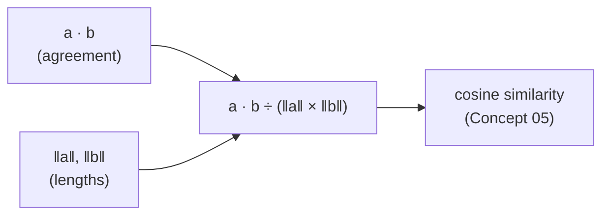

<div align="center">

# ✖️ Concept 04 — Dot Product and Norm


**The dot product measures how much two vectors agree. The norm measures how long a vector is. Together they're the building blocks of every similarity score.**

[⬅️ 03 · NumPy arrays](../03-numpy-arrays/) · [📂 Phase 2 index](../README.md) · [🗺️ Roadmap](../../README.md) · Next ➡️ `05 · Cosine similarity`

</div>

---

## 🎯 What you'll be able to do after this

- [ ] Compute a dot product and a norm by hand and in code
- [ ] Explain what a large, zero or negative dot product means
- [ ] Score one query against many vectors with `matrix @ query`
- [ ] Explain the "length problem" that makes raw dot products unreliable

---

## 🧠 1. Intuition

### Dot product = "how much do we agree, position by position?"

Two people rate three things from 0 to 1:

| | spicy food | horror films | hiking |
|---|:-:|:-:|:-:|
| You | 0.9 | 0.1 | 0.8 |
| Friend A | 0.8 | 0.2 | 0.9 |
| Friend B | 0.1 | 0.9 | 0.1 |

Multiply each column and add the results up:

- **You · A** = 0.9×0.8 + 0.1×0.2 + 0.8×0.9 = 0.72 + 0.02 + 0.72 = **1.46**. You both love the same things.
- **You · B** = 0.9×0.1 + 0.1×0.9 + 0.8×0.1 = 0.09 + 0.09 + 0.08 = **0.26**. You love different things.

When both are **high in the same positions**, the products are big and the total is big. That's the dot product.

### Norm = "how long is the arrow?"

Walk 3 steps east and 4 steps north. How far are you from the start? **5** (the classic 3-4-5 triangle). The **norm** is that straight-line length, computed the same way for any number of dimensions.

---

## ⚙️ 2. Technical Explanation

### Dot product

For two vectors of the same dimension:

```text
a · b  =  a₀×b₀  +  a₁×b₁  +  …  +  aₙ×bₙ
```

Multiply matching positions (the element-wise `a * b` from Concept 03), then **sum** them. The result is **one number** (a **scalar**).

| Dot product | Meaning (arrows from the origin) |
|---|---|
| **Large positive** | They point in a similar direction: similar |
| **≈ 0** | They're at right angles: unrelated |
| **Negative** | They point in opposite directions |

### Norm (length, magnitude)

```text
‖a‖  =  √(a₀² + a₁² + … + aₙ²)  =  √(a · a)
```

- `‖a‖` is read "the norm of a".
- `√` is the **square root**.
- This is **Pythagoras' theorem** (the long side of a right triangle is √(side₁² + side₂²)), extended to any number of dimensions.
- It's also called the **L2 norm** or **Euclidean length**. Note that the norm is just the dot product of a vector with **itself**, square-rooted.

### How they connect



Geometrically, the dot product equals **‖a‖ × ‖b‖ × (a number that depends only on the angle between them)**. So it mixes two things: **direction** (what we care about: meaning) and **length** (which we don't). Dividing the lengths back out leaves pure direction. That's cosine similarity, the next concept.

### The length problem

Double a vector and it points the **same way** (same meaning), but its dot products **double** too:

| | Vector | Norm | Dot with cat |
|---|---|:-:|:-:|
| dog | `[0.8, 0.2, 0.4]` | 0.917 | 0.82 |
| big_dog = dog × 2 | `[1.6, 0.4, 0.8]` | 1.833 | **1.64** |
| cat itself | `[0.9, 0.1, 0.2]` | 0.927 | 0.86 |

`big_dog` scores **1.64 with cat**, higher than **cat with itself (0.86)**. By raw dot product, a "longer" dog beats an identical cat. That's why raw dot products can't be trusted for similarity **unless all vectors have the same length**. (Spoiler for Concept 07: OpenAI embeddings do all have length 1. You'll see it in today's real-embedding run.)

### NumPy tools

| Task | Code |
|---|---|
| Dot product | `np.dot(a, b)` or `a @ b` |
| Norm | `np.linalg.norm(a)` |
| One query against **every row** | `matrix @ query` → one score per row |
| Index of the highest score | `np.argmax(scores)` |

`@` is Python's **matrix multiplication operator**. For a matrix and a vector, it computes the dot product of the vector with **each row**. That one character is the core of brute-force semantic search.

---

## 🔢 3. Tiny Example

`cat = [0.9, 0.1, 0.2]`, `dog = [0.8, 0.2, 0.4]`, `pizza = [0.1, 0.9, 0.3]`

**Dot products by hand:**

| Pair | Products | Sum |
|---|---|:-:|
| cat · dog | 0.9×0.8 = 0.72, 0.1×0.2 = 0.02, 0.2×0.4 = 0.08 | **0.82** |
| cat · pizza | 0.9×0.1 = 0.09, 0.1×0.9 = 0.09, 0.2×0.3 = 0.06 | **0.24** |

cat is much "closer" to dog than to pizza. ✅

**Norms by hand:**

| Vector | Squares | Sum | √ |
|---|---|:-:|:-:|
| `[3, 4]` | 9 + 16 | 25 | **5** |
| cat | 0.81 + 0.01 + 0.04 | 0.86 | **0.927** |

**Search in miniature.** For query `[0.85, 0.15, 0.3]`, `matrix @ query` gives:

| Row | Score |
|---|:-:|
| cat | **0.840** ← best |
| dog | 0.830 |
| pizza | 0.310 |

---

## 💻 4. Code

### Script 1 — From scratch, then NumPy: [`dot_and_norm.py`](dot_and_norm.py)

No API, no cost.

**Piece 1: from scratch in plain Python** (the from-scratch-first rule)

```python
def dot_product(a, b):
    return sum(x * y for x, y in zip(a, b, strict=True))


def norm(a):
    return math.sqrt(sum(x * x for x in a))
```

| Line | What it does |
|---|---|
| `zip(a, b, strict=True)` | Pair matching positions; error if the lengths differ (Concept 02) |
| `x * y ... sum(...)` | Multiply each pair, add everything up: **the dot product** |
| `x * x` | Square each element |
| `math.sqrt(...)` | Square root of the sum: **the norm** |

**Piece 2: the same in NumPy**

```python
cat_np, dog_np = np.array(cat), np.array(dog)
print(f"   np.dot(cat, dog)       = {np.dot(cat_np, dog_np):.2f}")
print(f"   cat @ dog              = {cat_np @ dog_np:.2f}")
print(f"   np.linalg.norm(cat)    = {np.linalg.norm(cat_np):.3f}")
```

Same answers as Piece 1, but running in fast compiled code. `np.linalg` is NumPy's **linear algebra** module (linear algebra = the math of vectors and matrices).

**Piece 3: one query against every row**

```python
items = ["cat", "dog", "pizza"]
matrix = np.array([cat, dog, pizza])
query = np.array([0.85, 0.15, 0.3])
scores = matrix @ query
for item, score in zip(items, scores):
    print(f"   {item:<6} {score:.3f}")
print("   best match:", items[int(np.argmax(scores))])
```

| Line | What it does |
|---|---|
| `matrix @ query` | Shape `(3, 3) @ (3,)` → shape `(3,)`: **one dot product per row** |
| `np.argmax(scores)` | The **index** of the highest score (`0` here, so cat) |
| `int(...)` | Convert NumPy's integer type to a plain Python `int` for list indexing |
| `items[...]` | Map the row number back to its name (the parallel list from Concept 03) |

**Piece 4: the length problem**

```python
big_dog = np.array(dog) * 2
print(f"   dog     = ... norm {np.linalg.norm(dog):.3f}  dot with cat {cat_np @ np.array(dog):.2f}")
print(f"   big_dog = ... norm {np.linalg.norm(big_dog):.3f}  dot with cat {cat_np @ big_dog:.2f}")
```

Same direction, double the length → double the dot product.

```bash
python phase-02-embeddings/04-dot-product-and-norm/dot_and_norm.py
```

Real output:

```text
From scratch:
   dot(cat, dog)   = 0.82
   dot(cat, pizza) = 0.24
   norm([3, 4])    = 5.00
   norm(cat)       = 0.927
   sqrt(dot(cat, cat)) = 0.927   (same as norm)

NumPy:
   np.dot(cat, dog)       = 0.82
   cat @ dog              = 0.82
   np.linalg.norm(cat)    = 0.927

matrix @ query (one dot product per row):
   cat    0.840
   dog    0.830
   pizza  0.310
   best match: cat

The length problem:
   dog     = [0.8 0.2 0.4]  norm 0.917  dot with cat 0.82
   big_dog = [1.6 0.4 0.8]  norm 1.833  dot with cat 1.64
```

### Script 2 — Dot products on real embeddings: [`real_dot_products.py`](real_dot_products.py)

4 tiny embedding calls. **This is your first real semantic search.**

```python
def embed(text):
    response = client.embeddings.create(model=EMBEDDING_MODEL, input=text)
    return np.array(response.data[0].embedding, dtype=np.float32)


query = "How do I reset my password?"
documents = [
    "I forgot my login password and need to change it.",
    "Where can I download my monthly invoice?",
    "What is the capital of France?",
]

query_vector = embed(query)
document_matrix = np.array([embed(text) for text in documents])

print(f"Query norm: {np.linalg.norm(query_vector):.4f}")
print(f"Matrix shape: {document_matrix.shape}\n")

scores = document_matrix @ query_vector
for text, score in sorted(zip(documents, scores), key=lambda pair: pair[1], reverse=True):
    print(f"   {score:.4f}  {text}")
```

| Line | What it does |
|---|---|
| `embed()` returns `np.array(..., float32)` | Real embeddings go straight into NumPy |
| `np.array([embed(t) for t in documents])` | Stack 3 vectors into a `(3, 1536)` matrix |
| `np.linalg.norm(query_vector)` | **Look at this number.** What's special about it? |
| `document_matrix @ query_vector` | 3 dot products, one per document |
| `sorted(zip(...), key=lambda pair: pair[1], reverse=True)` | Pair each text with its score, then sort by the score (`pair[1]`), highest first. A **lambda** is a tiny unnamed function: `lambda pair: pair[1]` means "given a pair, return its second item" |

```bash
python phase-02-embeddings/04-dot-product-and-norm/real_dot_products.py
```

**What to look for:**

| Check | Expect |
|---|---|
| Ranking | The forgot-password sentence on top, France at the bottom, though it shares almost no words with the query |
| Query norm | Very close to **1.0000**. OpenAI embeddings come pre-scaled to length 1 *(why that matters: Concepts 05 and 07)* |
| Matrix shape | `(3, 1536)` |

---

## 🎤 5. Interview Answer

> *"The dot product multiplies two vectors element-wise and sums the result; it's large when they're high in the same dimensions, near zero when they're unrelated and negative when they point opposite ways, and `matrix @ query` computes it against every stored vector in one operation. The norm is the vector's length, the square root of its dot product with itself. Because the dot product grows with length as well as direction, it's only a reliable similarity score when vectors are normalized, which is why we use cosine similarity or embeddings that are already unit length."*

---

## 📌 Cheat Sheet

| Task | Plain Python | NumPy |
|---|---|---|
| Dot product | `sum(x*y for x, y in zip(a, b))` | `a @ b` / `np.dot(a, b)` |
| Norm | `math.sqrt(sum(x*x for x in a))` | `np.linalg.norm(a)` |
| Score every row | loop | `matrix @ query` |
| Best row | `max(range(n), key=...)` | `np.argmax(scores)` |
| Sort pairs by score | `sorted(pairs, key=lambda p: p[1], reverse=True)` | `np.argsort(-scores)` |

---

## ⚠️ Common Mistakes

| Mistake | Consequence | Fix |
|---|---|---|
| Using `a * b` and expecting one number | You get a vector of products | `a @ b` (multiply **and** sum) |
| `query @ matrix` with the wrong shapes | Shape error, or the wrong axis | Rows = documents: `matrix @ query` |
| Ranking by raw dot product with mixed vector lengths | Longer vectors win unfairly | Normalize, or use cosine *(05, 07)* |
| Forgetting that `argmax` returns an **index** | Printing `0` instead of a name | `items[int(np.argmax(scores))]` |
| Sorting scores without their texts | Lose track of which score belongs to which text | Sort `zip(texts, scores)` pairs |

---

## 📖 Glossary

| Term | Plain meaning |
|---|---|
| **Dot product** | Sum of element-wise products; measures agreement |
| **Scalar** | A single number (as opposed to a vector) |
| **Norm / magnitude / L2 norm** | A vector's length: √(sum of squares) |
| **Square root (√)** | The number that, multiplied by itself, gives the original |
| **Pythagoras' theorem** | Long side of a right triangle = √(side₁² + side₂²) |
| **Linear algebra** | The math of vectors and matrices |
| **`@`** | Python's matrix-multiplication operator |
| **`np.argmax`** | Index of the largest value |
| **Lambda** | A tiny unnamed one-line function, e.g. `lambda pair: pair[1]` |
| **Brute-force search** | Comparing the query with **every** stored vector (Phase 4 shows when this gets slow) |

---

<div align="center">

**Status:** 🟡 In progress → say **`done`** after running both scripts.

[⬅️ 03 · NumPy arrays](../03-numpy-arrays/) · [📂 Phase 2 index](../README.md) · [🗺️ Roadmap](../../README.md)

</div>

<sub>Outputs from running these scripts with NumPy 2.5.4 on Python 3.12.11 · OpenAI embeddings are normalized to length 1 per the [OpenAI Embeddings guide](https://developers.openai.com/api/docs/guides/embeddings)</sub>
