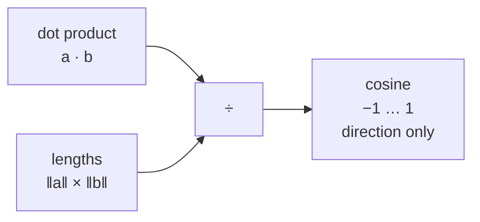

<div align="center">

# 📐 Concept 05 — Cosine Similarity


**Cosine similarity compares the *direction* of two vectors and ignores their length. It's the standard way to say "how similar in meaning" two embeddings are.**

[⬅️ 04 · Dot product and norm](../04-dot-product-and-norm/) · [📂 Phase 2 index](../README.md) · [🗺️ Roadmap](../../README.md) · Next ➡️ `06 · L2 distance`

</div>

---

## 🎯 What you'll be able to do after this

- [ ] Explain cosine similarity as "angle between arrows"
- [ ] Compute it from the dot product and norms
- [ ] Read values from −1 to 1
- [ ] Score a query against a whole matrix of embeddings
- [ ] Explain why cosine equals the dot product for OpenAI embeddings

---

## 🧠 1. Intuition

Two cooks make the same masala: one makes a **small pot**, one makes a **huge pot**. The amounts are completely different, but the **proportions** are identical, so it tastes the same.

| | Small pot | Huge pot |
|---|:-:|:-:|
| Chilli | 1 spoon | 10 spoons |
| Turmeric | 2 spoons | 20 spoons |
| Salt | 1 spoon | 10 spoons |

- The **dot product** (Concept 04) would call the huge pot "more similar" to everything, just because it's bigger. That's the length problem.
- **Cosine similarity** only asks: *are the proportions the same?* Same proportions = same direction = **cosine 1.0**.

For embeddings, **direction = meaning**. Length is noise. Cosine keeps the meaning and throws away the noise.

---

## ⚙️ 2. Technical Explanation

### The formula

```text
                       a · b
cosine(a, b)  =  ─────────────────
                  ‖a‖  ×  ‖b‖
```

Take the dot product (agreement × lengths), then **divide out both lengths**. What's left depends only on the **angle θ** (the Greek letter theta) between the two arrows: it *is* the **cosine of that angle**, written cos θ.

### Reading the value

| Angle between arrows | cosine | Meaning for embeddings |
|:-:|:-:|---|
| 0° (same direction) | **1.0** | Same meaning |
| 45° | 0.707 | Related |
| 90° (right angle) | **0.0** | Unrelated |
| 180° (opposite) | **−1.0** | Opposite direction |

The range is always **−1 to 1**, regardless of dimension or vector length. That's what makes scores comparable across queries.



### Cosine distance

Some tools report **cosine distance = 1 − cosine similarity** instead: 0 = identical, 2 = opposite. Same information, flipped so that **smaller = closer**. Always check which one a library returns.

### Real-world readings for text embeddings

| Fact | Consequence |
|---|---|
| Real text embeddings rarely produce strongly **negative** cosines | In practice scores mostly sit between 0 and 1 |
| Absolute values depend on the model | "0.6" doesn't mean the same thing in every model. **Rank** results by score; set any cut-off threshold by **measuring** on your own data (Phase 5) |
| OpenAI embeddings are pre-normalized to length 1 | ‖a‖ = ‖b‖ = 1, so the formula's denominator is 1 × 1 = 1 and **cosine = dot product**. Concept 07 explains how to use that |

### Vectorized: one query against every row

```python
(matrix @ query) / (np.linalg.norm(matrix, axis=1) * np.linalg.norm(query))
```

| Part | Shape (N documents, 1,536 dims) | Meaning |
|---|---|---|
| `matrix @ query` | `(N,)` | Every document's dot product with the query |
| `np.linalg.norm(matrix, axis=1)` | `(N,)` | Every document's length (`axis=1` = across each row) |
| `np.linalg.norm(query)` | a single number | The query's length |
| `/` | `(N,)` | Element-wise division → **N cosine scores** |

---

## 🔢 3. Tiny Example

**Angles you can picture** (2-D, comparing everything with `east = [1, 0]`):

| Other vector | Picture | cosine |
|---|---|:-:|
| `[2, 0]` | same way, twice as long | **1.000** |
| `[1, 1]` | 45° up | **0.707** |
| `[0, 1]` | straight up, 90° | **0.000** |
| `[-1, 0]` | pointing west | **−1.000** |

**By hand:** cosine(east, `[1, 1]`) = (1×1 + 0×1) ÷ (1 × √2) = 1 ÷ 1.414 = **0.707**.

**The length problem, fixed:**

| | dot product | cosine |
|---|:-:|:-:|
| cat vs dog | 0.820 | **0.965** |
| cat vs big_dog (dog × 2) | 1.640 | **0.965** |

The dot product doubled; cosine **didn't change**. cosine(cat, dog) = 0.82 ÷ (0.927 × 0.917) = 0.82 ÷ 0.850 = **0.965**.

**Ranking a query `[0.85, 0.15, 0.3]`:**

| Item | dot | cosine |
|---|:-:|:-:|
| cat | 0.840 | **0.991** |
| dog | 0.830 | **0.991** |
| pizza | 0.310 | 0.356 |
| big_dog | **1.660** ← dot's "winner" | **0.991** |

By dot product, `big_dog` wins just for being long. By cosine, cat, dog and big_dog tie (same direction), and pizza is clearly last. ✅

---

## 💻 4. Code

### Script 1 — Cosine from scratch: [`cosine_from_scratch.py`](cosine_from_scratch.py)

No API, no cost.

**Piece 1: cosine built from Concept 04's two functions**

```python
def dot_product(a, b):
    return sum(x * y for x, y in zip(a, b, strict=True))


def norm(a):
    return math.sqrt(sum(x * x for x in a))


def cosine_similarity(a, b):
    return dot_product(a, b) / (norm(a) * norm(b))
```

One new line: **dot ÷ (length × length)**. That's the whole formula.

**Piece 2: angles you can picture**

```python
east = [1, 0]
for name, other in [("same way     ", [2, 0]), ("45° apart    ", [1, 1]),
                    ("right angle  ", [0, 1]), ("opposite     ", [-1, 0])]:
    print(f"   {name} {other!s:<8} cosine = {cosine_similarity(east, other):6.3f}")
```

| Part | What it does |
|---|---|
| `for name, other in [(...), ...]` | Loop over (label, vector) pairs |
| `{other!s:<8}` | `!s` converts the list to text, `:<8` pads it to 8 characters |
| `:6.3f` | 6 characters wide, 3 decimals, so the minus sign lines up |

**Piece 3: the length problem, fixed**

```python
big_dog = [x * 2 for x in dog]
print(f"   dot(cat, dog)     = {dot_product(cat, dog):.3f}   cosine = {cosine_similarity(cat, dog):.3f}")
print(f"   dot(cat, big_dog) = {dot_product(cat, big_dog):.3f}   cosine = {cosine_similarity(cat, big_dog):.3f}")
```

**Piece 4: NumPy, one query against every row**

```python
def cosine_scores(matrix, query):
    return (matrix @ query) / (np.linalg.norm(matrix, axis=1) * np.linalg.norm(query))
```

**This function goes into your Phase 2 build.** `axis=1` gives one length per row (Concept 03's axis rule).

```bash
python phase-02-embeddings/05-cosine-similarity/cosine_from_scratch.py
```

Real output:

```text
Direction check (2-D):
   same way      [2, 0]   cosine =  1.000
   45° apart     [1, 1]   cosine =  0.707
   right angle   [0, 1]   cosine =  0.000
   opposite      [-1, 0]  cosine = -1.000

The length problem, fixed:
   dot(cat, dog)     = 0.820   cosine = 0.965
   dot(cat, big_dog) = 1.640   cosine = 0.965

Query vs every row:
   item        dot  cosine
   cat       0.840   0.991
   dog       0.830   0.991
   pizza     0.310   0.356
   big_dog   1.660   0.991
```

### Script 2 — Cosine on real embeddings: [`real_cosine.py`](real_cosine.py)

6 tiny embedding calls. Five documents chosen to sit at **different distances** from the query:

```python
query = "How do I reset my password?"
documents = [
    "I forgot my login password and need to change it.",   # same meaning, different words
    "How can I change the email address on my account?",   # same topic area (account settings)
    "Where can I download my monthly invoice?",            # same app, different task
    "The app crashes when I open the settings page.",      # support, but a bug report
    "What is the capital of France?",                      # unrelated
]
```

**Rank by cosine, and compare it with the dot product:**

```python
cosines = cosine_scores(document_matrix, query_vector)
dots = document_matrix @ query_vector

for index in np.argsort(-cosines):
    print(f"   {cosines[index]:7.4f}  {dots[index]:7.4f}  {documents[index]}")

print(f"\nLargest |cosine - dot| across all documents: {np.max(np.abs(cosines - dots)):.6f}")
```

| Line | What it does |
|---|---|
| `np.argsort(-cosines)` | **Indices** that would sort the scores. `-cosines` flips the sign so the **highest** comes first. Another way to sort than Concept 04's `sorted(zip(...))` |
| `cosines[index]`, `documents[index]` | Use the same index to fetch the score and its text |
| `np.abs(cosines - dots)` | How far apart cosine and dot are for each document |
| `np.max(...)` | The worst-case gap |

```bash
python phase-02-embeddings/05-cosine-similarity/real_cosine.py
```

**What to look for:**

| Check | Expect |
|---|---|
| Ranking order | Roughly the order of the comments: same meaning → same topic → same app → bug report → France |
| Score gaps | The paraphrase clearly above the rest; France clearly lowest |
| Cosine vs dot columns | **Practically identical**, because OpenAI vectors have length ≈ 1 |
| Largest gap | A tiny number like `0.000001` (float32 rounding) |

---

## 🎤 5. Interview Answer

> *"Cosine similarity is the dot product divided by the product of the two vectors' norms, which equals the cosine of the angle between them, so it measures direction and ignores length; it ranges from −1 to 1, with 1 meaning same direction and 0 meaning unrelated. That's why it's the default for text embeddings, where direction carries meaning. Since OpenAI embeddings are already unit length, cosine equals the plain dot product, so in practice I normalize once and rank with a single matrix multiply, and I treat score thresholds as model-specific values to tune on evaluation data."*

---

## 📌 Cheat Sheet

| Task | Code |
|---|---|
| Cosine, plain Python | `dot(a, b) / (norm(a) * norm(b))` |
| Cosine, NumPy (2 vectors) | `a @ b / (np.linalg.norm(a) * np.linalg.norm(b))` |
| Cosine, query vs matrix | `(M @ q) / (np.linalg.norm(M, axis=1) * np.linalg.norm(q))` |
| Rank highest first | `np.argsort(-scores)` |
| Cosine distance | `1 - cosine` |
| Unit-length vectors (OpenAI) | cosine == dot product |

---

## ⚠️ Common Mistakes

| Mistake | Consequence | Fix |
|---|---|---|
| Ranking by raw dot product on non-normalized vectors | Long vectors win unfairly | Use cosine, or normalize first |
| Confusing cosine **similarity** with cosine **distance** | Results sorted backwards | Similarity: higher = closer. Distance: lower = closer |
| Using one fixed threshold ("> 0.8 = match") from a blog post | Misses or false matches | Measure thresholds on your own data |
| Forgetting `axis=1` when computing row norms | One norm for the whole matrix → wrong scores | `np.linalg.norm(M, axis=1)` |
| Dividing by zero for an all-zero vector | `nan` scores | Guard against empty/zero vectors |
| `np.argsort(scores)` without the minus | Lowest score first | `np.argsort(-scores)` |

---

## 📖 Glossary

| Term | Plain meaning |
|---|---|
| **Cosine similarity** | Dot product ÷ (length × length); measures direction only, from −1 to 1 |
| **Angle θ (theta)** | The angle between two arrows |
| **cos θ** | The cosine of that angle: 1 at 0°, 0 at 90°, −1 at 180° |
| **Cosine distance** | 1 − cosine similarity; lower = closer |
| **Unit vector** | A vector with length (norm) exactly 1 |
| **`np.argsort`** | Returns the indices that would sort an array |
| **Threshold** | A cut-off score above which you call something a match |
| **`nan`** | "Not a number": the result of invalid math like 0 ÷ 0 |

---

<div align="center">

**Status:** 🟡 In progress → say **`done`** after running both scripts.

[⬅️ 04 · Dot product and norm](../04-dot-product-and-norm/) · [📂 Phase 2 index](../README.md) · [🗺️ Roadmap](../../README.md)

</div>

<sub>Outputs from running `cosine_from_scratch.py` with NumPy 2.5.4 on Python 3.12.11 · normalization of OpenAI embeddings and cosine recommendation from the [OpenAI Embeddings guide](https://developers.openai.com/api/docs/guides/embeddings)</sub>
