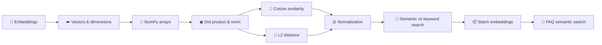

# 📐 Phase 2 — Embeddings & Semantic Search

**Turn text into numbers that capture meaning, then use simple math to find the most similar text.**

[🗺️ Back to roadmap](../README.md) · [⬅️ Phase 1](../phase-01-llm-foundations/)

---

## 🔨 Build goal

> **Semantic search over ~20 FAQ sentences using NumPy:** type a question in your own words and get the closest FAQ, even when no keywords match.

## 🧩 Concepts

| # | Concept | What you learn | Status |
|:-:|---|---|:-:|
| 01 | [Embeddings](01-embeddings/) | Text → a list of numbers that represents its meaning | ✅ |
| 02 | [Vectors and dimensions](02-vectors-and-dimensions/) | What those lists are, and what "1536 dimensions" means | 🟡 |
| 03 | NumPy arrays | Fast math on lists of numbers | ⬜ |
| 04 | Dot product and norm | The two building blocks of similarity | ⬜ |
| 05 | Cosine similarity | Measuring how alike two meanings are | ⬜ |
| 06 | L2 distance | Measuring how far apart two vectors are | ⬜ |
| 07 | Normalization | Making vectors length 1, and why it simplifies everything | ⬜ |
| 08 | Semantic vs keyword search | Matching meaning vs matching words | ⬜ |
| 09 | Batch embeddings | Embedding many texts in one call | ⬜ |
| 🔨 | Build: FAQ semantic search | Everything above in one program | ⬜ |

**Legend:** ✅ Done · 🟡 In progress · ⬜ Not started

## 🔗 How the pieces connect

## 🧭 Why this phase matters

Phase 1's chatbot only knows what the model was trained on. **RAG** (Phase 3) fixes that by finding the right pieces of *your* documents and putting them in the prompt. The "finding" part is semantic search, and semantic search runs on embeddings. This phase is the engine room of everything retrieval-related that follows (Phases 3–7).
